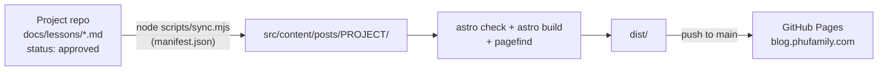

# cms

**Read approved lessons from several project repos on one static blog: series, concepts, field notes and methods.**

[](https://github.com/hoangphu7122002/cms/actions/workflows/ci.yml)
[](https://github.com/hoangphu7122002/cms/actions/workflows/deploy.yml)
[](https://blog.phufamily.com/)
[](https://github.com/hoangphu7122002/cms/commits/main)

## What and why

cms is the blog hub at https://blog.phufamily.com/ ("Hoang Phu: Lessons"). It is built from the AstroPaper theme (Astro, Tailwind, Pagefind search).

Posts are written next to the code and results they describe, in each project repo under `docs/lessons/`. This repo only holds posts that were reviewed and approved. A sync script copies them in.

The site is not indexed by search engines until `PUBLIC_INDEXABLE` is set to `"true"` in `.github/workflows/deploy.yml`.

## Features

| Feature | What you get |
|---|---|
| **Four post kinds** | `kind` in the front matter is `series`, `concept`, `fieldnote` (one wrong turn, about 1,000 words) or `method` (how we work). `project` names the source repo. |
| **Collections** | Readers see named groups read in order ("Part 2 of 5", prev/next, list of parts), not kinds. |
| **Sync from project repos** | `node scripts/sync.mjs` copies posts with `status: approved` into `src/content/posts/<project>/`. |
| **Search** | Pagefind index built with the site. |
| **Theme features** | Light and dark mode, archives, dynamic OG images, RSS, sitemap. |

### How a post gets into a collection

A post's collection is, in order:

1. `collection: <name>` in its front matter (optional);
2. else `series: <name>` when that is a real name, not a kind word like `series`, `concepts` or `field notes`;
3. else, when `series` or `part` is set, the name in `src/collections.ts` for `<project>:<kind>` (falls back to the project name).

Posts are ordered by `part`, then date. The displayed part number is the position among published posts. Sync copies front matter as written, so `collection` can be set in the source post. Renaming an entry in `src/collections.ts` only changes the title shown.

## Quickstart

Needs Node 22.12+ and pnpm.

```bash
git clone https://github.com/hoangphu7122002/cms.git && cd cms
pnpm install
pnpm dev          # http://localhost:4321/
pnpm build        # type check, build, search index
node scripts/sync.mjs --dry
```

`compose.yaml` also runs the dev server in a pnpm container on port 4321.

## How it works



Adding another project is one entry in `manifest.json`. Today it lists one source: `llm-serving-bench` (`../Triton/docs/lessons`).

## Architecture

| Layer | Stack |
|---|---|
| Site | Astro 7, MDX, Tailwind 4, TypeScript |
| Search | Pagefind |
| Config | [`astro-paper.config.ts`](astro-paper.config.ts) (site, posts per page, features, socials) |
| CI | [`ci.yml`](.github/workflows/ci.yml) on pull requests: lint, format check, build |
| Deploy | [`deploy.yml`](.github/workflows/deploy.yml): GitHub Pages |
| Infra | [`terraform/`](terraform) (`dns`) |

## Project layout

| Path | What's there |
|---|---|
| [`src/content/posts/`](src/content/posts) | synced posts, one folder per project (`datamate`, `llm-serving-bench`, `ott-chat`) |
| [`src/collections.ts`](src/collections.ts) | the collection tree: root, leaf, sub-leaf, with `match` rules |
| [`src/pages/`](src/pages) | routes: index, posts, collections, tags, archives, search, about, RSS, OG image |
| [`scripts/sync.mjs`](scripts/sync.mjs) | copies approved posts from the sources in `manifest.json` |
| [`manifest.json`](manifest.json) | list of source repos |
| [`terraform/`](terraform) | infra files |

Scripts: `pnpm lint`, `pnpm format:check`, `pnpm format`.

## License

MIT, see [LICENSE](LICENSE) (copyright Sat Naing, author of the AstroPaper theme). The theme's update path stays open: `git remote add upstream https://github.com/satnaing/astro-paper`.
