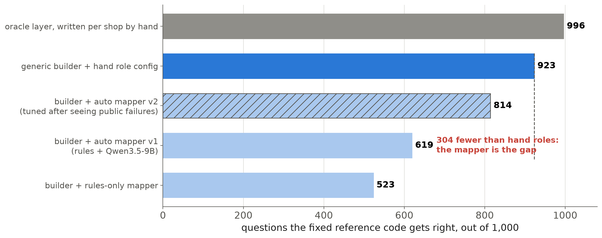

On November 2 my best open model got 25 of 100 questions right, and about 60% of the questions were solved by none of the four models I tried. Before buying a bigger GPU I asked a cheaper question: what if the data were perfect? This post is that diagnostic, what it told me, and why the real version of it, an automatic mapper, became the weak link.

## Key results

- With a hand-built clean layer (an "oracle", used only for diagnosis), correct answers out of 100 rose by **23 to 47** for every model: Qwen3-14B **15 to 62**, Qwen3-8B **9 to 54**.
- The best raw model, an illegal 32B used only as a ceiling, reached **25**. A specialist table model, TableGPT-R1, led raw (25) but fell behind once the layer was clean (57 against 62), at **87 s** per question.
- With the oracle tables, reference code scored **996/1,000**; with a hand-written column-role config **923**; with my automatic mapper only **619**. The mapper caused **52%** of the first pipeline's errors.
- My rule-based mapper found **0.993** of column roles on clean generated shops, **0.746** on heavily dirtied ones, and **0.50** under a swap to Indonesian.

## 1. The ceiling test

### 1.1 Raw models on the same 100 questions

I ran the November 2 pipeline (the model writes pandas over raw tables, up to 2 fixes after a crash) with eight models on the same 100 public questions. Scores use my own labels: the organisers did not release public answers.

| model | size | correct / 100 | PA | accuracy when answered |
|---|---|---|---|---|
| Qwen3-32B FP8 (over the 15B cap, ceiling only) | 32B | 25 | -0.29 | 32% |
| TableGPT-R1 | 8.2B | 25 | -0.38 | 28% |
| Qwen3-14B | 14.8B | 15 | -0.36 | 23% |
| Qwen2.5-Coder-14B | 14.8B | 14 | -0.52 | 17% |
| DataMind-14B | 14.8B | 14 | -0.58 | 16% |
| Qwen3-4B-Instruct | 4.0B | 12 | -0.52 | not recorded |
| Qwen3-8B | 8.2B | 9 | -0.46 | 14% |
| DataMind-7B | 7.6B | 6 | -0.57 | 9% |

Doubling from 14B to 32B bought 10 more correct answers. The union of four models solved only 38 of 100. An error read of 50 wrong answers put the blame on the pipeline: a wrong business rule (14), a wrong table or column (11), format (6), a misread Vietnamese question (6), a wrong period (5).

### 1.2 The oracle layer

So I removed the data problem by hand. For each public shop, Claude built a clean layer: orders, order lines and payments tables with cancel and return flags, duplicates removed, dates and money parsed. On top sat a catalogue of 34 business functions such as `revenue()`, `n_orders()` and `pct()`. The model only had to write 1 to 5 lines that call these functions. Building it took 11 minutes, and my own reference code scored 100 of 100 on it.

This layer could never ship: it was made per shop, after looking at the public files. It answers one question only: how good are these models when the data is not in the way?

| model | raw correct | oracle correct | PA with oracle | s per question |
|---|---|---|---|---|
| Qwen3-14B | 15 | 62 | +0.33 | 21 |
| Qwen3.5-9B | not run | 59 | +0.29 | 14 |
| TableGPT-R1 | 25 | 57 | +0.23 | 87 |
| Qwen3-8B | 9 | 54 | +0.22 | 12 |
| Qwen3-4B | 12 | 35 | -0.20 | 6 |

Three things stood out:

1. **Every model gained 23 or more.** The gain from clean data was 2 to 5 times the gain from a model twice the size.
2. **The specialist advantage vanished.** TableGPT-R1 led raw (25 against 15) but trailed with the oracle (57 against 62), and it was 4 times slower because it reasons at length.
3. **The rest was the model's job.** Qwen3-14B still got 38 wrong with the oracle. The first broken step was time (10), a filter value (9), what the question asked (5), format (4), answering an unanswerable question or the reverse (4), a crash (3), and only 3 from a gap in the layer.

One more number made abstain cheap to build: when two different models agreed on an answer, it was right 93% to 96% of the time.

## 2. Making the layer real

### 2.1 Roles, not schemas

To ship something, the layer had to be built for shops nobody had seen. I split the work into what a strong model does once at development time (the functions, a generic table builder, rules for guessing roles) and what my 9B model does at run time: tag each column of a new shop with a role, such as order code, order date, line amount, status, customer. I called that tag file a **RolesConfig**.

There were three levels of mapping to choose from: no map (raw, 15/100 for 14B), a light column-role tag, or a full schema map (the oracle, 62). On 100 questions, roles plus functions scored 88/100 against the oracle's 100/100, so I did not need the full schema map.

### 2.2 Builder fixes

On 1,000 public questions I wrote reference code for every question and ran it on tables built from each layer, so model errors drop out and only the layer is tested.

| tables built from | reference code correct / 1,000 |
|---|---|
| oracle layer | 996 (988 at first) |
| hand-written RolesConfig, first builder | 784 |
| + keep all columns and tables, infer shift hours | 915 |
| + extra functions (synonyms, error on an unknown name) | 923 |

The 784 came from the builder dropping things it did not expect: delivery tables, credit terms, stock lots, expense tables, stock moves. A layer that hides a table turns an answerable question into a confident wrong answer.

### 2.3 The mapper is the gap

Then I replaced the hand-written roles with the automatic mapper (hand-written rules plus Qwen3.5-9B).

The automatic mapper lost 304 answers against hand roles. On the first full run with a model (Qwen3.5-9B, PA 0.168, 469 right / 301 wrong / 230 abstain), the mapper caused 277 of the 531 non-correct answers (52%).

Mapper v2 fixed abbreviated headers, receipts mistaken for orders, unit tables, order-level discounts and odd status words, and reached 814. With it the next full run scored PA 0.330 (585 / 255 / 160). But I had fed the public failure list to the agent that wrote v2, so 814 is not a clean number. From then on I split the train shops for honest tests: 14 to tune on, 8 to measure only, 8 held back.

### 2.4 Without a mapper it was worse

I tried the obvious shortcut: drop the mapper, give the model the raw tables plus a value profile. On 100 questions the control scored PA 0.51; raw plus profile scored **-0.29** (23 right, 52 wrong, 25 abstain). In a paired comparison it won 10 questions and lost 58 (difference -0.80, SE 0.106). Selecting columns by word overlap instead of roles also lost: 0.41 against 0.51.

## 3. How the mapper breaks on unseen shops

The private set brings new shop types, so I measured the mapper on generated shops. A generator with 35 dirtying operators (table layout, cell formats, column names, language and domain swaps, file layout) made 1,000 training shops, 100 for validation, and held-out sets with operators, a language and a domain never seen in training.

Rules written for Vietnamese column names found almost every role on clean shops and lost a quarter of them under heavy noise. A new language or a new kind of table was worse than any amount of noise. My notes do not record whether the language swap translated whole shops or only the headers; the mapper's rules read column names, so the headers are the likely cause, but that is a guess. A keyword rule selector showed the same weakness on questions: recall 0.988 on 150 Vietnamese questions, 0.215 on the same questions in English. That gave me a rule for the rest of the project: every Vietnamese keyword component needs a path that does not depend on the words.

## 4. What happened to the layer

On November 5 I dropped the mapper and the 34-function catalogue: I believed a fixed function list capped what the model could do. The numbers agreed that there was a cap: even with the perfect oracle the 9B model stopped at 59/100, and at about 51 with the auto mapper. Part 2 shows how the raw restart went (all four baselines below 0).

The layer came back in a different form. Code, not a model, rebuilt canonical "views" per shop: orders, sales lines, purchase lines, payments, products, customers. In the CodeAct pipeline of November 13 (base Qwen3.5-9B, one sample per question), the run with views scored PA 0.579 (760 / 181 / 59); with views off it scored 0.173 (557 / 384 / 59). Same model, same questions, 0.41 apart (Part 6).

## Limits

- The ceiling and oracle tests use 100 public questions; one run each, SE about 0.07 at this size (my estimate).
- The oracle was built by a strong model after seeing the public files. It is a diagnostic, not a method.
- Mapper v2's 814 is contaminated by public failures, and every public number here is scored with my own labels.
- The noise study scores the rule-based part of the mapper on generated shops, not on real private shops; the scope of the language swap (whole shop or headers only) is unknown.

## Reproduce

1. Pick 100 questions. Run your solver over raw tables with several models.
2. Hand-build clean tables for those shops (dedupe, parse dates and money, flag cancels) plus a few business functions, then rerun. The gap is what the data layer is worth.
3. Write reference code for every question and run it on tables from each layer variant. Model errors drop out, and you score the layer alone.
4. For generalisation, dirty clean shops with a generator and hold out whole operators, a language and a domain.

## Sources

- Wang et al., "Executable Code Actions Elicit Better LLM Agents" (CodeAct), https://arxiv.org/abs/2402.01030.
- SemEval-2025 Task 8 (DataBench): the second-place system (86.21%) cleaned column names, summarised the table and selected columns before writing code.
- My runs, November 2026: 100-question ceiling and oracle-layer runs (Nov 2), reference-code layer tests on 1,000 public questions and mapper v1/v2 (Nov 4), raw-plus-profile A/B on 100 questions, generated-shop mapper study, CodeAct views on/off (Nov 13).

Written with Claude Code. Numbers checked against the runs under Sources.
