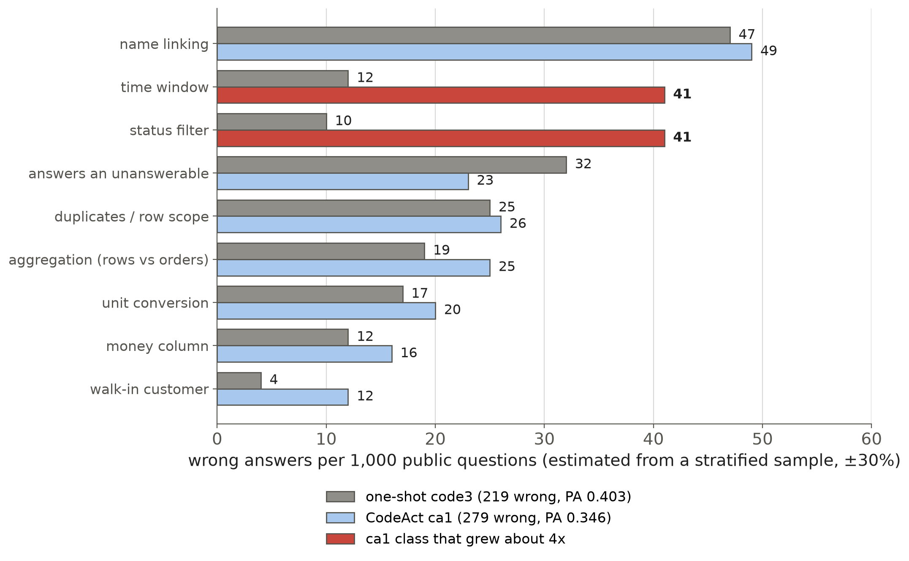
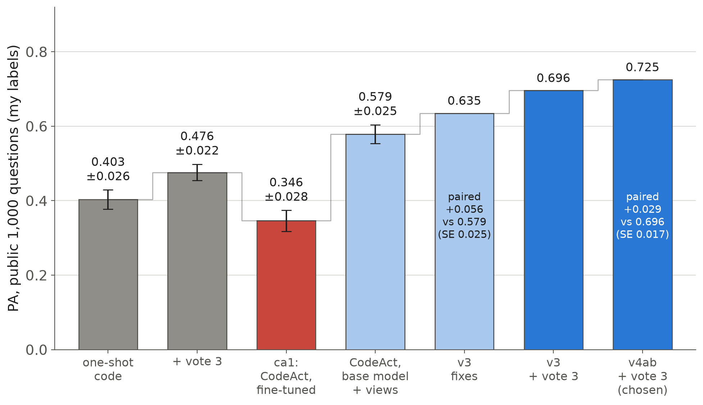

One-shot code commits before it looks. In Part 4 the model wrote one pandas program, I ran it, and whatever came out was the answer: 0.476 with a vote. The next step was to let the model run code, read the output, and then decide. It took three loops, and the first one made things worse.

All PA numbers here are on the 1,000 public questions, scored with my own labels (the organisers did not release public answers). The private score is not known yet.

## Key results

- On a test of 30 train questions with a strong teacher model (DeepSeek 4.1 Flash), one-shot code solved **17/30** on the first turn (2 of the 15 hard ones); a multi-turn code loop solved **29/30**, then **30/30** after one missing format rule was added.
- My first CodeAct solver, fine-tuned on 1,764 rows, scored **0.346** (625 right / 279 wrong / 96 abstain), worse than one-shot with a vote. Time-window errors rose from an estimated 12 to 41 per 1,000: the model printed the right period, then ignored it.
- The same loop on the **base** model with native tool calls and clean data views scored **0.579**; loop and prompt fixes took it to **0.635**; a 3-sample vote with abstain on weak agreement reached **0.725**.

## 1. Why one shot is not enough

### 1.1 What the one-shot model could not do

PA is (correct − wrong) / n: a right answer earns +1, a wrong one −1, and an abstain (declining to answer) earns 0. Wrong answers hurt, so a solver needs to notice when it is about to be wrong.

The one-shot solver could not notice. Its code ran on real data, but the model never saw the output before the answer was fixed. In the 1,000-question run it gave 219 wrong answers (622 right, 159 abstain). The repair step only fires when the code crashes; a program that runs and returns the wrong number is never repaired. Typical cases were a name in the question that did not match the name in the file (an estimated 47 per 1,000), or an unanswerable question answered anyway (about 32).

An invented example shows the problem. Ask "how many cups of iced milk coffee this month?" in a café shop whose item column reads `bac xiu (L)`, `bạc xỉu`, and `bac xiu da`. A program that filters on one spelling returns a small number and never sees the other two. A model that first prints the distinct item names would.

### 1.2 The 30-question test

Before building anything, I ran a small test with a strong teacher model (DeepSeek 4.1 Flash, not my 9B model) on 30 train questions, 15 hard and 15 easy:

| setup | first try | after one fix | turns per question | model calls |
|---|---|---|---|---|
| one-shot code | 17/30 (2/15 hard) | – | 1 | – |
| multi-turn code loop | 29/30 | 30/30 | 2.4 → 1.7 | 71 → 52 |
| loop, "look at the data first" prompt | 29/30 | – | 3.7 | 111 |

The loop solved the hard questions that one shot missed. Forcing exploration did not help: it doubled the model calls (52 to 111) for the same 29/30. The best prompt had no style instruction at all (30/30, 52 calls); "solve in one turn if possible" gave 29/30.

The open question was whether my 9B model could run such a loop.

## 2. Three loops

### 2.1 ReAct and CodeAct in one paragraph each

**ReAct** (reason + act) is a loop where the model writes a short thought, calls one tool, reads the tool's result, and repeats until it gives a final answer. The tools are named functions with arguments, such as `find_value(name)` or `run_python(code)`.

**CodeAct** is ReAct where the action is a block of code. Instead of choosing among named tools, the model writes a Python cell; helper functions are plain Python inside that cell. The CodeAct paper found code actions beat JSON tool calls for 12 of 17 models it tested, partly because one cell can do several steps at once.

### 2.2 An input: a teammate's ReAct harness

A teammate built a ReAct harness on the untrained Qwen3.5-9B: one LLM call per shop to fix a code-made draft of table and column roles, one call per question that returns the answer type, periods and names as JSON, then an agent with 7 tools (`run_python`, `find_value`, `final_answer`, `cannot_answer`, ...), one tool per turn, at most 8 turns. They reported 0.566 for a single run and 0.638 for a vote over 3 candidates (answer only when 2 of 3 agree); their branch has no runner for the 3 candidates, so how they were made is not documented. Those runs used their own runner, and their split and labels are unknown, so they are **not comparable** with my numbers, and I never put them on my ladder. What I took from it was design input: an untrained 9B model can run a loop when the data reaches it already cleaned, and most of a vote's gain comes from abstaining, not from more right answers. I later ported by hand their shop view chain, the question-analysis call, their Vietnamese normaliser for slang and missing accents, a shorter prompt (about 6-9k tokens instead of my 13.3k) and a `debt_at(day)` helper.

### 2.3 My first CodeAct: ca1

My first CodeAct solver (`ca1`) had three traits:

- the model wrote a short reasoning line and one fenced Python cell per turn, up to 10 turns;
- the cells ran in a **persistent kernel**: variables survive from one turn to the next, so the model can build a table in turn 1 and filter it in turn 2;
- I fine-tuned it first with LoRA (a small adapter trained on top of frozen weights) on 1,764 trajectories: 1,486 verified rollouts plus 278 repaired by a teacher model.

## 3. Why ca1 failed

ca1 scored 0.346 (SE 0.028), worse than the one-shot vote at 0.476. I read a stratified sample of 110 of its 279 wrong answers (spread over question types and shops) and weighted each class back to 1,000 questions, so each count carries about ±30%:

Two classes jumped about four times: **time window** (12 to 41) and **status filter** (10 to 41). The traces repeat one pattern: the model prints the right period, or the right set of cancelled statuses, and then filters with something else. In 55 of 236 wrong answers (23%) the correct value (by my labels) was already in a tool output: the answer was on screen and the model wrote another.

The loop itself was also broken. Of 2,483 turns, 1,054 (42.4%) ended in an error. 96 questions stopped without an answer: 51 because the model repeated the same code three or more times, 37 because the prompt overflowed the 20,480-token context. One habit came straight from my training data: 90% of the training rows contained an `assert` line, so the student wrote asserts that failed on real data and spent turns fixing them.

A loop gives the model the chance to look; it does not make the model use what it sees, and 1,764 training rows did not teach that.

## 4. CodeAct on the base model

### 4.1 What changed

Between November 12 and 14 I rebuilt the loop, each change behind an off-by-default flag:

- **Native tool calls.** I switched from my own fence format to Qwen3.5's official `<tool_call>` format with three tools: `run_python(code)`, `final_answer(type, value, unit)`, and `cannot_answer(reason)`. The base model already knows this format, so the **untrained** model could run the loop, and fine-tuning became optional.
- **Loop v2.** Skip a cell that repeats earlier code, escalate after repeated errors, prune old context, nudge to finish near the turn cap, use a stable seed per question.
- **Views.** The model saw clean canonical tables (`sales_lines`, `orders`, `payments`, ...) instead of raw files. Part 6 is about this layer; switching it off dropped PA from 0.579 to 0.173 (one sample each, base model).
- **Ported pieces** from the ReAct harness of Section 2.2: the shop view chain, question analysis, the normaliser, the shorter prompt and `debt_at(day)`.

### 4.2 The ladder

| run | right / wrong / abstain | PA |
|---|---|---|
| CodeAct base, 1 sample | 760 / 181 / 59 | 0.579 |
| same, 3 samples, plurality only | 775 / 193 / 32 | 0.582 |
| v3: loop, answer-shape and prompt fixes, 1 sample | 799 / 164 / 37 | 0.635 |
| v3 repeat, same config | 789 / 167 / 44 | 0.622 |
| v3, 3 samples, abstain if fewer than 2 agree | 790 / 94 / 116 | 0.696 |
| v4ab: rewritten convention lines, `debt_at` profile, 3 samples | 809 / 84 / 107 | 0.725 |

Two things stand out.

**The vote only helps with abstain.** Three samples with a plain majority moved PA from 0.579 to 0.582. The gain came from the rule "answer only if at least 2 of 3 agree": on the v3 runs the vote was worth +0.117 over the temperature-0 sample, of which +0.047 came from plurality voting and +0.070 from abstaining on weak agreement.

**Noise is real.** Running v3 twice with the same config gave 0.635 and 0.622. The same greedy config changed about 13% of answers between runs. I read every gain as a paired difference on the same 1,000 questions: v3 over the base loop is +0.056 (SE 0.025), v4ab over v3-with-vote is +0.029 (SE 0.017), below the +0.05 bar I had set for keeping a change without a repeat run.

The final image (Part 9) runs this CodeAct loop with a fine-tuned 9B model (Part 8) and an adaptive vote of 2 to 5 samples.

## Limits

- All PA values use my own labels on the public set; the organisers' answers may differ.
- The teammate's 0.566 and 0.638 come from their own runner on an unknown split and labels; the 0.638 is a vote over 3 candidates whose origin is not documented (3 runs voted offline is my guess, not confirmed). They are context, not a comparison.
- The error-class counts in Section 3 are weighted estimates from a stratified read of 94 (code3) and 110 (ca1) wrong answers, about ±30%.
- The 30-question test used DeepSeek 4.1 Flash on train questions, not my 9B student, and 30 questions give a wide error margin.
- Several fixes after v3 were chosen by looking at public-set failures, so part of the climb from 0.579 to 0.725 may not carry over to the private test.

## Reproduce

I ran Qwen3.5-9B in bf16 with vLLM on single cloud GPUs (L40S and H100) and later on a shared machine with two L40S cards. One 1,000-question single-sample run took 15.5 minutes on an H100 (ca1) and about 56 minutes on one L40S (the base-model loop); a 3-sample vote run took about 2 hours. The code sandbox is a separate Python process per question with a 30-second limit per cell. Each 1,000-question run on a rented GPU cost roughly 1.3 to 3 USD.

## Sources

- Yao et al., "ReAct: Synergizing Reasoning and Acting in Language Models", ICLR 2023.
- Wang et al., "Executable Code Actions Elicit Better LLM Agents" (CodeAct), ICML 2024.
- Qwen team, Qwen3.5 model card and function-calling documentation (tool-call template).
- My runs, November 2026: one-shot and vote runs on the 1,000 public questions; the first CodeAct run with a fine-tuned adapter; the base-model CodeAct ladder (single, vote, v3, v4ab) and its failure analyses; a teammate's harness notes and my audit of them; a 30-question teacher test on train questions.

Written with Claude Code. Numbers checked against the runs under Sources.
