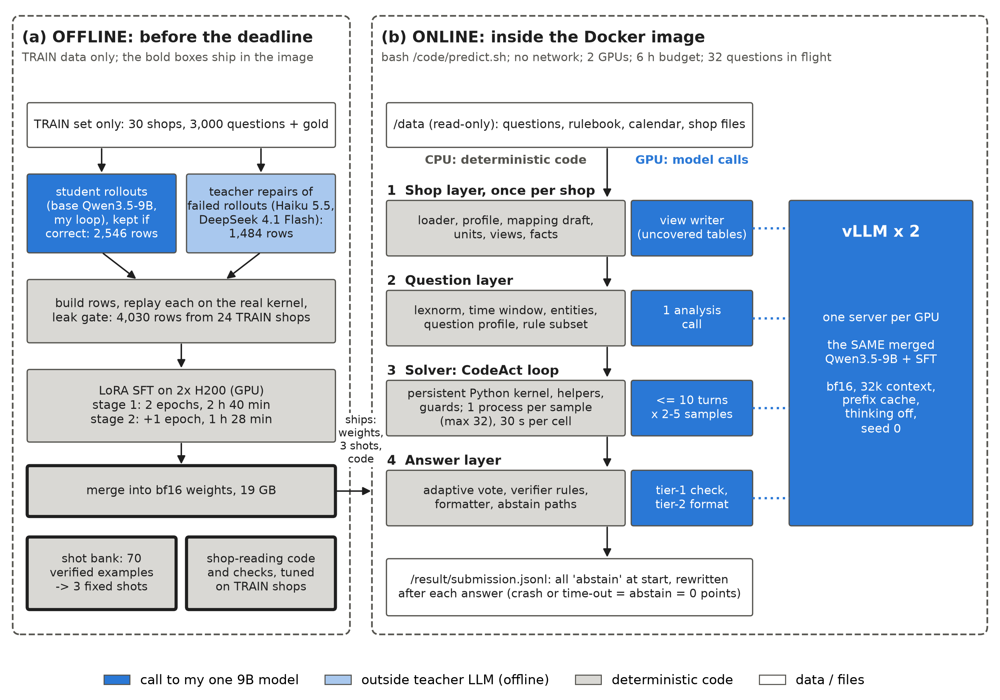
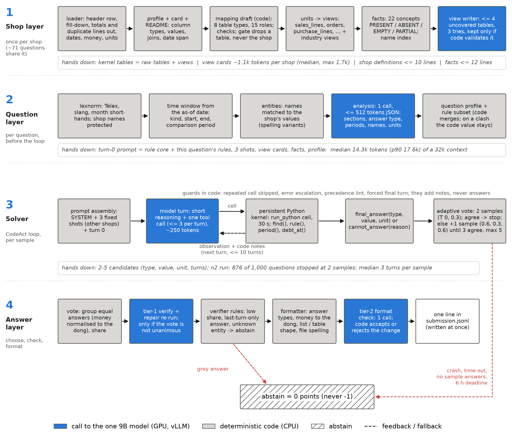
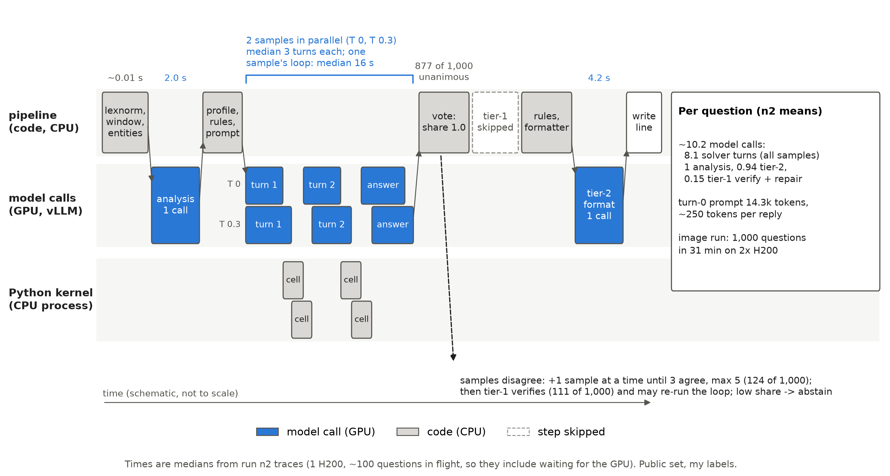
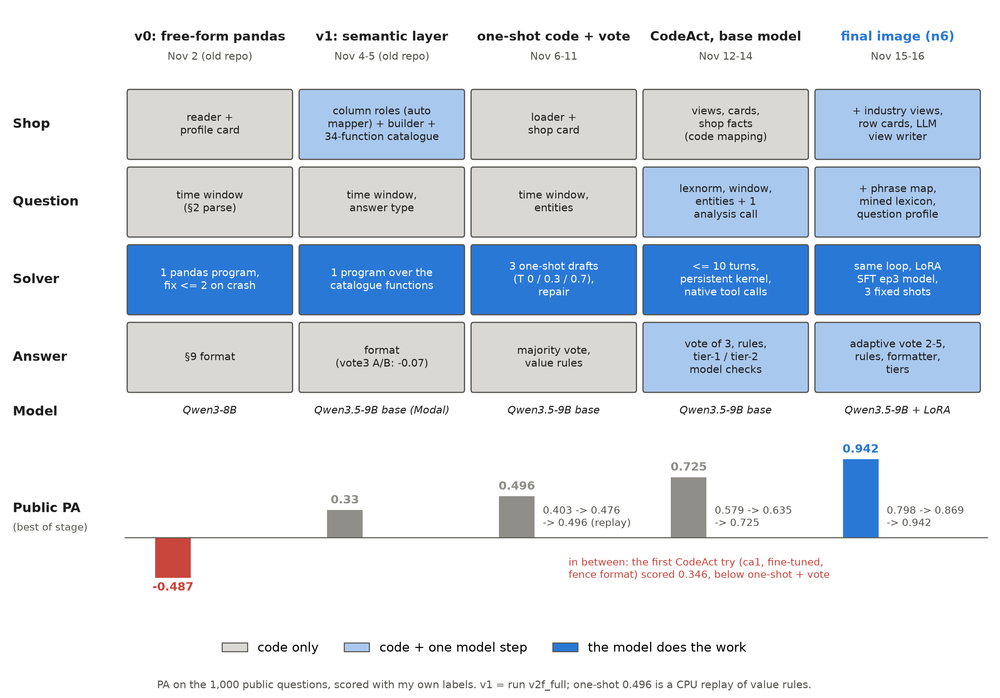

The other parts zoom in on one piece each. This part puts them back together: the system I submitted (image "n6")
from container start to the last line of `submission.jsonl`, what each stage hands to the next, which steps are code
and which ask the model, and how the shape changed over 15 days. Every public number below is scored with my own
labels (the organisers released no public gold); the private-test score is not known yet.

## Key results

- **One model does every model step.** Qwen3.5-9B (9,653,104,368 parameters) with my LoRA fine-tune merged into bf16
  weights (19 GB) handles question analysis, view writing, solving, checking and format checks. Two vLLM servers, one
  per GPU, serve the same weights. The image answered 1,000 public questions in 30-31 minutes on 2x H200.
- **Most of the system is code.** Of the 19 steps a shop and a question pass through, 5 call the model. In my n2 run a
  question cost about 10.2 model calls on average, 8.1 of them solver turns.
- **Prompts are big, replies are short.** The first solver prompt has a median of 14.3k tokens (of a 32k context); a
  model reply has a mean of about 250 tokens.
- **Abstain is a path, not an accident.** The output file starts with every answer set to abstain, and four separate
  places can send a question there. The final image scored PA 0.942 (961 correct, 19 wrong, 20 abstain).
- **The architecture moved more than the model did.** With 8-9B models throughout, public PA went from -0.487 (one free
  pandas program) to 0.942 (shop views + CodeAct loop + vote + fine-tune).

## 1. What the architecture has to fit

A question is one Vietnamese sentence about one shop: revenue last month, which customer owes most, how many orders were
cancelled in a week. The shop is a folder of csv, xlsx or sqlite files written the way small shops really write them,
plus a README; a shared rulebook defines the business terms (what counts as revenue, when a week starts).

The score is **PA**: +1 for a correct answer, -1 for a wrong one, 0 for **abstain**
(answering "I do not know"), divided by the number of questions. So a wrong answer costs as much as a right one earns,
and declining to answer is often the best move. Four rules shaped the design more than anything else:

| Rule | What it forced |
|---|---|
| one model, at most 15B parameters | every LLM step uses the same 9B weights |
| no network, 6 h for the private set | everything in a Docker image (27.6 GB); stop answering at 6 h minus 300 s |
| the organisers re-run the image; PA must stay within 0.03 | seeds fixed, greedy first sample, LLM steps checked by code |
| private set (~500 questions) has new shop types; no test data in training, no logic keyed on IDs | shop understanding has to be generic code, trained only on TRAIN |

## 2. Two halves: offline and online

### 2.1 Offline: everything before the deadline

The offline side only ever touches the official TRAIN set (30 shops, 3,000 questions with gold answers).

1. **Student rollouts.** The base Qwen3.5-9B runs my CodeAct loop on TRAIN; rollouts that match gold are kept: 2,546
   rows.
2. **Teacher repairs.** An outside teacher (Claude Haiku 5.5 with low reasoning, and DeepSeek 4.1 Flash) takes over a failed
   rollout from its first wrong turn, in the student's format; kept only if a replay on the real kernel reproduces
   gold: 1,484 rows.
3. **Gates.** 4,030 rows from 24 TRAIN shops pass a leak gate that refuses any public or private question; 110 frozen
   TRAIN questions are the validation set.
4. **LoRA SFT** (a small set of extra weights trained on top of a frozen model): rank 32, 2x H200. Stage 1: 2 epochs at
   learning rate 2e-4, 2 h 40 min (val loss 0.1567); stage 2: one more epoch at 1e-4 as a warm restart, 1 h 28 min
   (val loss 0.1590).
5. **Merge** the adapter into bf16 weights, so the image serves a plain model.

Also shipped: 3 fixed worked examples from a bank of 70 verified on TRAIN (never from the question's own shop), and
the shop-reading code, tuned on TRAIN shops.

### 2.2 Online: inside the image

`predict.sh` takes no arguments. It reads `/data` read-only, starts two vLLM servers (bf16, 32,768-token context,
prefix cache on, thinking off, seed 0, at most 24 sequences each) and runs 32 questions at a time. Before the first
answer it writes `submission.jsonl` with every line set to abstain, then rewrites the file atomically after each
answer, so a crash or the time limit keeps everything already answered. Part 9 covers the serving side in detail.

## 3. Inside the image: four layers

The code tree mirrors the layers: `src/modules/shop`, `question`, `solver/codeact`, `verifier`, `formatter`. Each
module reads named fields from a shared context and writes its own; the README of every module lists both, which is
what the contract table in section 5 is built from.

### 3.1 Shop layer (once per shop)

A shop is read once and shared by all its questions (about 71 per shop on the public set). Everything here is code,
except the last step.

- **Loader.** Finds the real header row, fills down cells written once per order, drops total rows and repeated lines,
  parses dates (`45689`, `1 thg 6 2025`) and money (`55.000đ`, `25k`, `1tr440`), splits `2 ly` into number and unit,
  and classes status labels (completed, cancelled, returned, in progress).
- **Profile, card, README.** Per column: type, null share, values, joins, date span.
- **Mapping draft.** Code picks a table type (8 types) and a role per column (15 roles: order id, line amount, status,
  ...), then checks them on the data, e.g. quantity x unit price - discount = line amount on at least 95% of lines. A
  failing table is dropped from the views, never the whole shop.
- **Units and views.** Canonical tables with English columns (`sales_lines`, `orders`, `purchase_lines`, `products`,
  ...) plus industry views when the data has them (installments, debt book, deliveries, lots, repair jobs). Business
  rules such as `counts_as_revenue` are applied once, here.
- **Facts.** 22 concepts (customer, cost, stock, debt ...) marked PRESENT, ABSENT, EMPTY or PARTIAL, so the model can
  see that a shop simply does not record something.
- **View writer (model).** Up to 4 raw tables no view covers go to the model, which writes pandas code for new views.
  Code runs it twice in a child process and keeps a view only if both runs agree, its key is unique and its sums
  reconcile with the raw table; 3 tries, each with the exact error.

Part of this chain was hand-ported on November 12 from a teammate's ReAct harness (Part 5) and wired to my loader. That
version asked the model to fix the code draft; the final image runs the **code draft only**, because, as the mapping README
says, "LLM output is not reproducible even at temperature 0".

### 3.2 Question layer

- **lexnorm** fixes the language and never the names: Telex typing, chat shorthand, month shorthands. An invented example:
  `dthu th3/2026 bnhiu` becomes `doanh thu tháng 3/2026 bao nhieu`. Shop names found in the data are protected first.
- **Time window** from the shop's as-of date: kind (day, week, month, until, Tết ...), start, end, and the comparison
  period the rulebook implies ("same days of last month").
- **Entities** match names in the question to the shop's real values, with spelling variants.
- **Analysis (model, 1 call).** Greedy, at most 512 tokens of JSON: rulebook sections, answer type, periods, names,
  units. The module's rule: "the LLM proposes, the code verifies, the code is the fallback". An unknown section or a
  name not in the question is dropped; bad JSON means no analysis. In n2, 996 of 1,000 calls returned usable JSON.
- **Question profile and rule subset.** Code merges both readings; on a clash the code value stays and the clash is
  shown. Only this question's rules go in full at the end of the prompt.

### 3.3 Solver: the CodeAct loop

**CodeAct** means the model acts by writing code: each turn is a short piece of reasoning plus one tool call. The tools
are `run_python(code)`, `final_answer(type, value, unit)` and `cannot_answer(reason)`. A cell runs in a **persistent
per-question Python kernel** (its own spawned process per sample, at most 32 at once, 30 s per cell), so variables survive from turn to
turn, as in a notebook. The kernel holds the raw tables, the views and helpers: `find()` for names, `rule()` for the
rulebook, period and calendar helpers, `debt_at()`, `check()`.

At most 10 turns, 3 calls per turn, 3,072 new tokens per reply. Code guards skip an identical cell after an error,
escalate repeated errors (stop after 4), lint pandas operator precedence and force a final answer at the end. Guards
add notes; they never write an answer.

**Adaptive vote.** Two samples at temperature 0 and 0.3; if they agree (money normalised to the dong), done. If not,
one more at a time (0.6, 0.3, 0.6) until 3 agree or 5 have run. In n2, 876 of 1,000 questions stopped at 2.

### 3.4 Answer layer

- **Vote** groups equal answers and computes the share of the largest group.
- **Tier-1 check (model)**, only when the vote is not unanimous: the model criticises the answer with quotes from the
  code and output; a grounded "not ok" triggers one repair, adopted only if a second check agrees and code checks do
  not get worse. It may not change the answer type.
- **Verifier rules (code)** turn a grey answer into abstain: low vote share, an answer given only on the last turn, a
  name the shop does not hold, a date outside the data.
- **Formatter (code)** puts the value in the official shape: numbers as JSON numbers, money rounded half-up to the
  dong, dates as `YYYY-MM-DD`, lists and tables in the required JSON form, names in the file's own spelling.
- **Tier-2 format check (model)**, one call per answered question: proposes a unit or number/percent fix that code must
  recompute and accept.

## 4. One question, end to end

I kept full traces for run n2 (1,000 public questions, PA 0.919, one H200 with about 100 questions in flight), so the
times below include waiting for the GPU; the shape, not the seconds, is the point.

| Step | Kind | n2 measurement |
|---|---|---|
| lexnorm, window, entities | code | ~0.01 s together |
| analysis | 1 model call | median 2.0 s (p90 4.7 s) |
| one solver sample | model + kernel | median 3 turns (853 of 2,313 samples used 2 turns; 44 hit the 10-turn cap); median 16 s |
| vote | code | share 1.0 on 877 questions |
| tier-1 | model, only if not unanimous | ran on 111 questions |
| rules, formatter | code | < 0.01 s |
| tier-2 | 1 model call | median 4.2 s |

That is about 10.2 model calls per question: 8.1 solver turns, 1 analysis, 0.94 tier-2, 0.15 tier-1. On the image (2
GPUs, 32 in flight) 1,000 questions took 30-31 minutes, about 9% of the 6-hour budget, and the private set is half that
size. Limits: 3,600 s per question, 30 s per cell, 60 s for analysis, 180 s for a tier repair; past a limit is an
abstain, never a guess.

## 5. Module boundaries and data contracts

| Stage (module) | Kind | Reads | Hands to the next stage | Size |
|---|---|---|---|---|
| `shop.loader` | code | shop folder | tables with original column names + meta (header row, fill-down, status classes, units) | parquet cache |
| `shop.profile` / `card` / `readme` | code | tables | column profile, card text, vocab | per column |
| `shop.mapping` | code (draft) | profile | table types, roles, gate | 8 types, 15 roles |
| `shop.units` -> `shop.views` | code | mapping, tables | views + view cards, shop definitions, side cards | cards ~1.1k tokens/shop (median; max 1.7k); definitions <= 10 lines |
| `shop.facts` | code | tables, README | 22 concepts with status and evidence | <= 12 lines |
| view writer (in `solver.codeact`) | model | uncovered tables | 0-2 validated views per table | <= 4 tables, 3 tries |
| `question.lexnorm`, `time`, `entities` | code | question, as-of date, names | clean text, window, matched names | a few lines |
| `question.analyze` | model | clean text, rule titles | sections, answer type, periods, names, units | <= 512 tokens |
| `solver.codeact` | model + kernel | all of the above | 2-5 candidates (type, value, unit, turns) | turn-0 prompt median 14.3k tokens |
| `verifier.vote` / `llm_tier1` / `rules` | code / model / code | candidates | one answer or abstain | |
| `formatter.spec9` / `llm_tier2` | code / model | answer | one line of `submission.jsonl` | |

The contracts are deliberately narrow. The solver never reads the loader's raw guesses directly; it reads views and
cards whose sizes are capped, so a 40-table shop cannot blow the 32k context. In the CodeAct stage the views sit next to
the raw tables, never instead of them, so a view that is wrong does not hide the original data.

## 6. Deterministic versus model: the rule I followed

Five steps call the model; fourteen are code. The split follows one rule: **the model may propose, code decides**.

- Where code can do the job reliably (dates, money parsing, status classes, units, time windows, formatting), there is
  no model call at all.
- Where only the model can do it (reading an odd table, choosing rules, writing the analysis code), its output is
  validated by code and has a code fallback: bad analysis JSON is dropped, a view-writer view must reconcile with the
  raw table, a tier-2 format change must be recomputed by the formatter.
- The final answer value only ever comes from the solver's own code, run in the kernel.

The reason is not taste. The organisers re-run my image and allow 0.03 PA of drift; I measured that the same greedy
setup changes about 13% of answers between runs, and the first sample differs on 12.5% of questions between H200 and
L40S. Every model step adds variance: in n3, model-written views cached only in memory cost 13 net questions on two
shops (part 10). My two image runs differed by 0.007, a margin that came from keeping the model in a box.

## 7. How the architecture got here

- **v0, November 2 (old repo).** A shop card plus one pandas program written by Qwen3-8B, repaired at most twice: PA
  -0.487 (79 correct, 566 wrong, 355 abstain). The model read the data right and the business rules wrong.
- **v1, November 4-5.** A hand-built oracle layer took Qwen3-14B from 15 to 62 correct on 100 questions. The generic
  version (role mapper, builder, 34-function catalogue) scored 923/1,000 with reference code and hand roles, 619 with
  the automatic mapper, and PA 0.33 with Qwen3.5-9B on rented L40S GPUs.
- **One-shot code + vote, November 6-11.** Three drafts and a vote: 0.403, 0.476 with vote, 0.496 with value rules (a CPU replay of the
  stored votes, not a live run). It still could not look at the data before committing.
- **CodeAct, November 12-14.** My first loop (ca1, fence format) scored 0.346, below the vote: the model printed the
  right period and then ignored it. Native tool calls plus shop views gave 0.579, 0.635, then 0.725 with a vote
  of 3; tier-1 and tier-2 checks were already on in these runs.
- **Final, November 15-16.** Fine-tune plus adaptive vote: 0.798; ep3 in the same harness 0.804; then harness batches: 0.869, 0.919
  (n2), 0.926 (n4, first submission), 0.942 (n6, final).

What survived from v1 is the layer, in a new form: the catalogue gave the model functions to call; the final layer
gives it data with rules already applied, ordinary pandas, and a kernel to look before it answers.

## Limits

- **Measured on n2, shipped n6.** The per-step numbers come from the n2 traces; n6 added eight small harness fixes. I
  expect the shape to be the same, not the exact counts.
- **Two model checks: kept for safety, measured no gain.** In n2, tier-1 ran on 111 questions and adopted no repair
  (10 were rejected); tier-2 ran on 941 answers and changed none. In one 1,000-question run of the ep3 model, tier-1
  made 5 repairs with a net effect of 0 and tier-2 changed nothing in 913 calls. I have no measurement for n4 to n6.
  They cost about 1.1 calls per question.
- **The view writer is fragile.** In n2 it sent tables on 8 of 14 shops and kept 2 views; 8 tables failed all 3 tries.
  Caching validated views per shop was proposed after n3 and not built before the deadline.
- **Code mapping has known blind spots.** In a perturbation test the draft kept only 48 of 128 roles with English headers
  and 33 of 128 with renamed files. Unseen-industry shops were my weakest group (PA 0.571 on the b64 model).
- **Public gains may not transfer.** Many final-week fixes came from public error analysis, and several fire on a single
  public shop. 0.942 is a public number on my labels; the private result is not known yet.

## Reproduce

The submitted Docker image (linux/amd64, 27.6 GB) with the organisers' command, two GPUs, no network, data read-only:
30-31 minutes per 1,000 public questions on 2x H200, two runs 0.007 PA apart. Training: two LoRA stages on 2x H200;
data generation and most tests on 2x L40S. Per-step times: n2 traces, one H200, ~100 questions in flight.

Cost: wall times are measured, money is mostly estimated. Training took about 5.3 GPU-hours (stage 1) and 2.9
GPU-hours (stage 2) on a shared H200 box with no bill recorded; a full 1,000-question run is about 1 to 1.6 GPU-hours.
The Claude teacher calls show about USD 211 of CLI cost, possibly notional; the DeepSeek teacher calls were not
metered. I kept no consolidated cost ledger for the last five days.

## Sources

- Qwen3.5-9B model card (Qwen, Hugging Face), Apache-2.0.
- Kwon et al., "Efficient Memory Management for Large Language Model Serving with PagedAttention" (vLLM), 2023.
- Wang et al., "Executable Code Actions Elicit Better LLM Agents" (CodeAct), 2024.
- Yao et al., "ReAct: Synergizing Reasoning and Acting in Language Models", 2023.
- Hu et al., "LoRA: Low-Rank Adaptation of Large Language Models", 2021.
- Wang et al., "Self-Consistency Improves Chain of Thought Reasoning in Language Models", 2023.
- My runs, November 2026: the resolved configuration and module READMEs of the submitted image; traces of run n2
  (1,000 public questions); image re-runs n4, n5 and n6; old-repo baselines v0 and v1; SFT logs of the two training
  stages. Public numbers scored with my own labels.

Written with Claude Code. Numbers checked against the runs under Sources.
