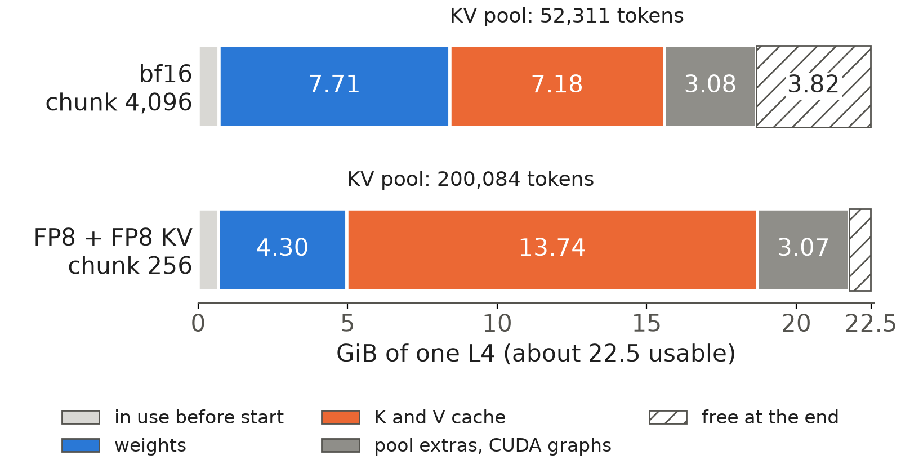
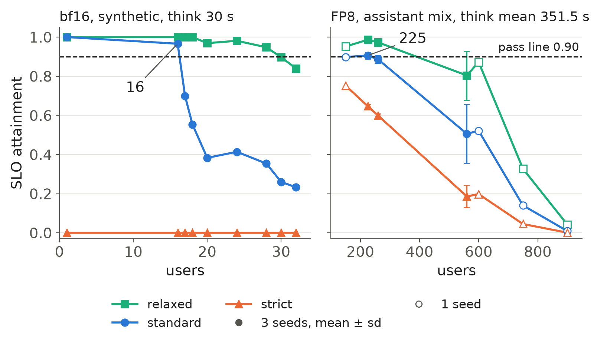

One NVIDIA L4 is the unit of this series: cost per user is its hourly price divided by its users. Here we show what the card holds when SGLang serves Qwen3-4B-Instruct-2507, and how many users it carries.

## Key results

| | first baseline | final configuration |
|---|---|---|
| weights and KV cache | bf16 | FP8 |
| weights in memory | 7.71 GiB | 4.30 GiB |
| KV cache per token (computed) | 144 KiB | 72 KiB |
| KV pool | 52,311 tokens | 200,084 tokens |
| workload, think time | synthetic, 30 s | assistant mix, mean 351.5 s |
| users at the standard tier | 16 (1 seed) | about 225 (3 seeds, borderline) |
| users per USD per hour | - | 281 at 0.80 USD, 205 at 1.1 USD |

At 225 users the pool peaked at 11 % full and about 2 requests were in flight, against 4.5 for the baseline. The jump from 16 to 225 is mostly a workload change.

## 1. What the card holds

### 1.1 Bytes per token

A serving GPU holds the weights, the KV cache (one key and one value vector per layer for every token a request has seen) and working memory. With round numbers, a 24 GB card with 8 GB of weights and 4 GB of working memory leaves 12 GB for the cache: 120,000 tokens at 100 KiB each, 240,000 at 50 KiB.

Bytes per token follow from the model config:

```python
import json

def kv_bytes_per_token(config_path: str, kv_bytes: int = 2) -> int:
    """KV cache bytes for one token: K and V, every layer, every KV head (kv_bytes 2 = bf16, 1 = FP8)."""
    with open(config_path) as f:
        cfg = json.load(f)
    heads = cfg["num_attention_heads"]
    kv_heads = cfg.get("num_key_value_heads", heads)
    head_dim = cfg.get("head_dim") or cfg["hidden_size"] // heads
    return cfg["num_hidden_layers"] * kv_heads * head_dim * 2 * kv_bytes   # 2 = K and V
```

For Qwen3-4B: 36 layers x 8 KV heads x 128 x 2 x 2 bytes = 144 KiB per token in bf16, 72 KiB in FP8 (computed). A request of our mean size, 2,004 prompt and 96 answer tokens, holds about 155 MB (148 MiB) of FP8 cache (computed).

### 1.2 The split, read from the log

SGLang logs each allocation at start. With our final flags:

```bash
python -m sglang.launch_server --model-path Qwen/Qwen3-4B-Instruct-2507-FP8 \
  --kv-cache-dtype fp8_e4m3 --chunked-prefill-size 256 \
  --attention-backend flashinfer --enable-mixed-chunk --port 30000 \
  2>&1 | tee server.log
grep -E "avail mem|KV Cache is allocated" server.log
```

```console
# bf16 baseline, default chunk of 4,096 prompt tokens (trimmed)
Load weight end. ... avail mem=14.08 GB, mem usage=7.71 GB.
KV Cache is allocated. dtype: torch.bfloat16, #tokens: 52311, K size: 3.59 GB, V size: 3.59 GB
Memory pool end. avail mem=4.76 GB
Capture target decode CUDA graph end. ... mem usage=0.13 GB, avail mem=3.82 GB.

# final FP8 flags
Load weight end. ... quant=fp8, fmt=e4m3, avail mem=17.52 GB, mem usage=4.30 GB.
KV Cache is allocated. dtype: torch.float8_e4m3fn, #tokens: 200084, K size: 6.87 GB, V size: 6.87 GB
Memory pool end. avail mem=1.73 GB
Capture target decode CUDA graph end. ... mem usage=0.21 GB, avail mem=0.71 GB.
```

The log's "GB" is GiB: 52,311 tokens x 147,456 bytes = 7.18 GiB, exactly the K plus V it prints (computed). The card reports 23,034 MiB, about 22.5 GiB. Subtracting consecutive `avail mem` values gives Figure 1.



*Figure 1. Memory of one L4, from the start-up logs. "Other" is the pool step beyond K and V, unnamed gaps and CUDA graphs.*

FP8 frees 3.4 GiB of weights and halves the bytes per token. The pool step also takes 2.14 GiB (bf16) and 2.05 GiB (FP8) beyond K and V, which the log does not name.

### 1.3 How the pool grew

The pool grew 3.8 times. In a feasibility test FP8 weights gave 77,171 tokens and an FP8 cache on top 154,343. A probe that changed only the prefill chunk, 4,096 to 256 tokens, raised SGLang's automatic memory fraction from 0.684 to 0.827 and the pool from 154,343 to 199,770 (measured). Our reading, not tested: a smaller chunk needs less working memory, so SGLang reserves less. A manual memory fraction did not help: 0.8 did not change attainment, 0.85 ran out of memory (bf16).

The pool is not the limit: 200,000 tokens hold 95 requests of the mean size, but at 225 users at most 9 ran at once.

## 2. How many users

### 2.1 The pass rule

A request counts when its time to first token (TTFT, mostly prompt prefill) and its time per output token (TPOT) both stay inside a tier. Rag (questions over retrieved documents) and code get twice the TTFT limit.

| tier | TTFT chat | TTFT rag, code | TPOT |
|---|---|---|---|
| strict | 0.5 s | 1.0 s | 30 ms |
| standard | 1.0 s | 2.0 s | 50 ms |
| relaxed | 2.0 s | 4.0 s | 100 ms |

Attainment is the share of all requests, failures included, that meet both limits. A level passes at 0.90; with three seeds (runs with different random request streams), mean minus standard deviation (sd) must reach 0.90.

A user is a closed loop: send a turn, read the answer (response time R), think for a time Z, repeat. Little's law links users U to requests in flight C:

```
U = C x (R + Z) / R
C = 4, R = 2 s, Z = 100 s  ->  U = 4 x 102 / 2 = 204
C = 4, R = 2 s, Z =  10 s  ->  U = 4 x  12 / 2 =  24
```

The same 4 requests in flight serve 204 or 24 users (hypothetical numbers): a user count needs its think time.

### 2.2 How we measure

No standard tool runs closed-loop users with think time and scores SLO tiers, so a custom script is needed:

```python
async def user(server, think_time, record):
    await sleep(uniform(0, think_time.sample()))   # staggered start
    history = []
    while not stopped:
        prompt = history + [next_turn()]
        t_send, first, n = now(), None, 0
        async for token in server.stream(prompt):
            first = first or now()
            last, n = now(), n + 1
        record(t_send, request_class, ttft=first - t_send,
               tpot=(last - first) / max(n - 1, 1), failed=first is None)
        history = prompt + [answer]
        await sleep(think_time.sample())           # lognormal, cut at 3600 s

def attainment(records, tier, warmup_s, window_s):
    window = [r for r in records if warmup_s <= r.t_send < warmup_s + window_s]
    ok = [r for r in window if not r.failed
          and r.ttft <= tier.ttft[r.request_class] and r.tpot <= tier.tpot]
    return len(ok) / len(window)                   # failures count as misses
```

The staggered start matters: without it, a 0.6B model scored 30 users at strict instead of 104. Scoring windows follow a warm-up: 600 s with about 290 to 1,300 requests per level in the final runs, 300 s with 116 requests at 16 users in the baseline.

### 2.3 Two edges: 16 and 225



*Figure 2. SLO attainment against users on two different workloads, so the x scales differ. Dashed: the 0.90 pass line.*

The baseline ran bf16 with Triton attention on a synthetic load: 1,000 prompt and 250 output tokens, one turn per user, Z = 30 s. Standard passed at 16 users. Strict served 0, because one request alone had a TPOT of about 31 ms. Relaxed passes at 28 users (0.948); our first write-up said 30, but 0.897 at 30 users misses the rule at three decimals.

The final configuration adds FP8, a prefill chunk of 256 tokens, FlashInfer attention kernels and mixed chunks (prefill chunks batched with decode); the assistant mix is multi-turn chat, rag and code with lengths from public traces. Think time is a lognormal fitted to request gaps in a public trace: median 116 s (raw trace median 103 s), mean 351.5 s, cut at 3,600 s. At 225 users standard is 0.906 ± 0.017, so mean minus sd is 0.889: borderline. At 260 it fails (0.886 ± 0.021); 240 was never run. Strict fails even at 150 users (0.752).

### 2.4 From 16 to 225 is a change of workload

Five things changed: precision, engine flags, prompts (1,000 tokens to a mean of 2,004), answers (250 to a mean of 96) and mean think time (30 s to 351.5 s). By Little's law, users per request in flight are (R + Z) / R (computed). The baseline had R = 11 s and Z = 30 s, so 3.7. At the final edge about 2 requests were in flight (measured 1.7 to 2.2), so R = 2 x 351.5 / (225 - 2) = 3.2 s and each request stands for about 112 users.

Changing Z alone at R = 11 s multiplies that by 8.8; changing R alone at Z = 30 s, by 2.8. Think time accounts for about 9 to 11 times, the shorter response time for about 3. FP8, chunked prefill and shorter answers all shortened R, and these runs cannot separate them.

The clean split needs bf16 on the assistant mix, which we lack. The one run, at U = 214, scored 0.416 at standard but never reached steady state (uncut think times and a simultaneous start, a load-generator bug fixed later) and was not re-run.

### 2.5 What sets the edge at 225

The misses are first-token misses. In one earlier run at 225 users (standard 0.956), 13 of 15 standard misses were TTFT-only, 9 came from prompts of 4k tokens or more, and the GPU was 78 % busy. In runs at 150 to 300 users, 2 to 3 % of requests missed with no long prefill pending, against 16-58 % with one pending. That is a correlation; head-of-line blocking (short requests queued behind a long prefill) is our reading. Over the three seeds at 225, standard scored 0.92 for prompts under 1k tokens, 0.94 for 1-3k and 0.79 for 3k or more.

In the baseline, each 1,000-token prefill also paused decode: inter-token gap p99 about 230 ms, median 41 ms. Strict fails on both latencies: 4k+ prompts (13 % of requests) need 0.83-1.36 s of TTFT on an empty L4, and TPOT p90 under load is 32-35 ms.

## 3. Limits

- The edge rests on 3 seeds at 225 and 260 users; 240 was never measured.
- The bf16 baseline is one seed on a synthetic workload with an older load generator.
- User counts depend on the think-time model, fitted from gaps between requests because no trace records think time.
- The price is an assumption: 0.80 USD is the GPU alone, about 1.1 USD adds the container's CPU and memory.
- The three-seed runs used two cloud platforms; parity was checked with two fixed-concurrency probes (TPOT 33.6 against 33.9 ms at C = 1), not a load run.

## 4. Reproduce

Our runs, September and October 2026, on one NVIDIA L4 (24 GB): Qwen3-4B-Instruct-2507 in bf16 and its FP8 checkpoint, SGLang 0.5.20 for the final runs.

1. Server: the command of Section 1.2. For the bf16 baseline, use the bf16 checkpoint with `--attention-backend triton --sampling-backend pytorch` and SGLang's default chunk of 4,096 tokens.
2. Memory: the `grep` of Section 1.2 for the split, `nvidia-smi` for the card total. For the chunk probe, start the FP8 server twice, with `--chunked-prefill-size 4096` and `256`, and compare `mem_fraction_static` in the printed server arguments and `#tokens` in the KV line.
3. Load: the closed-loop users of Section 2.2 with a lognormal think time (median 116 s, mean 351.5 s, cut at 3,600 s), a 30 s warm-up and a 600 s scoring window, 3 seeds at 225 and 260 users, scored with the tiers of Section 2.1. The baseline used one turn per user, 1,000 prompt and 250 output tokens, 30 s think time and 300 s windows.
4. Cost: the three seeds at 225 users took about 40 minutes of one L4, about $0.7 (estimate); the baseline sweep took about 98 minutes.

## 5. Sources

- Qwen3-4B-Instruct-2507 model card and config (36 layers, 8 KV heads, head size 128): https://huggingface.co/Qwen/Qwen3-4B-Instruct-2507; FP8 checkpoint: https://huggingface.co/Qwen/Qwen3-4B-Instruct-2507-FP8.
- SGLang server arguments (`--chunked-prefill-size`, `--mem-fraction-static`, `--enable-mixed-chunk`, `--attention-backend`): https://docs.sglang.io/advanced_features/server_arguments.html.
- Zheng et al., "SGLang: Efficient Execution of Structured Language Model Programs", NeurIPS 2024: https://arxiv.org/abs/2312.07104.
- Ye et al., "FlashInfer: Efficient and Customizable Attention Engine for LLM Inference Serving", 2025: https://arxiv.org/abs/2501.01005.
- Little, "A Proof for the Queuing Formula: L = λW", Operations Research 9(3), 1961.
- Wang et al., "BurstGPT: A Real-world Workload Dataset to Optimize LLM Serving Systems", 2024 (session gaps behind the think-time fit): https://arxiv.org/abs/2401.17644.
- Azure LLM inference traces, 2024 (prompt and answer lengths of the assistant mix): https://github.com/Azure/AzurePublicDataset.
- Our runs, September and October 2026: SGLang start-up logs, `nvidia-smi` and per-request records behind every measured number above.


Written with Claude Code. Numbers checked against the runs under Sources.
