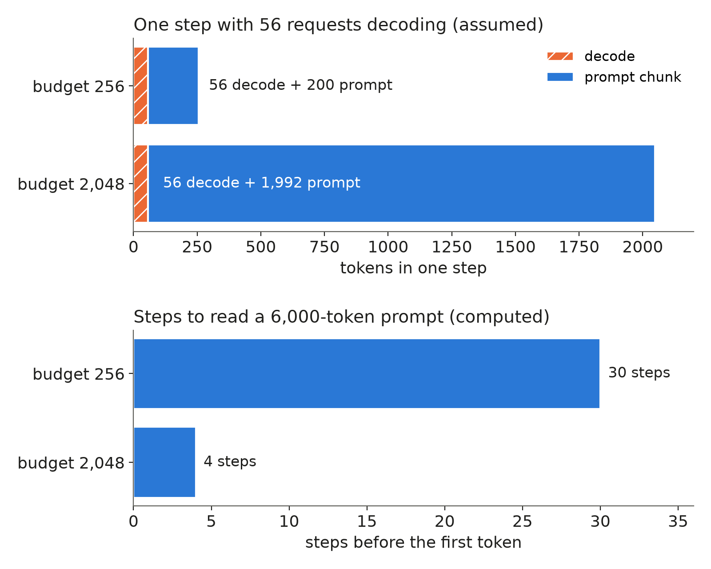
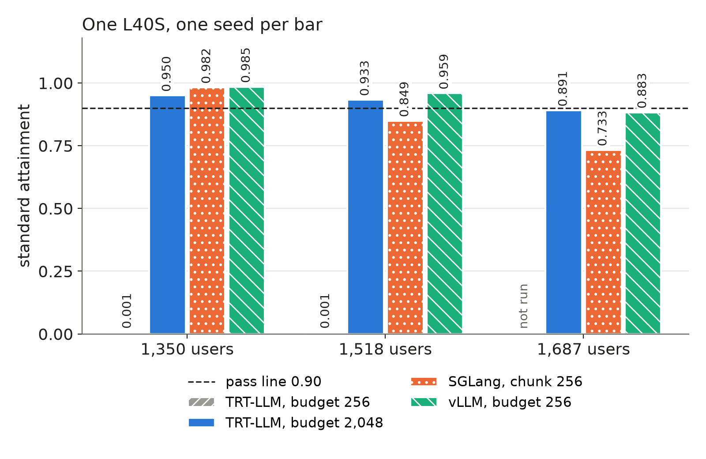

On one L40S, TensorRT-LLM (TRT-LLM, NVIDIA's serving engine) met our standard latency target for 0.001 of requests at 1,350 users, where vLLM and SGLang scored 0.985 and 0.982. The cause was one flag we had copied from vLLM: a per-step token budget of 256.

## Key results

- Budget 256: standard attainment 0.001 at 1,350 and 1,518 users (one L40S).
- Budget 2,048: 0.950, 0.933 and 0.891 at 1,350, 1,518 and 1,687 users; vLLM scored 0.985, 0.959 and 0.883.
- Prompts over 6,000 tokens at light load: median TTFT 1.02 s with budget 256; TTFT p90 0.52 s with 2,048.
- Our L4 verdict against TRT-LLM (standard 0.667 and 0.672) used the same budget 256.

## 1. Symptom

At 1,350 and 1,518 users the engine produced 257 output tokens per second from a KV pool of 477,952 tokens, at 48 % GPU use. A half-idle GPU pointed at a setting.

Standard tier: time to first token (TTFT) at most 1 s for chat, 2 s for rag (retrieval-augmented) and code; time per output token (TPOT) at most 50 ms. A load level passes when 0.90 of requests meet both.

## 2. The token budget

Each engine step feeds the GPU one token per generating request (decode) plus slices of unread prompts (prefill). The token budget caps the tokens in one step. In TRT-LLM decode tokens go first and prompt chunks fill the rest; vLLM's budget also counts decode, SGLang's chunk size only prefill.

```bash
trtllm-serve serve <model> --max_num_tokens 2048 --max_batch_size 256 \
  --extra_llm_api_options opts.yaml     # enable_chunked_prefill: true, fp8 KV, block reuse
vllm serve <model> --max-num-batched-tokens 256
python -m sglang.launch_server --model-path <model> --chunked-prefill-size 256
```

Assume 56 requests are decoding when a 6,000-token prompt arrives. At budget 256 the prompt gets 200 tokens per step and waits 30 steps for its first token; at 2,048 it waits 4. At about 30 ms per step (TRT-LLM's median TPOT on the L40S, 29.6 ms; steps not profiled), that is 900 ms of prefill before any queueing (computed). A 2,048-token step costs more, by an amount we did not measure.



*Worked example: 56 decoding requests assumed, step counts computed.*

## 3. What happened

TRT-LLM first ran with the other engines' settings: FP8 weights and KV cache, prefix reuse, budget 256. At light load (450 and 900 users) standard was 0.82 and 0.89, where SGLang and vLLM scored about 1.0. Median TTFT was 0.14 s for prompts under 500 tokens and 1.02 s over 6,000. On an idle engine a 6,000-token prompt needs about 24 steps of 256, roughly 0.72 s at 30 ms each (computed).

With only `max_num_tokens` changed to 2048, TTFT p90 at light load fell under 0.6 s for every prompt length. We then reran the high levels on the other engines' request stream.



*One seed per bar; dashed line = 0.90 pass rule.*

Single runs move by 0.02 to 0.05, so at 1,518 and 1,687 users TRT-LLM and vLLM tie within noise; SGLang trails both.

Why the same 256 hurt only TRT-LLM is our reading, not a profile: SGLang's median TPOT on the L40S, roughly one decode step, was 8.8 to 10.7 ms, against about 30 ms per TRT-LLM step.

The new budget left TPOT unsolved. At light load standard was 0.79 and 0.96, with TPOT p90 at 66 ms against the 50 ms limit. A single stream ran at 28.6 ms per token, slow for an L40S; per-step or CPU overhead is an untested hypothesis.

## 4. Lesson

The same flag value in two engines is a different setting when they spend their steps differently. Before blaming kernels, split TTFT by prompt length at light load; if it climbs with length (0.14 s to 1.02 s for us), tune the budget per engine.

```python
def ttft_by_length(records, edges=(500, 2000, 6000)):
    """Median TTFT per prompt-length bucket; records carry prompt_tokens, t_send, first_token_t."""
    buckets = {}
    for r in records:
        key = next((e for e in edges if r.prompt_tokens < e), "longer")
        buckets.setdefault(key, []).append(r.first_token_t - r.t_send)
    return {k: sorted(v)[len(v) // 2] for k, v in buckets.items()}
```

## 5. Limits

Our L4 screen used the same budget of 256: TRT-LLM scored 0.667 at 260 users and 0.672 at 320, against 0.861 for vLLM at 320 (a 3-seed mean against one seed). We stopped TRT-LLM on the L4 and now doubt that verdict; a rerun at 2,048 has not run.

On the L4 one stream alone ran at 80.7 ms per token, against about 23 ms for vLLM. One request barely fills a 256 budget, so the budget does not explain it; it also clashes with at least 0.667 of requests passing the 50 ms TPOT limit. We do not know why.

We checked the L40S numbers against summaries written at run time, not raw logs. Every TRT-LLM number is one seed, host KV offload off. The L40S cost is an estimate: about $3.5 of $7.95 measured for these runs and another experiment (our split).

## 6. Reproduce

Our runs, October 2026: TensorRT-LLM 1.3.0rc29, vLLM 0.30.0 and SGLang 0.5.20, Qwen3-4B-Instruct-2507 FP8 weights and FP8 KV cache.

1. Server: the TRT-LLM command of Section 2 with `--max_num_tokens 256` or `2048`, `--max_batch_size 256 --max_seq_len 32768`; chunked prefill, FP8 KV cache and block reuse in the options file. vLLM and SGLang as in Section 2, budget 256.
2. Load: closed-loop users that stream every token and record the send time, the first token and the last token; standard tier as in Section 1; one seed per level.
3. Check: TTFT by prompt length at light load with the function of Section 4; a single stream alone for the per-token floor.
4. Cost: the L4 screen took about 0.5 GPU hours, about $1.5; the four L40S runs about 2.6 GPU hours, about $3.5 (estimates).

## 7. Sources

- TensorRT-LLM, tuning `max_batch_size` and `max_num_tokens`: https://nvidia.github.io/TensorRT-LLM/performance/performance-tuning-guide/tuning-max-batch-size-and-max-num-tokens.html; `trtllm-serve`: https://nvidia.github.io/TensorRT-LLM/latest/commands/trtllm-serve/trtllm-serve.html.
- vLLM `serve` arguments (`--max-num-batched-tokens`): https://docs.vllm.ai/en/latest/cli/serve/.
- SGLang server arguments (`--chunked-prefill-size`): https://docs.sglang.io/advanced_features/server_arguments.html.
- Qwen3-4B-Instruct-2507 FP8 model card: https://huggingface.co/Qwen/Qwen3-4B-Instruct-2507-FP8.
- Our runs, October 2026: per-request records, engine commands and a single-stream smoke test behind every measured number above.


Written with Claude Code. Numbers checked against the runs under Sources.
