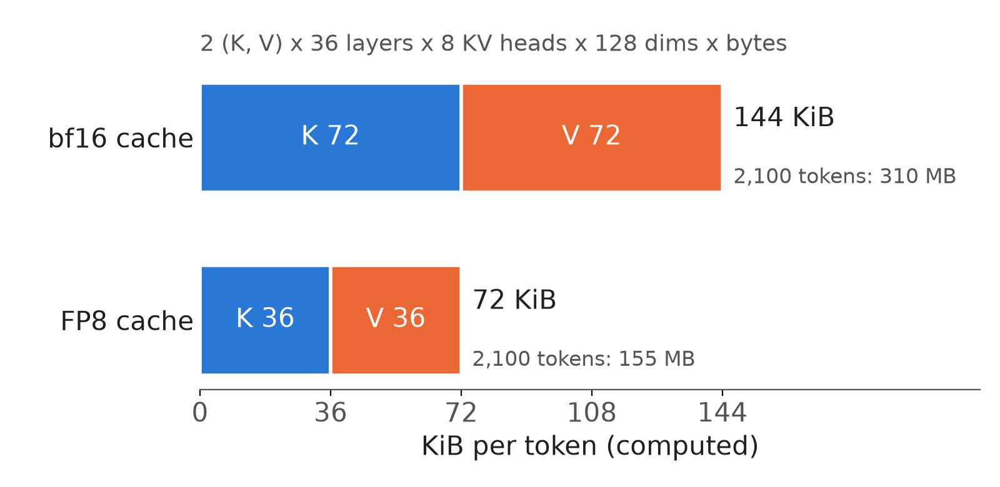
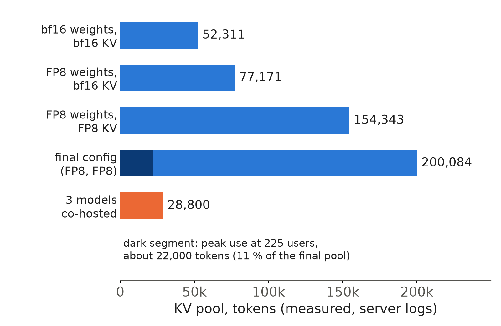
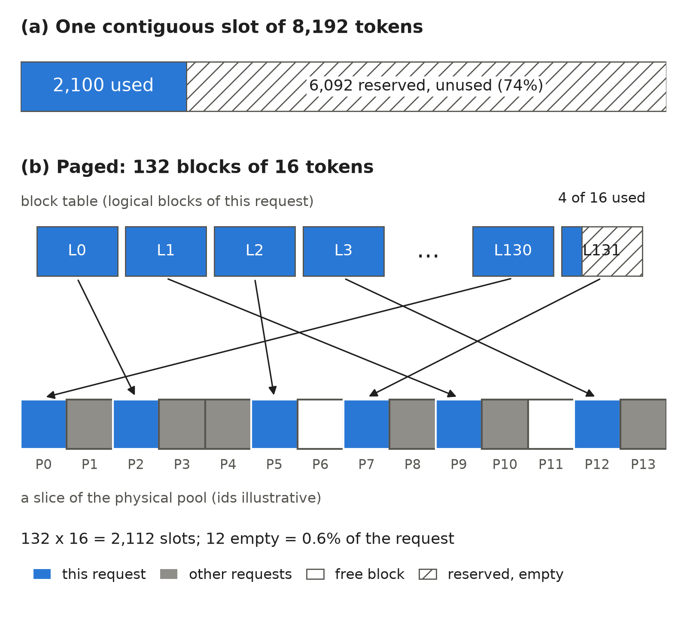

Take one chat request of 2,100 tokens (2,004 prompt, 96 answer) served by Qwen3-4B on one NVIDIA L4, a 24 GB GPU. By the end of its answer the GPU holds about 155 MB (148 MiB) of cached keys and values for it, with an FP8 cache. Below we derive that number, show the layout, and test a bigger cache.

## Key results

| what | number | kind |
|---|---|---|
| KV cache per token, Qwen3-4B | 144 KiB bf16, 72 KiB FP8 | computed |
| KV pool on one L4, final config | 200,084 tokens, about 95 requests of 2,100 tokens | measured; 95 computed |
| peak pool use at 225 users | 11 % | measured |
| empty space, 2,100-token request | 74 % in an 8,192-token slot, 0.6 % in 16-token blocks | computed |
| prefix cache on, U = 498 | 14.9 % of prompt tokens hit, standard 0.695 -> 0.777 | measured, 1 seed |
| host-RAM tier of about 64 GB | hit rate +11.5 to +13.2 points, attainment gain not confirmed | measured, 1 seed |


## 1. Bytes per token

Each decode step's attention reads the keys and values of every earlier token. They never change, so the engine stores them: the **KV cache**. On our L4 the prefill of a 2,004-token prompt took 0.395 s and one decode step 21.6 ms (measured), so recomputing the prompt at each step would cost about 18 decode steps per token.

Per token it holds one key and one value vector per layer and KV head:

```python
def kv_bytes_per_token(cfg: dict, bytes_per_elem: int) -> int:
    """K and V, every layer, every KV head (full attention only)."""
    head_dim = cfg.get("head_dim") or cfg["hidden_size"] // cfg["num_attention_heads"]
    return 2 * cfg["num_hidden_layers"] * cfg["num_key_value_heads"] * head_dim * bytes_per_elem

qwen3_4b = {"num_hidden_layers": 36, "num_key_value_heads": 8, "head_dim": 128}
print(kv_bytes_per_token(qwen3_4b, 2))   # bf16: 147456 bytes = 144 KiB
print(kv_bytes_per_token(qwen3_4b, 1))   # FP8:   73728 bytes =  72 KiB
```



*KV cache per token of Qwen3-4B, computed from the model config. FP8 halves every term.*

The engine agrees: SGLang logged an FP8 pool of 200,084 tokens with K and V of 6.87 GiB each, which is 200,084 x 73,728 bytes split in two; the bf16 pool of 52,311 tokens logged 3.59 GiB each.

## 2. Tokens per pool

At startup the engine turns most memory left after weights and working space into a **KV pool**, a fixed number of token slots shared by all requests. With round numbers, 10 GB left for an FP8 cache gives 10 x 10^9 / 73,728 = 135,634 tokens (hypothetical).



*KV pool on one L4 from SGLang server logs. The last two blue bars share dtypes; in a probe that changed only the prefill chunk, 4,096 to 256 tokens, the pool grew from 154,343 to 199,770 (measured; a later run logged 200,084). Dark segment: peak use at 225 users.*

FP8 weights added about 25,000 tokens; halving the bytes per token then gave 154,343, 2.95 times the bf16 pool. The final pool of 200,084 tokens is 13.7 GiB (14.8 GB) of the 22.5 GiB the card reports (computed).

That pool was never the limit. At 225 users, our capacity edge, the log showed at most 9 requests running and peak use of 11 % of the pool, while standard attainment was 0.906 ± 0.017 over 3 seeds. Our reading is that prefill compute was the limit. A small pool does hurt: with three models co-hosted on one L4 the LLM's pool shrank to about 28,800 tokens, 98 % in use, and standard attainment fell to 0.508 ± 0.028 (3 seeds). That run could not separate KV pressure from the GPU time the vision model took.

## 3. Paged attention

Early engines gave each request one contiguous slot sized for its longest possible answer. With a round slot of 8,192 tokens, our request leaves (8,192 - 2,100) / 8,192 = 74 % of it reserved and unused. PagedAttention (Kwon et al., 2023) cuts the pool into fixed-size **blocks** instead. Each request's **block table** maps its logical blocks to physical blocks anywhere in the pool, and the attention kernel reads through it.



*The same request in a contiguous slot and in 16-token blocks. Physical block ids are illustrative.*

A request takes a new block only at a block boundary, so at most 15 slots sit empty. Ours needs ceil(2,100 / 16) = 132 blocks, with 12 slots empty, 0.6 % (computed). One block of Qwen3-4B in FP8 is 16 x 72 KiB = 1,152 KiB. Sixteen is vLLM's default block size; we checked it in the v0.32.0 source while our runs used 0.30.0. The paper reports 2 to 4 times the throughput of FasterTransformer and Orca on its own hardware; we did not reproduce that.

The table also lets requests share a prefix. vLLM and TensorRT-LLM key each full block by a hash of all tokens up to it; SGLang keeps a token-level radix tree. In vLLM, if chat turn 1 was 40 tokens, turn 2 re-sends it: two full blocks (32 tokens) hit and skip prefill, and the 8-token partial block is recomputed.

## 4. Prefix cache and offload on one L4

Our load generator re-sends the whole conversation on every chat turn, so 48 to 59 % of prompt tokens repeat the same session's earlier tokens; only 0.2 to 1.0 % come from other sessions. At U = 498 (10 minutes, one seed each) we ran SGLang's radix cache (its prefix cache) on and off. With it on, 14.9 % of prompt tokens were hits, and standard attainment rose from 0.695 to 0.777, 8.2 points.

Our reading of the low hit rate is that histories are evicted before their owner returns. A CPU simulation of the same request stream, with a pool of about 200,000 tokens, showed that at 520 users the pool holds about 2 minutes of new KV traffic, while think time has a median of 116 s and a mean of 351 s.

A host-RAM tier keeps evicted blocks and copies them back over PCIe on a hit. The simulation says such a tier helps only when it is several times the GPU pool. Our first test broke that rule: an 8 GB host pool holds 108,507 tokens, 0.70 times the on/off run's 154,343-token GPU pool, and gave a 14.6 % hit against 14.9 % without it. A 64 GB host pool is 4.34 times the 200,084-token GPU pool, and SGLang's log counted 868,056 host tokens, which matches 64 x 10^9 / 73,728: its host "GB" is decimal.

```bash
# vLLM: FP8 KV, prefix caching, 64 GiB host tier, report cached tokens per request
vllm serve Qwen/Qwen3-4B-Instruct-2507-FP8 --kv-cache-dtype fp8_e4m3 --enable-prefix-caching \
  --kv-offloading-size 64 --kv-offloading-backend native --enable-prompt-tokens-details

# SGLang: radix cache on by default; 64 GB host tier, write-through (blocks copied to host as written)
python -m sglang.launch_server --model-path Qwen/Qwen3-4B-Instruct-2507-FP8 --kv-cache-dtype fp8_e4m3 \
  --enable-hierarchical-cache --hicache-size 64 --hicache-write-policy write_through --enable-cache-report
```

Each engine ran with and without the host tier: FP8 cache, 20-minute warm-up, 10-minute window, one seed per cell, vLLM 0.30.0 and SGLang 0.5.20.

| engine, U | prefix hit | standard | strict |
|---|---|---|---|
| SGLang, U = 260 | 23.1 % -> 34.6 % | 0.914 -> 0.927 | - |
| SGLang, U = 520 | 16.0 % -> 29.2 % | 0.582 -> 0.770 | - |
| vLLM, U = 320 | 23.3 % -> 34.8 % | 0.904 -> 0.915 | 0.575 -> 0.603 |
| vLLM, U = 520 | 16.2 % -> 28.9 % | 0.783 -> 0.799 | 0.294 -> 0.304 |

The hit rate rose by 11.5 to 13.2 points in every row. For SGLang at 260 users the simulation had predicted 23 -> 36 % and 16 % less prefill work; we measured 23.1 -> 34.6 % and 15 % less, with prefill busy itself modelled from measured token counts at 0.2 ms per uncached token.

Attainment did not move reliably. On vLLM every change sits inside the 0.02 to 0.05 noise of a single L4 run. On SGLang at U = 520 standard attainment rose by 0.19 with one seed, unconfirmed until we run 3 seeds. The simulation adds one structural reason: at 520 users, 45 % of prompts of 3,000 tokens or more are first turns, which no cache can serve.

Hits are a token-weighted share of `usage.prompt_tokens_details.cached_tokens`, which both engines return per request with the flags above; it includes tokens loaded from host RAM (vLLM: checked in its log; SGLang: read in its source). A custom script collects it:

```python
cached = prompt = 0
for rec in records:                       # one record per finished request
    if rec.cached_tokens is None or rec.prompt_tokens == 0:
        continue                          # engine did not report it
    cached += rec.cached_tokens
    prompt += rec.prompt_tokens
prefix_hit = cached / prompt if prompt else None
```

## 5. Limits

- 144 KiB and 72 KiB are computed; the logged K and V sizes and host-pool count agree, but we did not measure GPU bytes directly.
- The prefix-cache gain of 8.2 points and every offload number come from one seed per cell. The SGLang gain at U = 520 is unconfirmed.
- The offload rows differ in engine, version and baseline, so the table does not rank SGLang against vLLM.
- Hit rates depend on our synthetic generator, which has no shared system prompt or shared RAG documents.
- We did not profile attention kernels; block and hashing details come from the paper and framework docs.
- The 8,192-token slot and the illustrative block ids are round examples, not any engine's setting.

## 6. Reproduce

```bash
python -c "print(2*36*8*128*2, 2*36*8*128*1)"          # 147456 73728
python -c "print(200084/2100, 64e9/73728, 8e9/73728)"    # 95.3, 868055.6, 108506.9
```

Our runs, October 2026, all on one NVIDIA L4 (24 GB) with Qwen3-4B-Instruct-2507 FP8 and an FP8 KV cache:

1. Pool size: start SGLang 0.5.20 and read `#tokens` in its "KV Cache is allocated" line; peak use comes from its periodic token-usage lines under load.
2. Prefix cache: SGLang with the radix cache on and with `--disable-radix-cache`, then with an 8 GB and a 64 GB host tier (the commands of Section 4); vLLM 0.30.0 with and without `--kv-offloading-size 64`. Each cell: closed-loop users re-sending the whole conversation, 20-minute warm-up, 10-minute window, one seed; prefix hit with the script of Section 4.
3. Cost: about 3.5 USD for the SGLang host-tier pair and about 2 USD per vLLM pair (estimates). The offload simulation, a CPU replay of the same request stream through simulated GPU and host pools, runs in about 11 minutes.

## 7. Sources

- Kwon et al., "Efficient Memory Management for Large Language Model Serving with PagedAttention", SOSP 2023: https://arxiv.org/abs/2309.06180.
- Zheng et al., "SGLang: Efficient Execution of Structured Language Model Programs" (RadixAttention), NeurIPS 2024: https://arxiv.org/abs/2312.07104.
- vLLM automatic prefix caching design: https://docs.vllm.ai/en/latest/design/prefix_caching/; KV offloading: https://docs.vllm.ai/en/latest/features/kv_offloading_usage.html.
- SGLang hierarchical cache (HiCache) design: https://docs.sglang.io/advanced_features/hicache_design.html.
- TensorRT-LLM KV cache and block reuse: https://nvidia.github.io/TensorRT-LLM/latest/features/kvcache.html.
- Qwen3-4B-Instruct-2507 model card and config: https://huggingface.co/Qwen/Qwen3-4B-Instruct-2507; FP8 checkpoint: https://huggingface.co/Qwen/Qwen3-4B-Instruct-2507-FP8.
- Our runs, October 2026: SGLang and vLLM server logs and per-request records behind every measured number above.


Written with Claude Code. Numbers checked against the runs under Sources.
