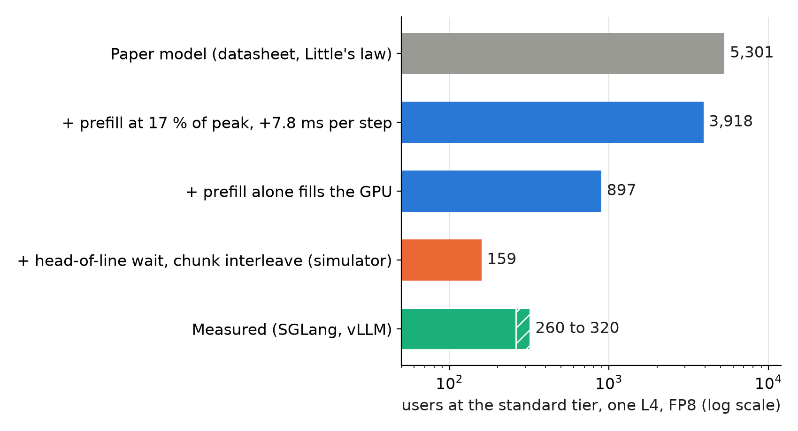

Before measuring, we predicted from datasheet numbers that one L4 serving Qwen3-4B (FP8 weights and KV cache) holds 5,301 users at the standard latency tier. Our engines held about 260 (SGLang) and 320 (vLLM).

## Key results

- One L4, FP8, standard tier: model 5,301 users, measured about 260 (SGLang) and 320 (vLLM); 20x and 17x too high.
- One L40S, FP8: model 19,087, measured at least 1,350 (no level fell below the pass line); at least 14x too high.
- Per-step errors: prefill 5.7 to 5.9x too fast, idle time per output token (TPOT) 1.6x (L4) to 2.1 to 2.5x (L40S).
- Two numbers measured on an empty L4 predicted the L40S prefill within 3 %; fed to a queue simulator, they gave a strict-tier capacity of 1,278 users against about 1,260 measured.

## 1. Symptom

The model was never pessimistic in any of our five comparisons. Order was right; the size was off by 10 to 20x.

Workload for all numbers: mean prompt 2,004 tokens, mean answer 96 tokens, 351.5 s think time between requests. Standard tier: time to first token (TTFT) at most 1 s for chat and 2 s for rag and code; TPOT at most 50 ms. Measured users: the highest level where 0.90 of requests met the tier.

## 2. What we expected

The model is Little's law: concurrent requests C = arrival rate x time in system, so users = C x (think time + response time) / response time. The response time comes from the GPU datasheet: decode reads the weights once per step (memory bandwidth), prefill costs 2 x parameters FLOPs per prompt token at the datasheet peak (the model's formula, computed, not measured).

## 3. What happened

### 3.1 How we found it

We compared per-token speeds first; a user count hides which term is wrong.

| per token | model | measured | model is |
|---|---|---|---|
| L4 FP8 idle TPOT | 13.8 ms | 21.6 ms | 1.6x too fast |
| L4 FP8 prefill | 0.033 ms | 0.197 ms | 5.9x too fast |
| L40S FP8 prefill | 0.011 ms | 0.063 ms | 5.7x too fast |

Measured prefill is 17 % of the FP8 peak on both GPUs. We then added the two measured numbers (17 % prefill, +7.8 ms per decode step) to the model, step by step:

*Model steps are computed; the last model step comes from our simulator, the bottom bar is measured.*

### 3.2 The cause

Little's law counts only decoding requests; it never charges the GPU for the prefill every request needs. A 2,000-token prompt takes about 0.4 s on the L4 (2,004 x 0.197 ms, computed), so prefill alone saturates the GPU near 900 users (a 354.5 s user cycle, think plus an assumed 3 s wait, over 0.395 s; computed, 897 in our script). In the simulator, decode overhead barely moved the standard tier (1,894 users with it alone, 1,919 without).

The standard tier fails far below saturation. At 260 users prefill is only about 29 % busy, but one 4,000 to 8,000-token prompt takes 1 to 1.6 s and blocks everything behind it, and each 256-token chunk stretches the decode steps of running requests (TPOT median 22, 39, 53 ms at 150, 600, 750 users). A simulator with those two effects gave 159 users, which is our reading of the remaining gap; Poisson arrivals and a missing prefix cache were not isolated.

The test that mattered: we calibrated on an empty L4 only (167 requests) and changed nothing for the L40S. It predicted L40S prefill 0.0651 against 0.0634 ms per token measured (+3 %), attainment within 1.5 points at three levels, and strict capacity 1,278 against about 1,260. Idle TPOT was +4 to +27 % off, so the 7.8 ms does not transfer exactly.

## 4. Lesson

Measure two numbers on an idle GPU before trusting a capacity model: prefill ms per token from long prompts, and TPOT from a single stream. If prefill is 5x slower than the datasheet, no decode formula will rescue the user count. A user count near the saturation point of any one resource is a cliff: with 15 % less prefill work (a prefix-cache what-if), the simulated L4 standard capacity moved from 159 to 377.

## 5. Limits

The L40S measured value is a lower bound, so "14x" is a floor. The L4 simulator, with Poisson arrivals, first-come order and no KV limit, is not validated: it is 0.5 to 0.6x low. One engine configuration (chunk 256, tensor parallel 1) supplied the calibration.

## 6. Reproduce

Our runs, October 2026: Qwen3-4B-Instruct-2507 FP8 on one L4 and one L40S, SGLang 0.5.20 and vLLM 0.30.0, prefill chunk 256.

1. Idle prefill: send 167 requests one at a time to an empty server, regress TTFT on prompt tokens; the slope is ms per token. Idle TPOT: median of a single stream.
2. Load: closed-loop users with 351.5 s think time, mix of chat, rag and code prompts, 10 minutes per level; pass at 0.90 of requests inside the tier.
3. Model: users = C x (think + response) / response, with and without the measured prefill slope; add a queue only after that.
4. Cost: CPU only for the model work; no new GPU time.

## 7. Sources

- Little's law: J. D. C. Little, "A proof for the queuing formula L = lambda W", Operations Research, 1961.
- vLLM `serve` arguments: https://docs.vllm.ai/en/latest/cli/serve/; SGLang server arguments: https://docs.sglang.io/advanced_features/server_arguments.html.
- Qwen3-4B-Instruct-2507 FP8 model card: https://huggingface.co/Qwen/Qwen3-4B-Instruct-2507-FP8.
- Our runs, October 2026: per-request records behind every measured number above.

Written with Claude Code. Numbers checked against the runs under Sources.
