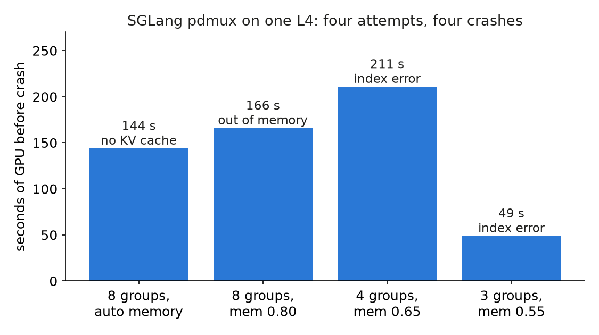

We wanted to know whether splitting one GPU between prefill and decode would cut the latency misses of our chat workload. SGLang 0.5.20 has a flag for it, `--enable-pdmux`. We never got a number out of it.

## Key results

- Reference without pdmux (SGLang, chunk 256, 450 users, one L4): standard attainment 0.84, TTFT misses 13 %, TPOT misses 5 %.
- pdmux: 0 measurements. A first crash on a renamed attribute, then four attempts that each failed after 49 to 211 s of GPU time.
- Spend on the dead end: about 0.5 L4 hours (computed: 1.2 h for the day minus about 0.7 h of other runs; approximate).
- The SM split itself worked: 8 groups, prefill/decode from 40/18 to 30/28 of 58 SMs.

## 1. Symptom

Standard tier: time to first token (TTFT) at most 1 s for chat, 2 s for rag and code; time per output token (TPOT) at most 50 ms; a request passes when it meets both. At 450 users plain SGLang on the L4, with 256-token prefill chunks, had 0.84 attainment. Its misses were 13 % on TTFT and 5 % on TPOT.

pdmux (prefill/decode multiplexing) did not get that far. With the flag on, the engine died at start with an `AttributeError` on `gpu_id`.

## 2. What we expected

Prefill and decode compete for the same streaming multiprocessors (SMs, the GPU's compute units). pdmux uses CUDA green contexts to give each phase its own SM share, so by design a long prompt cannot stall decode steps. Our reading of the idea: it could trade the 5 % TPOT misses against TTFT, with no second GPU. We had no predicted number, only the hope that the split would help. The L4 has 58 SMs, a small pool to divide. Our pdmux attempts ran with chunked prefill off (`--chunked-prefill-size -1`) and the overlap scheduler off, so even a working run would not have matched the chunk-256 reference setup.

## 3. What happened

### 3.1 The four crashes

```
attempt                             result
SGLang 0.5.20, default              AttributeError: Scheduler has no gpu_id (moved to Scheduler.ps)
+ patch gpu_id/tp_size              green contexts OK (8 SM groups); auto mem-fraction-static = -0.099, no KV cache
+ mem-fraction-static 0.80          CUDA out of memory in decode graph capture (22.01 of 22.03 GiB used, 48 MiB in graph pools)
+ 4 groups, 0.65, graph bs 16       IndexError in decode attention backend list
+ 3 groups, 0.55, graph bs 8        same IndexError after 49 s
```

The first bug was a rename in 0.5.20; a `sed` in our staged environment fixed it. The second and third looked like memory. We guessed that pdmux keeps one attention backend per SM group, so fewer groups would free memory (we hoped about 3.8 GiB); that was never verified.



*Measured: seconds of the load-test step until each crash, after machine boot; attempts two to five of the table, in order.*

### 3.2 The cause

Reading the 0.5.20 source, the attention-backend list is sized from `--sm-group-num` (3 or 4 entries), while the stream groups are sized from a config file that defaults to 8; the CLI value is ignored there. Graph capture loops over 8 streams and indexes 4 backends. That explains the `IndexError` (source reading, not a debugger session). A fix needs the config file and the flag set to the same group count. We wrote plans for that and did not merge them.

## 4. Lesson

An experimental flag costs more than its time to read: each attempt paid a boot plus a crash. Make the cheap failure cheap, by running the lean config first and setting a rule up front: stop after the second crash that has a new cause. We stopped after the fifth start, with no measurement, since the path looked untested upstream.

## 5. Limits

We do not know whether pdmux helps on an L4: it was never measured, on any engine. The crash times (144, 166, 211, 49 s) are those of four runs, one each. The memory explanation is a hypothesis. The group-count cause comes from reading source of one version, 0.5.20; a later version may differ.

## 6. Reproduce

Our runs, October 2026: SGLang 0.5.20 on one L4, Qwen3-4B-Instruct-2507 FP8.

```bash
python -m sglang.launch_server --model-path <model> --enable-pdmux \
  --sm-group-num 4 --mem-fraction-static 0.65 --cuda-graph-max-bs-decode 16 \
  --kv-cache-dtype fp8_e4m3 --attention-backend flashinfer \
  --chunked-prefill-size -1 --disable-overlap-schedule
```

Expect the `IndexError` unless the pdmux config file (`--pdmux-config-path`) sets `sm_group_num` equal to `--sm-group-num`; we did not test that fix. Cost: each crash 49 to 211 s after boot, 5 to 15 minutes of L4 per start including boot. The load we meant to run: 450 closed-loop users, 30 s warm-up, 10-minute window, seed 0.

## 7. Sources

- SGLang server arguments: https://docs.sglang.io/advanced_features/server_arguments.html.
- NVIDIA CUDA green contexts: https://docs.nvidia.com/cuda/cuda-driver-api/group__CUDA__GREEN__CONTEXTS.html.
- Our runs, October 2026: engine logs of each attempt, and the reference run without pdmux.


Written with Claude Code. Numbers checked against the runs under Sources.
