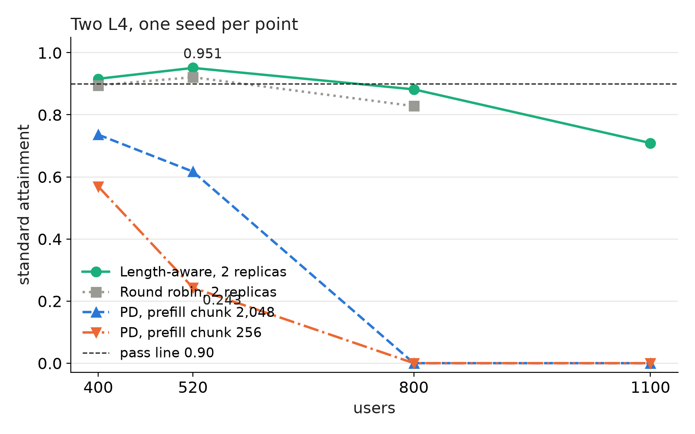

We tested whether prefill/decode disaggregation (PD: one GPU reads prompts, another generates tokens) could match simple routing on two L4s. It lost by far: at 520 users, standard attainment was 0.243 for PD against 0.951 for a router that sends long prompts to one replica.

## Key results

Standard attainment, 2 x L4, SGLang 0.5.20, one seed per cell (measured):

| users | length-aware | round robin | PD, chunk 256 | PD, chunk 2,048 |
|---|---|---|---|---|
| 400 | 0.916 | 0.895 | 0.569 | 0.736 |
| 520 | 0.951 | 0.921 | 0.243 | 0.617 |
| 800 | 0.882 | 0.828 | 0.000 | 0.000 |
| 1,100 | 0.709 | not run | 0.000 | 0.000 |


## 1. Symptom

Standard tier: time to first token (TTFT) at most 1 s for chat and 2 s for rag and code, time per output token at most 50 ms; a level passes at 0.90. The first PD attempt on Mooncake (a KV transfer library) crashed: after 257 requests the prefill logged a queue-full error and the decode side reported its peer as dead. With fixed transfer settings, the rerun ran but failed 29 to 57 requests per level from minute 45.

## 2. What we expected

Our design guess was that PD would at best tie length-aware routing. On one L4 most misses were short prompts waiting behind long prefills. PD keeps prefill chunks out of decode steps, but its prefill GPU still serves prompts first come, first served, so that wait stays. Length-aware routing attacks the wait directly: prompts of at least 3,000 tokens go to replica 0, the rest to replica 1.

The load on the prefill GPU: a mean prompt of 2,004 tokens per 351.5 s of think time is about 5.7 prompt tokens per user per second. At 0.197 ms per token, 400 users keep it 45 % busy, 520 users 58 %, 800 users 90 % and 1,100 users over 100 % (computed, no prefix-cache credit).




*One seed per point; dashed line = 0.90 pass rule. Round robin has no 1,100 point.*

## 3. What happened

### 3.1 How we found it

We first suspected the KV transfer, where the first attempt died. From prefill end to first token the router logged about 0.03 s (measured), so the copy between GPUs was cheap. Then we looked at the prefill GPU itself.

```bash
# per-request router log: prefill_s = time the prefill GPU took, first_s = time to first token
# bucket prefill_s by minute and count requests waiting on the prefill engine
```

Median prefill time was 0.9 to 4 s at 400 and 520 users and 85 to 315 s at 800 users and above, with 150 to 420 requests waiting (measured). The GPU peaked near 5,500 prompt tokens per second against a mean load of 1,500 to 3,200 (measured). The prefix-cache hit rate was 4.8 %, against about 15 % without PD (measured); we did not find why, since with one prefill GPU every turn of a conversation returns to the same cache.

### 3.2 The cause

Our reading, from logs, not a controlled test: one prefill GPU is the bottleneck. Every prompt must pass through it, while length-aware routing splits prompt work between both GPUs and keeps cache locality on each.

A bigger prefill chunk (2,048 tokens on the prefill GPU, decode still 256) helped: standard rose from 0.569 to 0.736 at 400 users and from 0.243 to 0.617 at 520, and failed requests fell to 0 to 1 per level. It did not remove the queue: prefill time still reached minutes at 800 users and above (rough 600 s windows), so the small chunk was only part of the problem.

## 4. Lesson

Before splitting a pipeline across GPUs, check that the stage you isolate has more capacity than the load it must carry alone. Here one L4 prefilled at most 5,500 tokens per second while load reached 3,200 on average, with bursts of 40 simultaneous requests at the start. Compare the split to routing on the same hardware first.

## 5. Limits

One seed per cell; seed spread for length-aware routing at 520 users was about 0.03 (three seeds, 0.902 to 0.956), far below the PD gap of 0.7. We ran PD only with SGLang and Mooncake over TCP; vLLM PD with NIXL (a transfer library) never started in our sandbox (all eight variants; a sandbox limit, inferred). On four L4s, two prefill plus two decode GPUs (prefill chunk 2,048) scored 0.000 standard at 1,500 users against 0.838 for two long plus two short replicas (one seed each); keeping each conversation on one prefill GPU was not tried. The first crash did not reproduce in a short probe, and the cause of the rerun's late failures is inferred.

## 6. Reproduce

Our runs, October 2026: Qwen3-4B-Instruct-2507 FP8 weights and FP8 KV cache, SGLang 0.5.20, 2 x L4, chunked prefill 256.

1. Length-aware: two independent replicas behind a router that sends prompts of at least 3,000 tokens to replica 0 and the rest to replica 1, least loaded within each (a custom router is needed).
2. PD: `python -m sglang.launch_server --disaggregation-mode prefill|decode --disaggregation-transfer-backend mooncake_tcp --page-size 16`, prefill on GPU 0 with `--disaggregation-bootstrap-port 8998`, decode on GPU 1, plus a router that sends each request to both engines with the bootstrap host, port and room (a custom router is needed). We also raised the Mooncake TCP queue limits and turned on SGLang's failed-session probe.
3. Load: closed-loop users with a mean think time of 351.5 s, 10 minutes per level at 400, 520, 800 and 1,100 users, one seed.
4. Check: log per request the prefill time and the time to first token; chunk size is `--chunked-prefill-size`.

## 7. Sources

- SGLang PD disaggregation docs: https://docs.sglang.io/advanced_features/pd_disaggregation.html.
- DistServe (Zhong et al., OSDI 2024), prefill/decode disaggregation: https://arxiv.org/abs/2401.09670.
- Mooncake: https://github.com/kvcache-ai/Mooncake.
- Our runs, October 2026.


Written with Claude Code. Numbers checked against the runs under Sources.
