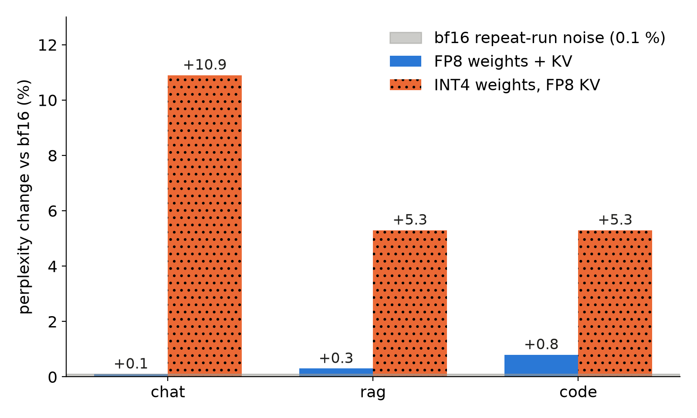

On one L4, a quality gate told us FP8 "passed" against a bf16 reference that had mostly crashed: 353 of 400 tasks failed with out-of-memory (OOM). Rescored with a working reference, FP8 sat within noise of bf16 and INT4 weights did not.

## Key results

- bf16 reference: 353 of 400 tasks failed (OOM on prompt log-probabilities), yet the gate gave a verdict.
- FP8 against bf16: accuracy -0.5, -0.3 and -0.0 points, perplexity +0.1, +0.3 and +0.8 % (chat, rag, code).
- INT4 weights with FP8 KV: accuracy -1.1, -1.2 and -1.1 points, perplexity +10.9, +5.3 and +5.3 %. bf16 against itself moves by 0.1 point and 0.1 %.
- INT4 speed at 4 and 8 requests in flight: TPOT median 15 and 18 ms against 24 and 28 ms for FP8 on the same day (measured).

## 1. Symptom

The gate compares each quantised variant with a bf16 run of the same prompts. The bf16 run had failed for most tasks, and the gate treated an empty reference as a pass. A "pass" built on nothing is worse than a failure, because nobody looks at it again.

## 2. What we expected

INT4 weights read half the bytes of FP8 per decode step. The L4 decodes bound by weight reads, so we expected lower latency at low load. We did not know what it would cost in quality, and that was the question the gate existed to answer.

## 3. What happened

### 3.1 How we found it

The perplexity tasks ask the server for log-probabilities of the prompt tokens. We sent 16 at once, about 400 positions each, over a vocabulary of 151,936. That is 3.9 GB of values if each is a 4-byte float (computed; the float width is our assumption). On a 24 GB card already holding bf16 weights and a KV pool, we read that as enough to fail the request.

The fixes were two rules. Log-probability tasks run 2 at a time, and a label with more than 5 % failed tasks is marked invalid, with the reference checked first.

A separate failure hid INT4 for a while: the INT4 checkpoint kept its chat template in a `.jinja` file that our download pattern skipped, so every chat request returned HTTP 400. The engine also needed about 6.5 minutes after weights loaded before it served (kernel preparation).

### 3.2 The cause

For the OOM, the log-probability batch is our reading; nobody profiled the allocation. The gate bug is certain: it had no check that the reference was valid.

Once a second run was valid, we scored FP8 and INT4 against bf16 on 50 tasks per kind, with a bf16-against-bf16 repeat as the noise floor.



*Measured on one L4, 50 tasks per kind, one run per label.*

FP8 stays near the noise floor; INT4 sits 5.3 to 10.9 % above bf16 in perplexity, against a repeat-run noise of 0.1 %. For speed, the byte argument held at low load and failed at high load. Our reading: the INT4 kernel dequantises the weights to 16-bit before the multiply, while FP8 runs on FP8 tensor cores. At 16 and 32 in flight INT4 produced 250 and 264 tokens per second against 267 and 305 for FP8 (measured).

## 4. Lesson

A quality gate needs three things before it can say "pass": a reference with under 5 % failed tasks, a noise floor from the reference run against itself, and a threshold relative to that floor.

```python
def gate(ref, noise, cand, max_failed=0.05):
    if ref.failed / ref.total > max_failed:
        return "invalid"          # never compare against a broken reference
    delta = abs(cand.ppl - ref.ppl) / ref.ppl
    return "pass" if delta <= 3 * abs(noise.ppl - ref.ppl) / ref.ppl + 0.01 else "fail"
```

The threshold here is a sketch, not what we ran. We kept INT4 only for a strict, low-load deployment, and FP8 as the default.

## 5. Limits

The text-agreement check against bf16 still failed FP8: 12 % against a fixed 60 % threshold, while bf16 against itself reached only 68 %. One different token changes the rest of a long greedy answer, so the check measures sameness, not quality; we now report it and never let it fail a label.

Each label ran once, with 50 tasks per kind, so a difference of two tasks is 4 points on code validity. INT4 was measured only with FP8 KV, so we cannot separate the weight and KV effects. One model (Qwen3-4B), one GPU, one INT4 checkpoint. The FP4 KV cache did not start on this GPU (Blackwell only); FP4 weights were not tried.

## 6. Reproduce

Our runs, October 2026: SGLang 0.5.20 on one L4, Qwen3-4B-Instruct-2507 in bf16 and FP8, and the public W4A16 INT4 checkpoint `RedHatAI/Qwen3-4B-Instruct-2507-quantized.w4a16` served with `--kv-cache-dtype fp8_e4m3`.

1. Serve each variant; for INT4 make sure the chat template file is downloaded.
2. Score the same 50 prompts per kind (chat, rag, code) at temperature 0: next-token accuracy and perplexity from prompt log-probabilities, two requests at a time.
3. Run bf16 twice for the noise floor. Mark any label with over 5 % failed tasks invalid.
4. Probe latency with a fixed number of requests in flight (4, 8, 16, 32) and record TPOT.
5. Cost: our lean run (bf16, FP8 and INT4 scoring plus the FP8 and INT4 latency probe) took about 33 minutes of L4 time, by the session clock (measured).

## 7. Sources

- Frantar et al., GPTQ (INT4 weight quantisation): https://arxiv.org/abs/2210.17323.
- Marlin mixed-precision kernels (W4A16): https://github.com/IST-DASLab/marlin.
- SGLang quantisation docs: https://docs.sglang.io/advanced_features/quantization.html.
- Qwen3-4B-Instruct-2507 model card: https://huggingface.co/Qwen/Qwen3-4B-Instruct-2507.
- Our runs, October 2026: per-task records for each label, the latency probe and the repeat-run noise floor.


Written with Claude Code. Numbers checked against the runs under Sources.
