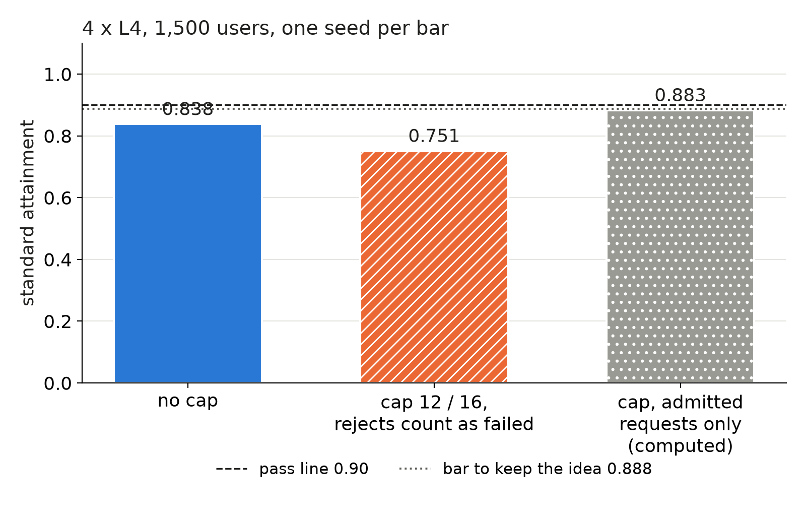

We put a cap on requests in flight at the router of a 4 x L4 deployment, expecting the admitted requests to stay fast past the capacity limit. At 1,500 users standard attainment fell from 0.838 to 0.751, so we dropped the idea.

## Key results

- 4 x L4 (2 long-prompt + 2 short-prompt replicas), 1,500 users, one seed each: standard attainment 0.838 without a cap, 0.751 with caps of 12 and 16 in flight.
- 458 of 3,069 requests were rejected (14.9 %). Strict 0.514 to 0.459; relaxed 0.925 to 0.821.
- The bar, set before the run, was 0.888 to justify three seeds. We missed it by 0.137.

## 1. Symptom

Setup: SGLang serving Qwen3-4B on four L4 GPUs behind a router that sends prompts of 3,000 tokens or more to the long group and the rest to the short group, least-loaded within each group. At 1,200 users this layout passed standard (0.924 over 3 seeds); at 1,500 it scored 0.838, below the 0.90 pass rule.

Standard tier: time to first token (TTFT) at most 1 s for chat, 2 s for rag and code; time per output token at most 50 ms. A level passes when 0.90 of requests meet both. A rejected request counts as failed, in the denominator.

## 2. What we expected

Past the capacity limit, requests wait in engine queues and every request misses its target, not only the last in line. Refusing the excess should keep the admitted ones inside it. We set the rule before the run: at 1,500 users the capped layout had to beat the uncapped one by 0.05, so reach 0.838 + 0.05 = 0.888, to earn three seeds; otherwise we drop the idea.

The router answers HTTP 503 with a `Retry-After: 3` header, without calling an engine. A rejected user waits that long, then starts a new session.

## 3. What happened

### 3.1 How we set the caps

We read the router logs of the three passing seeds at 1,200 users and took the 95th percentile of in-flight requests per group: 12 for the long group, 16 for the short group (summed over the group). We did not tune them on the test run.

```python
def admit(group, in_flight, caps, retry_after_s=3):
    """Router hook: refuse before any engine call when the group is full."""
    if in_flight[group] >= caps[group]:
        return 503, {"Retry-After": str(retry_after_s)}
    in_flight[group] += 1
    return None  # forward to the engine; decrement when the stream ends
```

One thing had to change in the load generator first. Before, a user whose turn failed started a new session at once; against a gateway that refuses fast that is a tight retry loop that inflates the load. Users now wait the server's `Retry-After`.

### 3.2 The result



*One seed per bar. The third bar is computed from the second and is not a pass or fail result.*

Of 3,069 requests, 458 were rejected, so 2,611 were admitted. Passing requests: 0.751 x 3,069 = 2,305 (computed). Among the 2,611 admitted, that is 0.883. So the cap did help the admitted requests a little (0.838 to 0.883), but the 14.9 % rejected cost more than that gain.

Why it failed is our reading, not a profile: the 12 and 16 caps came from a level where the system was healthy, so at 1,500 users they sat close to the normal load of a busy group and refused requests an engine could still have served inside the target.

## 4. Lesson

A cap is only worth it if the requests it refuses would have missed anyway. Before building it, count how many requests miss at the load you care about: at 1,500 users 0.162 missed without a cap, and the cap rejected 0.149 of all requests while 0.117 of the admitted ones still missed. With the cap, 458 rejected plus 306 admitted but late is 764 of 3,069 failed, or 0.249, against 0.162 without it (computed).

Report the rejection rate beside attainment, and never score only the admitted requests.

## 5. Limits

One seed, one load level (1,500 users), one cap pair. The rule needed 0.888; we did not test other caps, other `Retry-After` values or a queue with a deadline instead of a hard refusal. A rejected user is replaced by a newly sampled session, so the class mix may have drifted; we did not check per-class attainment. The run cost about $1 (estimate).

## 6. Reproduce

Our runs, October 2026: SGLang 0.5.20, Qwen3-4B-Instruct-2507 FP8 weights and KV cache, chunked prefill 256, four L4 24 GB GPUs in one container.

1. Serve four replicas on four ports behind a router in your own code: prompts of 3,000 tokens or more go to the long group, others to the short group, least in-flight first.
2. Add the hook of Section 3.1 with caps from the 95th percentile of in-flight requests per group at a load where the uncapped layout passes.
3. Load: 1,500 closed-loop users with think time, streaming, one seed, a 10-minute measurement window; count a 503 as a failed request; users wait `Retry-After` after a failure; compare against the uncapped layout at the same load and seed.
4. Cost: about 14 minutes of validation on four L4s, about $1 (estimate).

## 7. Sources

- SGLang server arguments: https://docs.sglang.io/advanced_features/server_arguments.html.
- RFC 9110, `Retry-After` and 503 Service Unavailable: https://www.rfc-editor.org/rfc/rfc9110.
- Qwen3-4B-Instruct-2507 FP8 model card: https://huggingface.co/Qwen/Qwen3-4B-Instruct-2507-FP8.
- Our runs, October 2026: per-request router and client logs behind every number above.


Written with Claude Code. Numbers checked against the runs under Sources.
