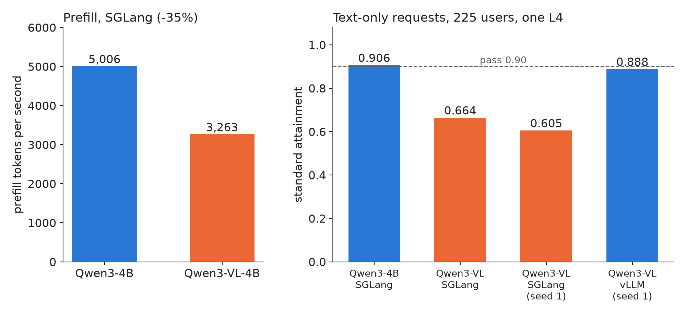

We swapped the text model for its vision-language sibling (VLM, a model that also reads images) on one L4, expecting a small cost for the extra weights. On text-only requests, SGLang's standard attainment fell from 0.906 to 0.664. Decode was unchanged; prefill was not.

## Key results

- Qwen3-4B against Qwen3-VL-4B on SGLang, 225 users, text only, 3 seeds: standard attainment 0.906 against 0.664 (sd 0.069).
- Prefill throughput 5,006 against 3,263 tokens/s (-35 %); TTFT p50 396 against 825 ms; decode 22.2 against 22.1 ms per token (one request running).
- Same VLM on vLLM in text-only mode (1 seed): 0.888 against 0.605 on SGLang for the same seed.
- VLM serving image requests alone on one L4: 350 users on SGLang (0.971 over 3 seeds), 300 on vLLM (1.000 over 3 seeds).

## 1. Symptom

Standard tier: time to first token (TTFT) at most 1 s for chat, time per output token (TPOT) at most 50 ms; a load level passes when 0.90 of requests meet both. Same engine flags, same load, same text prompts and outputs (median 23 output tokens). Only the checkpoint changed (weights of about 4.5 against 6.0 GB).

## 2. What we expected

A VLM is a vision encoder plus a language model. For text-only requests the encoder sits idle, so we assumed the same cost. The KV pool was not the limit: peak use was 14 % of 137,000 tokens and 14 % of 165,000.

## 3. What happened

### 3.1 How we found it

Per-request logs of the two runs: decode per token matched at 1, 2 and 4 running requests (22.2, 23.9, 34.1 ms against 22.1, 22.9, 31.8 ms), which ruled out the weights. Prefill did not match: for batches of at least 250 new tokens the median throughput fell by a third, and the queue behind it doubled TTFT.



*Measured, one L4, 225 users. Bars 1 and 2: 3 seeds. Bars 3 and 4: one seed; noise is about 0.03.*

### 3.2 The cause

The SGLang log says: "Breakable CUDA graph is incompatible with multimodal model; disabling prefill CUDA graph". A CUDA graph records a run of GPU kernels once and replays it with one launch. Our config chunks prefill to 256 tokens per step, so every chunk is a small batch and the per-kernel launch cost is paid in full. That is our reading of why prefill slowed; we did not profile kernels. The slower prefill built queues (TTFT p50 2.1x) and TPOT p90 rose from 37.5 to 68.7 ms. Our reading for TPOT: with mixed chunking, decodes share a batch with a prefill chunk, so a slow chunk delays them too.

### 3.3 Fixes we tried

The SGLang option for a different prefill graph backend (`tc_piecewise`) stopped the server at start: mixed chunking requires the breakable backend, which is the one multimodal models disable. We did not try it without mixed chunking.

On vLLM with images switched off (`limit-mm-per-prompt` image 0, video 0) the same VLM scored 0.888 with 1 seed, against 0.605 on SGLang with that seed and 0.889 for the text model. On that seed the penalty belongs to the SGLang multimodal path, not to the model.

## 4. Image requests

With real images the cost moves. Each request carried one synthetic 1,024 x 1,024 image (about 1,024 image tokens = (1,024 / 32)^2 at 32 px per token, computed) plus 200 text tokens, with 300 answer tokens. A 256 budget would cut that 1,224-token prompt into 5 steps (computed), each without a prefill graph, so we raised the chunk to 2,048. The image class got a 2 s TTFT limit.

On one L4, alone, SGLang held 350 users (0.958 at 350, 0.756 at 400, one seed; 3 seeds at 350: 0.971 with sd 0.038). vLLM held 300 (1.000 over 3 seeds) and scored 0.719 at 400 with one seed. The levels differ, so this is not an engine comparison.

## 5. Lesson

A model that looks like its text sibling can lose an engine optimization by being multimodal. Before putting a VLM on text traffic, compare prefill throughput at your chunk size and grep the server log for a disabled graph.

```bash
python -m sglang.launch_server --model-path <vl-model> --chunked-prefill-size 2048 2>&1 \
  | grep -i "cuda graph"          # look for "disabling prefill CUDA graph"
vllm serve <vl-model> --limit-mm-per-prompt.image 0 --limit-mm-per-prompt.video 0   # text-only mode
```

## 6. Limits

Text-only attainment: 3 seeds on SGLang, one on vLLM (noise about 0.03). Image capacity: one L4, one image per request, one turn, no multimodal cache hits. Client lag p99 (how late the load generator sent) was 58 to 64 ms in the 3-seed image runs, above our 50 ms gate, so those numbers lean pessimistic. vLLM's edge between 300 and 400 users was not searched. VLM text quality was not measured.

## 7. Reproduce

Our runs, October 2026: SGLang 0.5.20 and vLLM 0.30.0 on one L4, Qwen3-4B-Instruct-2507 and Qwen3-VL-4B FP8, FP8 KV cache.

1. Text-only: SGLang with FP8 KV, flashinfer, mixed chunk, `--chunked-prefill-size 256`; closed-loop users with trace think time, 225 users, 3 seeds.
2. Images: `--chunked-prefill-size 2048 --max-running-requests 64 --mm-attention-backend triton_attn`; each simulated user sends one new image per request (a custom script builds it), a search from 50 users upward, standard tier, 3 seeds at the edge.
3. Compare per-request logs: decode ms per token at 1 to 4 running requests, prefill throughput over batches of at least 250 new tokens.
4. Cost (estimates): about $0.5-0.6 per text-only run, $0.9-1.1 per image capacity search, $0.7 per 3-seed image run.

## 8. Sources

- SGLang server arguments: https://docs.sglang.io/advanced_features/server_arguments.html.
- vLLM multimodal inputs (`--limit-mm-per-prompt`): https://docs.vllm.ai/en/latest/features/multimodal_inputs/.
- Qwen3-VL model card: https://huggingface.co/Qwen/Qwen3-VL-4B-Instruct.
- Our runs, October 2026: per-request records and server logs behind every measured number above.


Written with Claude Code. Numbers checked against the runs under Sources.
