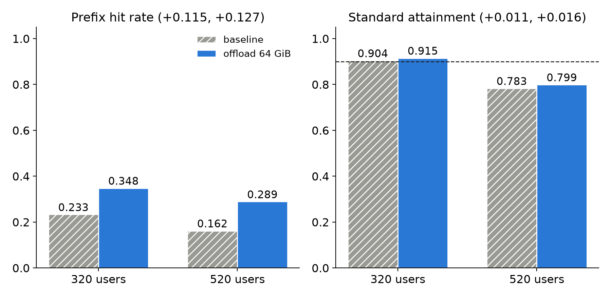

We turned on vLLM's native KV offload to host RAM on one L4. The prefix hit rate rose by 11.5 and 12.7 points at two loads, and the latency target did not move beyond noise.

## Key results

One L4, vLLM 0.30, FP8 KV cache, token budget 256, one seed per cell, noise 0.02 to 0.05 (measured).

| Users | Prefix hit, base / offload | Standard, base / offload | Strict, base / offload |
|---|---|---|---|
| 320 | 0.233 / 0.348 | 0.904 / 0.915 | 0.575 / 0.603 |
| 520 | 0.162 / 0.289 | 0.783 / 0.799 | 0.294 / 0.304 |

Failed requests: 0 in all four runs.

## 1. Symptom

Prefix caching skips the prefill of a prompt prefix already seen. When the GPU's KV pool is full, old blocks are dropped, and the next request with that prefix recomputes it. A host tier keeps those blocks in RAM so they can be copied back. We expected a higher hit rate to lower time to first token (TTFT) and raise attainment.

Standard tier: TTFT at most 1 s for chat, 2 s for rag and code; time per output token at most 50 ms; a request passes when it meets both.

## 2. What we expected

The saved prefill should shorten TTFT, so standard attainment should rise with the hit rate. Our first test at 320 users gave +0.011 standard (computed). Our first guess was that the GPU pool was too empty to matter, since vLLM reported KV usage of about 2 %. The +11.5-point hit gain at the same load means, in our reading, that the GPU still dropped blocks that were later restored from host, so that guess was weak. We then reran at 520 users, the high-load point of an earlier SGLang cache test.

## 3. What happened

### 3.1 How we found it

The change is two flags. Host hits are counted as cached tokens, so a hit-rate metric built from per-request cached tokens sees them.

```bash
vllm serve Qwen/Qwen3-4B-Instruct-2507-FP8 \
  --kv-cache-dtype fp8_e4m3 --enable-prefix-caching --enable-prompt-tokens-details \
  --gpu-memory-utilization 0.90 --max-model-len 32768 \
  --max-num-batched-tokens 256 --linear-backend triton \
  --kv-offloading-size 64 --kv-offloading-backend native   # the two new flags
```

We ran each load twice, with and without the flags, 20 min warm-up and a 10 min window.



*One seed per bar; dashed line = 0.90 pass rule.*

The hit gain was close to constant: +11.5 points at 320 users and +12.7 at 520 (computed). Attainment at 520 users moved +0.016 standard, +0.010 strict and -0.004 relaxed (computed), all inside noise.

An earlier test with SGLang's hierarchical cache (HiCache) and a 64 GB host pool, also one seed on one L4 at 520 users, gave a similar hit gain, 16.0 % to 29.2 %. There standard attainment did rise, from 0.582 to 0.770. The engines and baselines differ (0.582 against 0.783), so this pair cannot tell whether the larger gain belongs to HiCache or to a weaker starting point.

### 3.2 The cause

Our reading, not a profile: at 520 users standard sits at 0.78 and strict at 0.29, so most misses come from queueing, and the prefill that a hit saves is small next to the wait. We did not split TTFT into queue time and prefill time to confirm it.

## 4. Lesson

A higher hit rate is an input to latency, and on its own it proves nothing about the SLO. Before enabling a cache tier, estimate what a hit saves in milliseconds and compare it with the queue wait you see at the target load. If the wait is larger, expect the tier to move the cache metric and leave attainment where it was.

```python
def saved_vs_queue(records):
    """Median prefill time saved by cache hits against median queue wait; records carry cached_tokens, prefill_s, queue_s."""
    hit = [r for r in records if r.cached_tokens > 0]
    saved = sorted(r.prefill_s for r in hit)[len(hit) // 2]
    wait = sorted(r.queue_s for r in records)[len(records) // 2]
    return saved, wait
```

## 5. Limits

One seed per cell, so a real gain of about 0.02 would be invisible. We tested two loads on one L4 with one model; the `lmcache` backend of the same flag, other loads and a prefill-heavy mix were not tested. The HiCache comparison crosses engines and baselines. We never measured queue time against prefill time, so Section 3.2 is a hypothesis. The cost was about $2 per pair of runs (estimate).

## 6. Reproduce

Our runs, October 2026: vLLM 0.30.0, Qwen3-4B-Instruct-2507 FP8 weights, FP8 KV cache, one L4 24 GB.

1. Server: the command of Section 3.1 with and without the two offload flags. The offload tier maps 64 GiB of shared host memory, so give the offload container about 96 GiB of RAM.
2. Load: closed-loop users that stream every token, with a lognormal think time (median 116 s, cut at 3,600 s); 320 and 520 users, 20 min warm-up, 10 min window, one seed.
3. Metrics: prefix hit as cached tokens (`usage.prompt_tokens_details.cached_tokens`) over prompt tokens; attainment with the tiers of Section 1, a load passing when 90 % of requests pass.
4. Cost: about 0.7 GPU hours per run, about $2 per baseline-plus-offload pair (estimate).

## 7. Sources

- vLLM docs, automatic prefix caching: https://docs.vllm.ai/en/latest/design/prefix_caching/.
- vLLM docs, KV offloading: https://docs.vllm.ai/en/latest/features/kv_offloading_usage.html.
- SGLang docs, HiCache design: https://docs.sglang.io/advanced_features/hicache_design.html.
- PagedAttention (Kwon et al., 2023); RadixAttention/SGLang (Zheng et al., 2023).
- Our runs, October 2026: per-request records behind every measured number above.


Written with Claude Code. Numbers checked against the runs under Sources.
