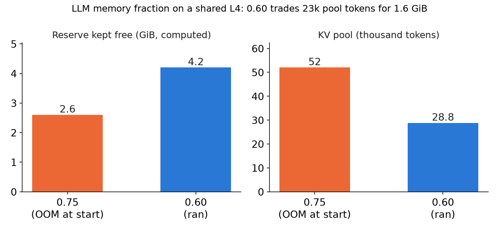

We put three SGLang processes on one L4 with about 22.5 GiB usable: an embedding model, a vision-language model (VLM) and the LLM. With the LLM at memory fraction 0.75 it crashed at start-up; at 0.60 it started, and its KV pool was too small.

## Key results

- Fraction 0.75, LLM started last: out of memory in CUDA-graph capture, 0.52 GiB free, KV pool 3.56 GB (52k tokens).
- Fraction 0.60: starts; reserve 4.2 GiB instead of 2.6 GiB (computed from 10.5 GiB free); KV pool 28.8k tokens, 98 % used, queue up to 11.
- LLM standard attainment with the VLM: 0.508 ± 0.028 (3 seeds), against 0.904 ± 0.020 without it (137k-token pool, 0.75).

## 1. Symptom

The first attempt was cancelled; the second died while the LLM captured CUDA graphs: `CUDA out of memory, tried to allocate 512 MiB`, with 0.52 GiB free.

## 2. What the fraction means

In SGLang, `--mem-fraction-static` sets how much of the GPU a process may take for weights plus KV pool. Our reading of the engine code: the process keeps (1 - fraction) x (memory free when it starts) and gives the rest to weights and pool. Processes started earlier shrink what the later ones see. Activations, CUDA graphs and the CUDA context must fit in the reserve.

The log of the failed start gives the walk. The LLM, started last, saw 10.5 GiB free. At 0.75 it may take 0.75 x 10.5 = 7.9 GiB for weights and pool; the weights took 4.3 GB, which leaves about 3.6 for the pool. The log showed 3.56 GB, 52k tokens at 72 KiB per token (computed: 36 layers x 8 KV heads x 128 x 2 x 1 byte for FP8). The reserve is 0.25 x 10.5 = 2.6 GiB (computed). We had planned as if little else needed memory after the pool. In fact about 2.1 GiB went to other allocations (from the log), and only 0.52 GiB was left at graph capture.

At 0.60 the same walk gives 0.60 x 10.5 = 6.3 GiB, about 2.0 for the pool, about 29k tokens; the log showed 28.8k. The reserve grows to 0.40 x 10.5 = 4.2 GiB (computed).

```bash
# order matters: each process keeps (1 - fraction) of what is free at its start
python -m sglang.launch_server --model-path <embedding> --is-embedding --mem-fraction-static 0.12
python -m sglang.launch_server --model-path <vlm>       --mem-fraction-static 0.40
python -m sglang.launch_server --model-path <llm>       --mem-fraction-static 0.60   # was 0.75
```

## 3. What each setting trades

Pool size against headroom. The two-process setup (embedding at 0.12, LLM at 0.75, started second) gave a 137k-token pool. The three-process setup gave 52k tokens at 0.75 and 28.8k at 0.60. We have no record of the free memory at the LLM's start in the 0.60 run; the pool fits 10.5 GiB again (our reading), but the two sizes are not a measured pair.



*Reserve computed from the 10.5 GiB free logged at the failed start, assumed the same at 0.60; 52k tokens from that log, 28.8k measured.*

Our earlier runs at 225 users peaked at 15k to 28k tokens of KV, 11 to 15 % of their 137k to 200k pools (from the logs). A 28.8k pool sits at that peak. The log showed it 98 % used with a queue of 11 requests, so the pool was the bound. We first claimed the peak was about 1.4k tokens; that was wrong, and we corrected it.

The VLM also took GPU time: about one VLM request was decoding at any moment (computed: 0.05 requests per second x about 15 s each). The processes share the GPU by time-slicing, and this run cannot separate the two causes. We dropped a rerun at 0.70.

## 4. Lesson

Write the memory split as arithmetic before launching: reserve = (1 - fraction) x free at start, for each process in start order. Then check the pool it leaves against your measured peak, not a guess. Here the larger reserve fixed the crash and left a pool no larger than the workload's peak.

## 5. Limits

One cancelled and one OOM attempt, then a single 0.60 configuration; 0.65 and 0.70 were not run. The 0.75 run with two processes and the 0.60 run with three differ in more than the fraction. The reserve numbers are computed from one logged free-memory value. Each lost attempt cost about $0.15, and the three-seed 0.60 run about $0.9 (estimates).

## 6. Reproduce

Our runs, October 2026: SGLang 0.5.20, one L4 24 GB, Qwen3-4B-Instruct-2507 FP8 as LLM, Qwen3-Embedding-0.6B (bf16) and Qwen3-VL-4B-Instruct FP8 beside it, no MPS (GPU time-slicing).

1. Start the processes in the order of the command block, each waiting for health before the next. LLM flags: `--kv-cache-dtype fp8_e4m3 --chunked-prefill-size 256 --enable-mixed-chunk --attention-backend flashinfer`. Embedding: `--disable-radix-cache --context-length 2048`. VLM: `--disable-radix-cache --context-length 8192 --max-running-requests 16`.
2. Read the pool and free memory from each server log at start-up (`max_total_num_tokens`, free GiB).
3. Load: 225 closed-loop LLM users with think time, 3 seeds, 600 s window; open-loop VLM requests at 0.05 per second (one 1024 x 1024 image, 200 text tokens, 300 output tokens); 512-token embedding calls at 0.2 per second.
4. Watch KV-pool use and queue length during the run.
5. Cost: about $0.9 for the three seeds on one L4 (estimate).

## 7. Sources

- SGLang server arguments (`--mem-fraction-static`): https://docs.sglang.io/advanced_features/server_arguments.html.
- Qwen3-4B-Instruct-2507 FP8 model card: https://huggingface.co/Qwen/Qwen3-4B-Instruct-2507-FP8.
- Qwen3-VL-4B-Instruct model card: https://huggingface.co/Qwen/Qwen3-VL-4B-Instruct.
- Our runs, October 2026: server logs and per-request records behind every measured number.


Written with Claude Code. Numbers checked against the runs under Sources.
