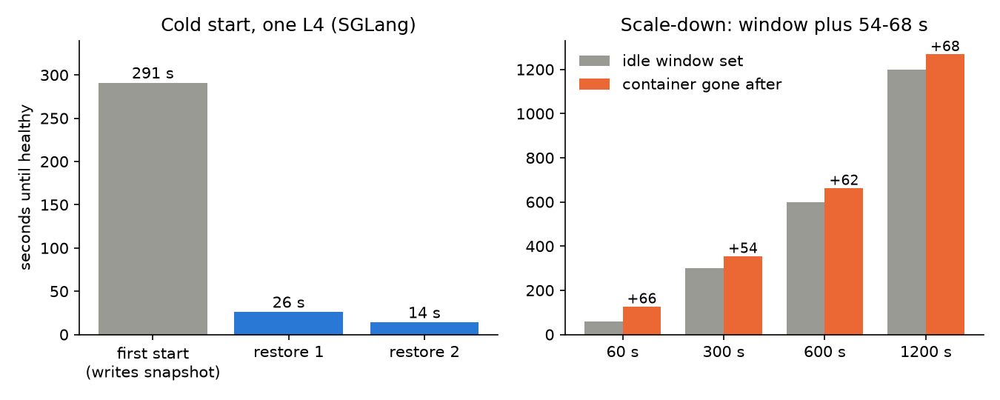

We ran our L4 benchmarks on a serverless GPU platform (Modal) to pay only while a run was alive. A sleeping laptop, preemption, a default timeout and cold starts each cost us time or money.

## Key results

- Laptop clamshell sleep cancelled two runs about 2 min after the lid closed.
- Cold start of one SGLang replica on an L4: about 257 s; 291 s for the start that also writes a GPU memory snapshot (alpha feature); 26 s and 14 s on two restores from it.
- Idle window 60 / 300 / 600 / 1,200 s: container gone after 126 / 354 / 662 / 1,268 s.
- Default function timeout 300 s; we set 3,600 s.
- At 1,000 parallel streams, 13 % failed from a laptop; from a container in the same region at most 0.3 % at any level.

## 1. Symptom

Two runs ended with "Received a cancellation signal" and "Runner terminated", each about 2 min after the laptop went to sleep (power log at 00:23 and 21:58 local time). The first had run about 40 min of L4, about $0.7 (estimate), and lost its last load level and its report step.

## 2. What we expected

We expected a job started with `modal run --detach` to survive the client. It did not: the remote call was owned by the local process, so sleeping the laptop cancelled it.

## 3. What happened

### 3.1 Cancellation and preemption

Every GPU function there is preemptible: a preempted container restarts with the same input, and our first version started over. One run was preempted about 12 min into validation; the restart re-ran recording, and the original deadline left 22 min, so validation was skipped. On one 4 x L4 run, three failed attempts cost about $2.6 (estimate) before the attempt that finished, which cost about $5.1.

Two fixes. The session now spawns the run and exits (`.spawn()` instead of waiting on `.remote()`), and the restart reads a state file: finished steps are skipped, the deadline counts from the first start, and the Volume (the platform's persistent disk) commits every 60 s instead of 5 min. Resume worked on a later real preemption. A killed attempt is still billed; resume saves only the repeat. The spawn fix still needs a run that kills the client on purpose.

### 3.2 Timeouts and region

The default function timeout is 300 s. With 3,600 s set, test streams of 1 to 30 min all finished; at the default our probe would have measured the timeout.

Latency tests from a laptop mislead. At 1,000 parallel streams, 13 % failed from the laptop, all client-side connection errors; from a container in the same region at most 0.3 % failed at any level from 100 to 1,000. Through the platform's web endpoint, a real SGLang engine's first token came +0.13 s later at p50 with the GPU in the caller's region and +0.2 to 0.5 s later when the GPU landed elsewhere (two runs, two regions). Time per output token matched a direct call.

### 3.3 Cold start and idle window

Earlier logs showed a replica needing 220 to 270 s (SGLang) or 270 to 420 s (vLLM); we had assumed 3 min. On a real L4 with snapshot mode on, the first start took 291 s: it also warms up with 3 chats and writes the snapshot. A later run put a start without a snapshot at about 257 s. Two restores from the snapshot took 26 s and 14 s. A redeploy invalidates the snapshot, so the next start pays the full 291 s again.

*Measured. Cold start: one L4, one measurement each. Idle window: a CPU probe, one container per setting.*

The idle window is a floor. Setting 60 s, the container was gone after 126 s. Across four settings a container lived 54 to 68 s past its window (computed), about one extra billed minute per idle period.

## 4. Lesson

Treat the client as unreliable and the container as killable. Detach the job, checkpoint every step, and anchor the deadline to the first start so a restart cannot overspend. Read every default, such as the 300 s timeout, before trusting a long measurement, and probe latency from the GPU's region.

## 5. Limits

The cold starts are one measurement each on one L4, cost about $0.17 (estimate). Snapshot billing was not visible in the bill; several simultaneous containers were untested. The idle-window probe used a fake engine on CPU. We never found out why one restart re-ran a step it had already finished.

## 6. Reproduce

Our runs, October 2026: Modal SDK 1.6.1, L4 GPU, SGLang 0.5.20 and vLLM 0.30.0.

1. Launch with `modal run --detach` and a function that spawns the long job; poll its logs. Set `timeout=` explicitly.
2. Write a state file of finished steps and the first-start time to the Volume; commit it often.
3. Cold start: time from container start to the first healthy chat reply. Idle window: set `scaledown_window`, stop sending, poll the container list.
4. Probe latency from a container in the same region as the GPU.

## 7. Sources

- Modal docs: GPU guide https://modal.com/docs/guide/gpu, preemption https://modal.com/docs/guide/preemption, "truly serverless GPUs" https://modal.com/blog/truly-serverless-gpus.
- Our runs, October 2026: session logs, a CPU probe and L4 checks behind every number above.

Written with Claude Code. Numbers checked against the runs under Sources.
