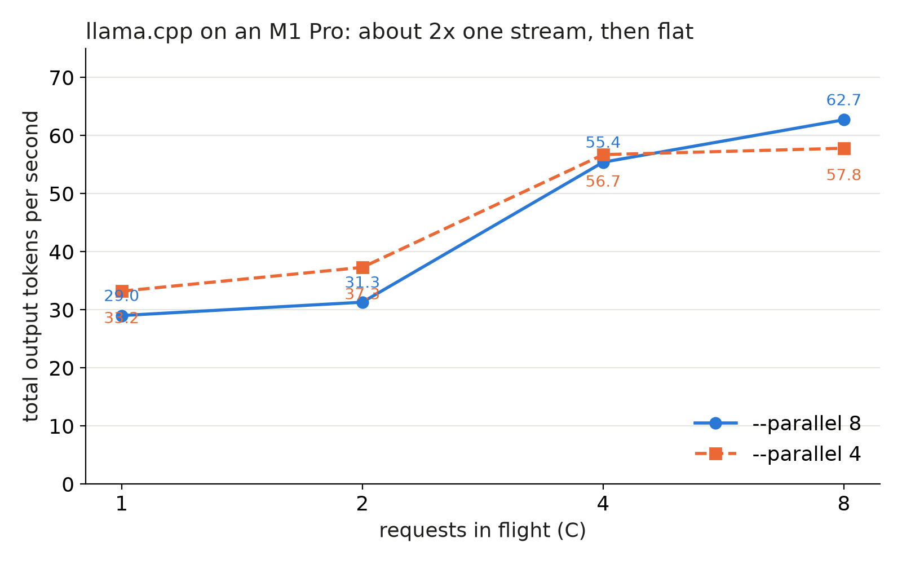

A laptop is the cheapest server we own, so we measured it before renting anything. llama.cpp's `llama-server` on an M1 Pro (16 GB) decoded 29 tokens per second for one request and topped out near 63 for eight.

## Key results

- 1 request: 29.0 tokens/s total, TTFT p50 0.75 s (`--parallel 8`).
- 8 requests: 62.7 tokens/s total, 9.3 per request, TTFT p50 5.27 s.
- `--parallel 4` and `--parallel 8` saturate at about the same total (57.8 and 62.7 at 8 requests); 0 errors in all cells.
- Cost if we rented a cloud Mac: about $3.89 per 1M output tokens at full load (computed from the list price and our M1 Pro speed; the rented M2 was not measured).

## 1. Symptom

We wanted a floor for "small model, small box". The question was whether a Mac could stand in for a GPU pool under load. The answer came from the totals: past 4 requests in flight they barely grow (55.4 to 62.7 tokens per second), so extra users mostly get slower.

## 2. What we expected

Our reading before the run: decode on Apple silicon is bound by memory bandwidth, since each token reads the whole 4-bit model (2.5 GB). Batching should add throughput, as on a GPU, but the one GPU also runs prefill, so the ceiling should come early. We did not model it further.

## 3. What happened

### 3.1 Setup and method

```bash
llama-server -m Qwen3-4B-Instruct-2507-Q4_K_M.gguf \
  -ngl 99 --flash-attn --cont-batching -c 16384 --parallel 8 --port 8099
```

llama.cpp build 5150 from Homebrew, Metal backend, macOS 15, otherwise idle machine. The load was a closed loop: C streaming chats in flight, 16 per level, about 200-token prompts with a unique prefix, `max_tokens=256`, one warm-up request, one run per cell. A custom script is needed for this; it only has to time the first and last token of each stream.

### 3.2 Numbers



*Measured, one run per point, same load for both lines.*

| `--parallel` | C | TTFT p50 | total tok/s | per request tok/s |
|---|---|---|---|---|
| 8 | 1 | 0.75 s | 29.0 | 31.9 |
| 8 | 4 | 2.70 s | 55.4 | 16.1 |
| 8 | 8 | 5.27 s | 62.7 | 9.3 |
| 4 | 8 | 20.19 s | 57.8 | 16.8 |

One stream decoded 32 to 36 tokens per second, so the 62.7 total is about 2x one stream (computed: 62.7 / 31.9 = 1.97). TTFT grew by about 0.65 s per extra request. Our reading: prompts are prefilled one after another on the same GPU that decodes, so each new user waits behind the others' prefill. At 8 requests a user waited 5 s for a first token.

`--parallel 4` with 8 requests in flight left four requests queued, so its 20 s TTFT is queue time. Its total, 57.8 tokens per second, was close to the 62.7 of `--parallel 8`; the extra slots mainly cut TTFT. At 2 requests the total barely moved from 1 request in both runs (31.3 against 29.0 and 37.3 against 33.2); we did not repeat it, so it may be noise.

### 3.3 Renting a Mac

An EC2 `mac2-m2.metal` host costs about $0.878 per hour with a 24-hour minimum, so a short test costs about $21. At 62.7 tokens per second the cost is 0.878 / (62.7 x 3,600 / 1e6) = $3.89 per 1M output tokens (computed). This is a floor: it assumes the host is busy 24 hours a day, and it uses the M1 Pro speed as a stand-in because we did not measure the M2. We did not rent one.

## 4. Lesson

A Mac with llama.cpp fits a small local pool for development or low load. It is a poor replacement for a GPU under load: the total stops at about 2x one stream and the per-user speed drops from 16.1 to 9.3 tokens per second between 4 and 8 requests. Measure the total at 1, 4 and 8 requests in flight before you pick `--parallel`; past the knee, extra slots buy only TTFT.

## 5. Limits

One run per cell and one machine, so read the ranking and not the decimals. The model was a 4-bit GGUF of Qwen3-4B-Instruct-2507, not the weights our GPU pool serves, and we did not check quality. We did not measure an L4 with this load script, so these numbers are not compared with any GPU. Also not measured: MLX, other quantisations, longer prompts, power draw, thermal throttling in long runs.

## 6. Reproduce

Our runs, October 2026: llama.cpp build 5150, `unsloth/Qwen3-4B-Instruct-2507-GGUF` Q4_K_M (2.5 GB), M1 Pro 16 GB.

1. Server: the command of Section 3.1, once with `--parallel 8` and once with `--parallel 4`.
2. Load: closed loop at C = 1, 2, 4 and 8 requests in flight, 16 streaming chats per level, about 200-token prompts with a unique prefix, `max_tokens=256`, one warm-up request; record TTFT and output tokens per second.
3. Cost: minutes on a laptop; electricity only.

## 7. Sources

- llama.cpp server documentation: https://github.com/ggml-org/llama.cpp/tree/master/tools/server.
- Qwen3-4B-Instruct-2507 GGUF (unsloth): https://huggingface.co/unsloth/Qwen3-4B-Instruct-2507-GGUF.
- AWS EC2 Mac instances and Dedicated Host pricing: https://aws.amazon.com/ec2/instance-types/mac/.
- Our runs, October 2026: per-level logs behind every measured number above.


Written with Claude Code. Numbers checked against the runs under Sources.
