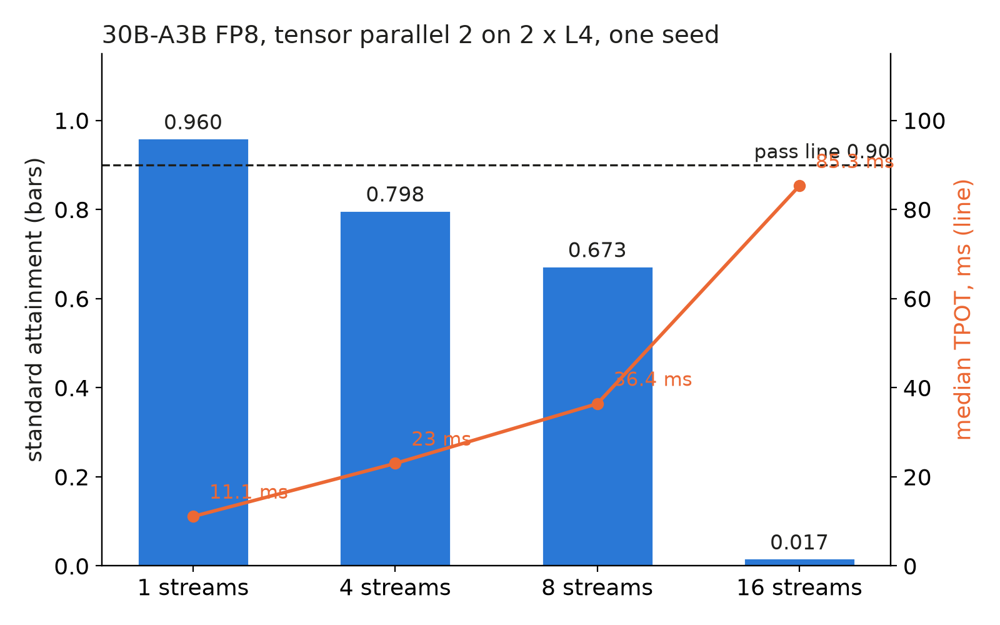

A mixture-of-experts (MoE) model activates only a few experts per token, so a 30B model can decode like a 3B one. We tried Qwen3-30B-A3B in FP8 on two 24 GB L4s: a single stream was twice as fast as our 4B dense model, but the first capacity level, 160 users, already failed.

## Key results

- Single stream (tensor parallel 2): TPOT 11.1 ms, 67 tok/s; our 4B dense model on one L4 ran at about 22 ms in earlier runs (43-46 tok/s).
- Probe at 1, 4, 8, 16 streams: standard attainment 0.960, 0.798, 0.673, 0.017; at 16 streams TTFT p50 was 2.7 s.
- Capacity search, first level, 160 users: standard 0.669, strict 0.421, relaxed 0.890. Our 4B on the same two L4s, run as two replicas behind a router, held the standard tier at 640 users.
- Total cost: about $1.9, the sum of two run estimates; one seed throughout.

## 1. Symptom

Standard tier: time to first token (TTFT) at most 1 s for chat, 2 s for rag (retrieval-augmented) and code; time per output token (TPOT) at most 50 ms. A load level passes when 0.90 of requests meet both.

The search started at 160 users and failed there (0.669). With no passing level the capacity edge is only known to be below 160.

## 2. What we expected

The model has 128 experts, 8 used per token, 30.5 B parameters in total and 3.3 B active. FP8 weights take about 31 GB, so 15.5 GB per GPU when split in two (computed). That leaves under 8.5 GB of each 24 GB card for the KV cache and activations (computed upper bound). The 4B dense model decoded at about 22 ms per token in our earlier single-stream runs, so a 3.3 B-active model should decode at least as fast. We set a drop rule before running: if a single stream was far slower than the 4B, skip the capacity search.

## 3. What happened

We served it with SGLang (an open-source serving engine) in two layouts: tensor parallel 2 (`tp2`, every layer split across both GPUs) and tensor plus expert parallel 2 (`ep2`, 64 experts per GPU, tokens routed between them). Closed-loop streams, zero think time, 60 s per level.

| streams | tp2 TTFT p50 | tp2 TPOT p50 | tp2 tok/s | tp2 standard | ep2 TPOT p50 |
|---|---|---|---|---|---|
| 1 | 91 ms | 11.1 ms | 67 | 0.960 | 12.1 ms |
| 4 | 254 ms | 23.0 ms | 93 | 0.798 | 24.8 ms |
| 8 | 419 ms | 36.4 ms | 144 | 0.673 | 38.6 ms |
| 16 | 2,703 ms | 85.3 ms | 106 | 0.017 | 87.2 ms |


`tp2` beat `ep2` at every level, so the capacity search used `tp2`. The single stream passed the drop rule at half the 4B's TPOT. Under load it grew fast: 36.4 ms at 8 streams, and at 16 streams throughput fell from 144 to 106 tok/s.



*Probe, one seed per level, think time 0; line = median TPOT.*

The capacity search then ran the real workload mix with think time. At 160 users it measured 44 tok/s, far below the 144 the probe reached; our reading is that decode throughput was not the limit. The setups differ: the 4B number comes from two single-GPU servers behind a length-aware router, the MoE from one server across both GPUs. With that caveat, the gap in users is at least 4x (640 against under 160, computed).

We did not profile the run. Our reading is that the misses came from TTFT: long prompts prefill in 256-token chunks, every chunk pays for traffic over PCIe between the two GPUs, and first tokens queue past the limit.

## 4. Lesson

A fast single stream says little about capacity. Active parameters set decode speed at one stream; with a PCIe-only pair of cards, splitting each layer across GPUs adds communication to every step and to every prefill chunk. Run a concurrency probe (1, 4, 8, 16) before a capacity search, and read the TTFT column as closely as TPOT.

## 5. Limits

One seed per level, and a single capacity level: we did not search below 160 users, so the real edge is unknown. A shorter prefill chunk, a larger one, or a different parallel layout might move it; none was tried. We compared no answer quality, so the question of whether 30B answers beat 4B answers is open. INT4 on one L4 and a four-GPU layout with two 30B replicas were not run.

## 6. Reproduce

Our runs, October 2026: SGLang with Qwen3-30B-A3B-Instruct-2507 FP8, two L4 24 GB.

```bash
python -m sglang.launch_server --model-path <Qwen3-30B-A3B-Instruct-2507-FP8> \
  --tp-size 2 --attention-backend flashinfer --sampling-backend flashinfer \
  --enable-mixed-chunk --kv-cache-dtype fp8_e4m3 --chunked-prefill-size 256
# ep2 variant: add --ep-size 2
```

Load: closed-loop streams, concurrency 1/4/8/16, zero think time, 15 s warm-up, 60 s window, at least 100 requests, seed 0. Capacity: users with think time, start at 160, standard tier. Download the 31 GB of weights first on CPU, so GPU time is not spent on it. Cost: the probe about $0.9 and the capacity search about $1.0 (estimates).

## 7. Sources

- Qwen3-30B-A3B-Instruct-2507 model card: https://huggingface.co/Qwen/Qwen3-30B-A3B-Instruct-2507.
- SGLang server arguments: https://docs.sglang.io/advanced_features/server_arguments.html.
- Our runs, October 2026: per-request records behind every measured number above.


Written with Claude Code. Numbers checked against the runs under Sources.
