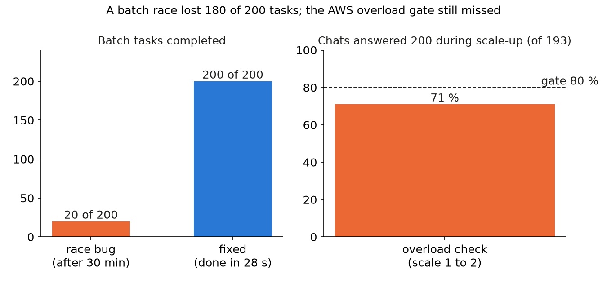

We tested the front of a serving endpoint (gateway, batch API, scaler) on a fake engine, then ran it against a real L4 pool on Modal (a serverless GPU platform): first from a laptop, then on AWS Lambda. The logic worked; five bugs no fake test had shown came up.

## Key results

- Batch race (front on a laptop, real pool): 20 of 200 tasks done after 30 min; after the fix, 200 of 200 in 28 s.
- Stale scaler memory: 0 containers for 10 min; fixed by re-sending the target, at most every 60 s.
- Lambda quota: 10 concurrent executions raised to 1,000.
- After all fixes, the overload check on AWS still missed its gate: 71 % of 193 chats answered, gate 80 %.

## 1. Symptom

Five faults, all found by running on real services.

| Fault | What we saw | Cause | Fix |
|---|---|---|---|
| Terraform permission | two permission resources timed out and conflicted | a public Function URL adds its own access statements | removed ours |
| Terraform name | scaler env names came out as `//MODAL_TOKEN_ID`, `Token missing` | `replace(p, "/x/", "")` is a regex, not a string | an explicit name map |
| Lambda quota | throttles in gateway, worker, batch API | account limit of 10 concurrent executions, shared with other functions | quota to 1,000 |
| Batch race | 20 of 200 tasks done in 30 min, queue empty, batch stuck IN_PROGRESS | see 3.1 | 2 s retry |
| Stale target | pool at 0 containers for 10 min | see 3.2 | re-send target |

## 2. What we expected

We expected the fake engine, which passed 5 of 5 chaos checks, to predict the real stack. Its queue delivers at once, its replicas live inside the scaler, and it has no quota.

## 3. What happened

### 3.1 The batch race

The batch service queued a batch's tasks before it moved the batch to IN_PROGRESS. A worker already polling saw a task while its batch was still VALIDATING, dropped it and acknowledged it. A real queue send takes time; the in-memory one never did.

On a real pool: 20 of 200 done after 30 min, the rest lost, chats unaffected. The fix sends such a task back with a 2 s delay while its batch is younger than 5 min. After it, 200 of 200 finished in 28 s.

```python
def handle(task, batch):
    if batch.status == "VALIDATING" and batch.age_s < 300:
        queue.release(task, delay_s=2)   # not ready yet: do not ack
        return
    run(task)
    queue.ack(task)
```

### 3.2 The stale scaler memory

The scaler stores its replica target in a database item. After we stopped and redeployed the pool, the platform's minimum was 0 again, but the item still said target 1 from days earlier. The scaler wrote the target only at its first look. Result: 0 containers for 10 min, ticks running normally.

We first suspected the pool's memory snapshot; the SDK reports ready only after post-snapshot start-up, so we ruled that out. The fix re-sends the target, at most every 60 s, while ready replicas are below it.

### 3.3 What still failed

After the fix, the scaler went 0 to 1 replica within 17 s of the first refusals. Three gates still missed (single runs):

- Overload: capacity grew 8 to 16 as designed, but 71 % of 193 chats got 200 (gate 80 %). The gateway has no queue, so extra callers got 503 while capacity was 8.
- Batch plus chat: 194 of 200 tasks in 1,800 s, 0 failed, chats 100 %; worker concurrency was 2.
- Idle: capacity reached 0, but 2 samples showed capacity 8 with 0 ready replicas, a lag of 1 to 2 scaler ticks.

A fresh deploy also invalidated the pool's memory snapshot: the first replica took about 291 s, while the gateway waits only 90 s.



*Measured, one run each. Separate checks: the race ran with the front on a laptop, the overload check on AWS Lambda; both on a Modal L4 pool.*

## 4. Lesson

A fake passes what it can model. Test the seams it cannot: delayed delivery between queue and state, and stored state that outlives what it describes. Re-assert a stored target against the platform's real count.

Request quotas before the first load test; a limit of 10 looked like a bug in three services.

## 5. Limits

Every number is one run. That the 71 % comes from the missing queue is our reading; we did not rerun with a queue or a warm snapshot. The race fix was verified on a pool behind a laptop stack, not on AWS.

## 6. Reproduce

Our runs, October 2026: Terraform on AWS Lambda (Function URLs, SQS, DynamoDB, EventBridge schedules), Python 3.12, in front of an SGLang pool on Modal, one L4 per replica (8 slots, at most 4 replicas).

1. Race: create a batch of 200 tasks against a real queue, with a worker already polling; count completions after 30 min.
2. Stale target: stop the pool, redeploy, and watch ready replicas against the stored target for 10 min.
3. Load: closed-loop chat callers during scale-up; gate on the share answered with 200.
4. Cost: about $4.5 of Modal GPU time for the day of real-pool checks that found the race and verified its fix (estimate); AWS cost not measured.

## 7. Sources

- AWS Lambda Web Adapter: https://github.com/awslabs/aws-lambda-web-adapter
- Terraform `replace` function: https://developer.hashicorp.com/terraform/language/functions/replace
- Our runs, October 2026.


Written with Claude Code. Numbers checked against the runs under Sources.
