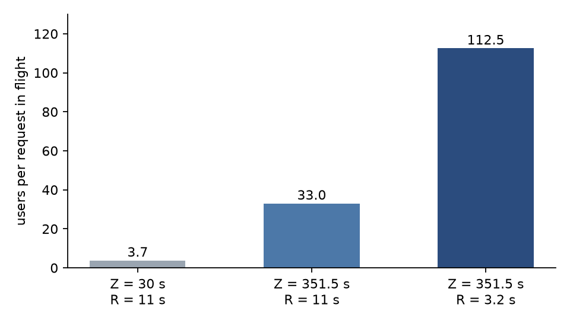

## Key results

| | early synthetic load | assistant mix |
|---|---|---|
| mean think time | 30 s | 351.5 s |
| response time R | 11 s | 3.2 s (computed) |
| users per request in flight | 3.7 | about 112 (computed) |
| level length | 300 s | 30 s warm-up, 600 s window, 3 seeds |

Users at an edge are comparable only when think time matches: 16 users at 30 s and 225 users at 351.5 s are different loads, not a 14 times gain.

## 1. The question and the rule

How many users does one GPU carry? We answer in users, because a user is a closed loop: it sends a turn, waits for the answer, thinks, and sends again. Requests per second is an output of that loop, not an input. When the server slows down, a closed-loop user sends less, as a person would. A fixed requests-per-second generator keeps pushing and measures a queue, not a service.

The rule: quote capacity as users, and always with the think-time distribution beside it.

## 2. A calculation with round numbers

Little's law links users U, requests in flight C, response time R and think time Z:

```
U = C x (R + Z) / R
C = 4, R = 2 s, Z = 100 s  ->  U = 4 x 102 / 2 = 204
C = 4, R = 2 s, Z =  10 s  ->  U = 4 x  12 / 2 =  24
```

The same 4 requests in flight serve 204 or 24 users (hypothetical numbers). The user count alone says little about the server; the ratio (R + Z) / R carries the load.

## 3. The load generator

No standard tool runs think-time users and scores latency tiers, so a custom script is needed. This sketch is generic:

```python
import asyncio, random, time

async def user(send, think, window, records, seed):
    rng = random.Random(seed)                       # one stream per user: reproducible
    await asyncio.sleep(rng.uniform(0, think(rng)))  # start partway through a think time
    history = []
    while not window.stopped:
        prompt = history + [next_turn(rng)]
        t0 = time.monotonic()
        ttft, n, answer = None, 0, ""
        async for tok in send(prompt):              # streaming reply
            ttft = ttft or time.monotonic() - t0
            n, answer = n + 1, answer + tok
        total = time.monotonic() - t0
        records.append(dict(t=t0, ttft=ttft, n=n, tpot=(total - ttft) / max(n - 1, 1) if ttft else None))
        history = prompt + [answer]
        await asyncio.sleep(think(rng))             # think time Z

async def run(send, users, think, warmup, measure, seed):
    window, records = Window(warmup + measure), []
    await asyncio.gather(*(user(send, think, window, records, seed * 100_000 + i) for i in range(users)))
    return [r for r in records if warmup <= r["t"] - window.t0 < warmup + measure]
```

`Window` is a small helper that sets `stopped` after the duration and records its start `t0`; only requests sent inside the measurement window are scored.

## 4. Warm-up, window and seeds

A fresh start puts every user at the same phase, so short thinkers cycle many times before long thinkers return. We saw this: a validation at 214 users scored 0.42 attainment with a 30 s warm-up and a 900 s window (measured; the run never reached steady state). Its think times were uncut (mean 532 s) and every user started fresh, so the server saw 0.92 requests per second against 0.60 expected. The fix cut think times at 3,600 s and started each user partway through a think time, as it would be in steady state.

Our final levels used a 30 s warm-up and a 600 s window. A level passes when mean minus standard deviation over 3 seeds, each a different random request stream, reaches 0.90 attainment. Near the edge the seed-to-seed sd on the standard tier was 0.017 to 0.021 (measured, 3 seeds), and one single-seed run read 0.956 where the three-seed mean was 0.906. We therefore do not read gaps under about 3 points (our rule).

## 5. The think-time change

Our first load used synthetic requests with Z = 30 s, and carried 16 users at the standard tier. We then fitted Z to gaps in a public chat trace: median about 103 s, gaps over 3,600 s dropped as a new visit, mean 351.5 s. The same server then served about 225 users.



*Figure 1. Users carried by one request in flight, (R + Z) / R, computed from measured R and the two mean think times.*

At the 225-user edge the server held 1.7 to 2.2 requests in flight (measured, mean over seeds), so R = 2 x 351.5 / 223 = 3.2 s and each request stood for about 112 users (computed, 225 / 2). Think time alone gives a factor 8.8; the shorter R is the rest. Our other changes (precision, flags, shorter answers) also shortened R and these runs cannot separate them.

Little's law on the mean also over-predicts. At 498 predicted users, standard attainment was 0.76 (measured, 1,197 requests, 15 min window). Our reading: heavy-tailed think times make C burst above its mean, and the bursts miss the 50 ms TPOT limit.

## 6. Limits

- Z is fitted from request gaps in a public trace; no trace records think time directly.
- The 16 users and 225 users come from different workloads, so no single factor is the cause.
- The 30 s warm-up was not swept.
- Open-loop and burst arrivals were not tested.

## 7. Reproduce

Our runs, September and October 2026, one NVIDIA L4, SGLang 0.5.20. Run the Section 3 loop against a streaming endpoint (`/v1/chat/completions` with `stream=true`) with a lognormal Z (median 116 s, mean about 352 s, cut at 3,600 s), a 30 s warm-up, a 600 s window and seeds 1 to 3. Score each request as a pass when time to first token and time per output token are inside the tier. Level cost: about 10.5 minutes of one GPU per seed (computed, 30 s + 600 s) plus engine start.

## 8. Sources

- Little, "A Proof for the Queuing Formula: L = λW", Operations Research 9(3), 1961.
- Wang et al., "BurstGPT: A Real-world Workload Dataset to Optimize LLM Serving Systems", 2024: https://arxiv.org/abs/2401.17644.
- Schroeder, Wierman, Harchol-Balter, "Open Versus Closed: A Cautionary Tale", NSDI 2006.
- Our runs, September and October 2026.


Written with Claude Code. Numbers checked against the runs under Sources.
