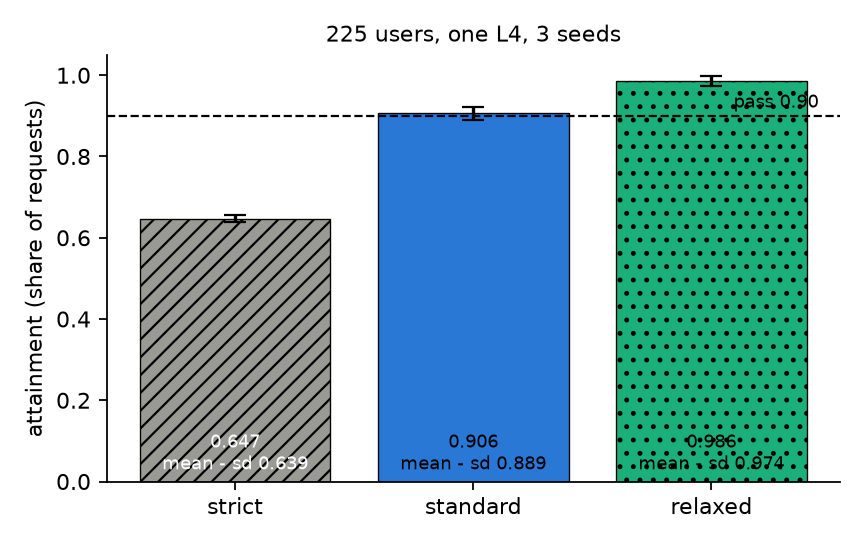

"How many users does this server carry" has no answer until we fix what counts as served. We fixed it as the share of requests that meet their latency targets, and we call a user count the capacity when that share stays at 0.90 or above.

## Key results

- One L4, 225 users, 3 seeds: strict 0.647 ± 0.008, standard 0.906 ± 0.017, relaxed 0.986 ± 0.012.
- Standard at 225 users: mean minus sd is 0.889, so the level fails the rule.
- Same configuration, one seed: 0.956 at 225 users. One seed overstated it by 0.05.
- A router cap that rejected 14.9 % of requests moved standard from 0.838 to 0.751 when rejects were counted, and to 0.883 (computed) when they were not.

## 1. The rule

Every request has a class (chat, rag, code) and two latencies: time to first token (TTFT) and time per output token (TPOT). A tier is a pair of limits. Standard is TTFT 1 s for chat, 2 s for rag and code, and TPOT 50 ms; strict is 0.5 s, 1 s and 30 ms; relaxed is 2 s, 4 s and 100 ms. A request meets the tier only if both limits hold.

Attainment is met requests divided by all requests sent in the scoring window, failures and rejects included. A level passes when attainment is at least 0.90. With three seeds (different random request streams) the mean minus the sample standard deviation must reach 0.90, so a noisy level has to clear the line by its own spread.

## 2. Why the mean misleads

A mean hides the tail that users feel. Take 100 requests, hypothetical: 88 with TTFT 0.4 s and 12 with 4 s. The mean is 0.88 x 0.4 + 0.12 x 4 = 0.83 s, under the 1 s limit, yet only 88 requests meet it: attainment 0.88, a fail.

The same holds across classes. Over three seeds at 225 users, standard scored 0.92 for prompts under 1k tokens, 0.94 for 1-3k and 0.79 for 3k or more (measured). The 0.906 overall is a blend, so we also read the long-prompt class on its own. Why long prompts miss most, head-of-line blocking behind long prefills, is our reading.

The tier matters as much as the load. At the same 225 users the strict tier scored 0.647 and relaxed 0.986 (Figure 1): "capacity" without a tier is not a number.



*Figure 1. Attainment per tier at 225 users, mean and sd over 3 seeds. Dashed: the 0.90 pass line.*

## 3. Rejected and late requests

A rejected request is a miss in the denominator. If it were dropped from the count, a server could raise attainment by refusing work. At 1,500 users on four L4s, a router cap rejected 458 of 3,069 requests (0.149); standard attainment was 0.751 with rejects counted and 0.883 over only the 2,611 admitted (computed, 0.751 x 3,069 / 2,611), against 0.838 with no cap (one seed each). A request that never gets a first token also counts as failed. A request sent inside the window that finishes after it is still scored on its own latencies.

## 4. The noise band

Repeated runs of one configuration differ. The standard sd over three seeds was 0.017 at 225 users and 0.021 at 260; at 560 users it was 0.149. A single run at 225 users scored 0.956, the three-seed mean 0.906. We treat two single-seed configurations closer than about 0.02 to 0.05 as a tie, and a level within one sd of 0.90 as borderline (our rule).

Our edge: standard passes at 225 users only by the single-seed rule, and the three-seed rule fails it by 0.011. At 260 users it scored 0.886 ± 0.021 and fails. We call the capacity "about 225, borderline".

## 5. The computation

```python
from statistics import mean, stdev

def attainment(records, tier, t0, t1):
    """records: dicts with t_send, cls, ttft, tpot, failed (rejected counts as failed)."""
    win = [r for r in records if t0 <= r["t_send"] < t1]
    ok = [r for r in win if not r["failed"]
          and r["ttft"] <= tier["ttft"][r["cls"]] and r["tpot"] <= tier["tpot"]]
    return len(ok) / len(win)

def passes(per_seed, rule=0.90):
    if len(per_seed) == 1:
        return per_seed[0] >= rule
    return mean(per_seed) - stdev(per_seed) >= rule   # sample sd, n - 1
```

## 6. Limits

The 0.90 line and the tier limits are our choice, not a standard. Three seeds give a rough sd. Rejection numbers come from one seed at one load level. The long-prompt split is a measured breakdown, and "head-of-line blocking behind long prefills" is our reading of it.

## 7. Reproduce

Our runs, September and October 2026: closed-loop users with a lognormal think time (mean 351.5 s), a 30 s warm-up, a 600 s scoring window, 3 seeds, SGLang on one NVIDIA L4. Score every request the load generator sent, with the function of Section 5. A three-seed level runs 31.5 minutes of load (computed) plus engine start, so about 40 minutes of one L4 (estimate).

## 8. Sources

- Zheng et al., "SGLang: Efficient Execution of Structured Language Model Programs", NeurIPS 2024: https://arxiv.org/abs/2312.07104.
- Kwon et al., "Efficient Memory Management for Large Language Model Serving with PagedAttention", SOSP 2023: https://arxiv.org/abs/2309.06180.
- Our runs, September and October 2026: per-request records behind every measured number above.


Written with Claude Code. Numbers checked against the runs under Sources.
