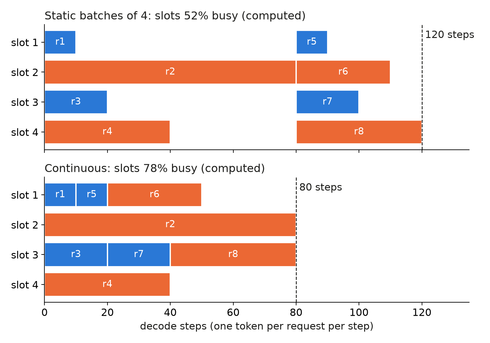
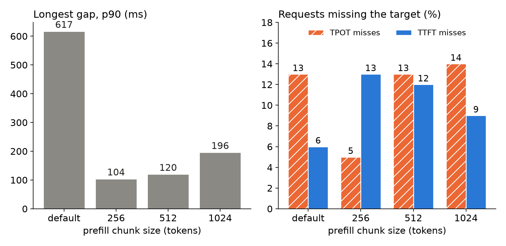

Eight requests want 10, 80, 20, 40, 10, 30, 20 and 40 answer tokens, and the GPU has 4 slots. If the engine waits for each group of 4 to finish, it needs 120 steps and the slots are busy 52 % of the time. If it refills a slot the moment one finishes, it needs 80 steps and the slots are 78 % busy (both computed, one token per request per step, lengths assumed). That refill rule is **continuous batching**. It creates a new problem, which **chunked prefill** solves and then partly re-creates; we measured both on one L4.

## Key results

| what | number | kind |
|---|---|---|
| 8 requests, 4 slots: static vs continuous | 120 vs 80 steps | computed, assumed lengths |
| longest gap between two tokens, p90, 450 users | 617 ms default chunk, 104 ms chunk 256 | measured, 1 seed |
| requests over the TPOT limit | 13 % default, 5 % chunk 256 | measured, 1 seed |
| requests over the TTFT limit | 6 % default, 13 % chunk 256 | measured, 1 seed |
| standard attainment, chunk 256 / 512 / 1024 | 0.84 / 0.80 / 0.82 (default 0.82) | measured, 1 seed |

## 1. Continuous batching

A decode step produces one token for every running request. A static batch holds all its requests until the longest one ends, so slots of short answers idle. Orca (Yu et al., 2022) schedules per step instead: finished requests leave and waiting ones join between steps. vLLM, SGLang and TensorRT-LLM all do this.



*Worked example: assumed answer lengths 10, 80, 20, 40, 10, 30, 20, 40; busy share and step counts computed.*

The catch: a newly joined request must first be read. This **prefill** processes the whole prompt in one pass and is compute-bound, while a decode step is memory-bound. On our L4 (Qwen3-4B, FP8) a 2,004-token prefill took 0.395 s and one decode step 21.6 ms (measured, single request).

## 2. The stall

If the 2,004-token prompt is prefilled in one step, every other request waits those 0.395 s for its next token. Take a 10-token answer with 9 gaps between tokens. One 0.6 s stall makes its time per output token (TPOT) 600 / 9 = 67 ms, over a 50 ms limit; a 300-token answer dilutes the same stall to about 27 ms (computed from our stall size).

At 300 users on the default chunking, 61 TPOT misses were examined: 54 had a single gap over 300 ms between two tokens. The median longest gap of answers over 100 tokens was 601 ms. By answer length, TPOT misses were 13 % for 5 tokens or fewer, 18 % for 6 to 20, 12 % for 21 to 100 and 2 % above 100 (measured, one seed). Short answers miss because one long prompt landed in their window, so fewer users would not fix it.

## 3. Chunked prefill

The fix (Sarathi-Serve, Agrawal et al., 2024): cap the prompt tokens read per step. A 2,004-token prompt at a 256-token chunk takes ceil(2,004 / 256) = 8 steps. If step time scaled linearly with tokens, each chunk step would add about 0.395 x 256 / 2,004 = 50 ms (computed under that assumption; we did not profile steps). Decoders then see a 50 ms gap instead of a 395 ms one, and the prompt's first token comes after 8 steps instead of 1.

Two knobs name this. In SGLang the **chunk size** limits only prompt tokens per step; in vLLM the **token budget** counts decode tokens too. With **mixed chunking**, a step carries decode tokens and a prompt chunk together instead of alternating; this was on in all our runs.

```bash
python -m sglang.launch_server --model-path <model> --chunked-prefill-size 256 --enable-mixed-chunk
vllm serve <model> --enable-chunked-prefill --max-num-batched-tokens 256
```

## 4. What the chunk size did on one L4

Setup: SGLang 0.5.20, Qwen3-4B-Instruct-2507 FP8, one L4, a chat/rag/code mix, 450 closed-loop users with real think times, 10 minutes, one seed per cell, standard target (TTFT 1 s, or 2 s for rag and code; TPOT 50 ms; 0.90 of requests must pass).



*Measured at 450 users, one seed per bar. "Default" is SGLang's default chunk.*

| 450 users | default | 256 | 512 | 1024 |
|---|---|---|---|---|
| standard | 0.82 | 0.84 | 0.80 | 0.82 |
| relaxed | 0.95 | 0.98 | 0.93 | 0.93 |
| TTFT p90 | 1.12 s | 1.64 s | 1.63 s | 1.33 s |

Chunk 256 removed the long stalls and moved the misses to the first token: TPOT misses fell 13 % to 5 %, TTFT misses rose 6 % to 13 %, and TTFT p90 rose from 1.12 s to 1.64 s. At 300 users the pattern repeated: longest gap 621 to 96 ms, TPOT misses 12 % to 4 %, TTFT misses 8 % to 13 %, TTFT p90 1.25 to 1.90 s, standard 0.85 to 0.86.

The bigger chunks did not sit between the two. At 512 and 1,024 the big stalls were gone (only 2 or 3 of about 100 TPOT misses had a gap over 300 ms), yet TPOT misses returned to 13 and 14 %. Our reading is that each 512- or 1,024-token step slows the decode batch by about 100 to 200 ms, and a long prompt needs several of them, so short rag and code answers still miss. Standard attainment moved by at most 0.04 across all four settings, and single L4 runs vary by 0.02 to 0.05, so the headline is the shift between the two kinds of miss, not a ranking. No setting reached 0.90.

A fixed-concurrency probe (C requests always in flight, no think time) showed the cost side. At 8 in flight the inter-token gap p99 fell from 363 to 72 ms with chunk 256, but standard attainment at 16 in flight fell from 0.58 to 0.34 and at 32 from 0.22 to 0.00, and TTFT reached 1.2 s and 6.3 s at 16 or more in flight. Our reading: a small chunk is a latency knob for moderate load, and it taxes a saturated GPU because every long prompt takes more steps.

An earlier probe (also one seed) tried a 512 chunk with mixed batches against mixed batches alone: the p99 gap dropped from about 700 to 162 ms at 16 in flight, while attainment did not improve (0.29 against 0.31). Smooth tokens and meeting the target are different things.

## 5. Lesson

Chunk size trades the readers' gaps against the new prompt's wait, and one GPU cannot remove the trade. Measure both TTFT and TPOT misses, and the longest gap per request, not mean TPOT: a mean hides the one 600 ms stall that fails a short answer.

```python
def longest_gaps(records):
    """records: per-request token arrival times (seconds). Returns the p90 of the longest gap, in ms."""
    gaps = sorted(max(b - a for a, b in zip(r.token_t, r.token_t[1:])) * 1000
                  for r in records if len(r.token_t) > 1)
    return gaps[int(0.9 * len(gaps))]
```

## 6. Limits

- One seed per cell; single L4 runs moved by 0.02 to 0.05. The 0.80 to 0.84 spread of standard attainment is inside that noise.
- One model, one engine for the sweep, one workload; the chunk sizes were not tried on vLLM or TensorRT-LLM (their budgets behave differently, see the token-budget post).
- The 50 ms chunk step is computed from a linear assumption; step times were not profiled, and the 100 to 200 ms for big chunks is our reading.
- The static-versus-continuous example uses assumed lengths and ignores prefill.
- We did not test a size between 256 and 512 or below 256, or priority scheduling that favours short answers.

## 7. Reproduce

```bash
python -c "import math; print(math.ceil(2004/256), 0.395*256/2004, 600/9)"   # 8, 0.0505, 66.7
```

Our runs, October 2026: SGLang 0.5.20 on one NVIDIA L4, Qwen3-4B-Instruct-2507 FP8 weights and KV, `--chunked-prefill-size` set to 256, 512 and 1024 against the default, with `--enable-mixed-chunk` on throughout. Load: 450 closed-loop users with sampled think times (mean about 6 minutes), users started mid-think, 10-minute level, one seed. Metrics: TTFT, TPOT and the longest inter-token gap per request, from per-token arrival times (a custom script). Cost: about 37 minutes of L4 time per pair of levels.

## 8. Sources

- Yu et al., "Orca: A Distributed Serving System for Transformer-Based Generative Models", OSDI 2022: https://www.usenix.org/conference/osdi22/presentation/yu.
- Agrawal et al., "Taming Throughput-Latency Tradeoff in LLM Inference with Sarathi-Serve", OSDI 2024: https://arxiv.org/abs/2403.02310.
- Kwon et al., "Efficient Memory Management for Large Language Model Serving with PagedAttention", SOSP 2023: https://arxiv.org/abs/2309.06180.
- vLLM optimization and chunked prefill docs: https://docs.vllm.ai/en/latest/configuration/optimization.html.
- SGLang server arguments (`--chunked-prefill-size`, `--enable-mixed-chunk`): https://docs.sglang.io/advanced_features/server_arguments.html.
- Our runs, October 2026: SGLang logs and per-request records behind every measured number above.


Written with Claude Code. Numbers checked against the runs under Sources.
