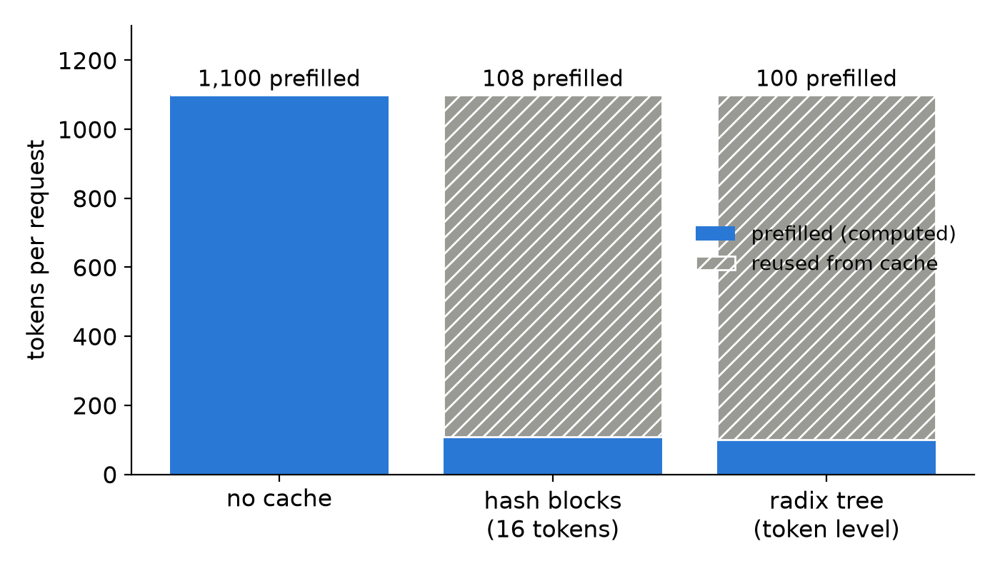
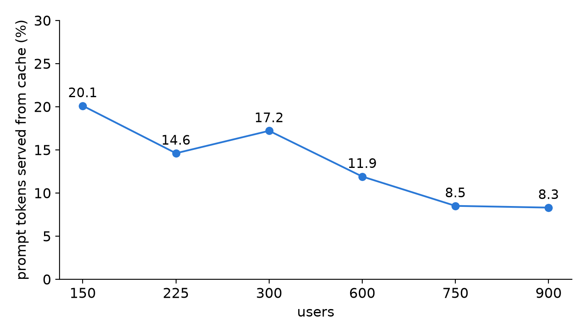

Two requests that start with the same 1,000-token system prompt should not both pay to prefill it. Prefix caching keeps the KV of earlier tokens and reuses it when a new prompt begins with the same tokens. Below we compute what each engine's design saves on a round example, then look at what the hit rates we measured on one NVIDIA L4 did and did not buy.

## Key results

| what | number | kind |
|---|---|---|
| tokens prefilled, 1,000-token shared prompt + 100-token question | 1,100 no cache, 108 hash blocks, 100 radix tree | computed |
| prefix cache on vs off, 498 users | hit 14.9 %, standard attainment 0.695 -> 0.777 | measured, 1 seed |
| prefix hit, one vLLM engine | 20.1 % at 150 users, 8.3 % at 900 | measured |
| 64 GiB host tier | hit +11.5 to +13.2 points, vLLM attainment inside noise | measured, 1 seed |
| 4 GPUs, 520 users, sticky vs round-robin routing | hit 39.4 % vs 14.1 % | simulated (replay) |


## 1. Two ways to find a shared prefix

Both engines split the cached KV into blocks and look a new prompt up from its first token. They differ in how.

**Hash blocks (vLLM).** Each full block (16 tokens in our vLLM runs) gets a key: a hash of its own tokens and the key of the block before it. A block therefore matches only if every earlier token matches too. A new prompt is cut into blocks, and the engine walks them in order until a key is missing. A trailing partial block has no key and is always recomputed. Freed blocks stay in a pool and are evicted least recently used first.

**Radix tree (SGLang, RadixAttention).** The cache is a tree whose edges are token sequences. A new prompt follows the tree as far as its tokens match, and the engine reuses the KV at the node where it stops. When a prompt diverges in the middle of an edge, the edge is split, so matching works token by token (page size 1, SGLang's default). Leaves nobody is using are evicted least recently used first.

The cost of the hash design is the partial block; the benefit is a flat table with cheap lookup. The tree gives exact matches and an explicit view of shared branches, at the price of a more complex structure.

## 2. A worked example

Take a chat service whose system prompt is 1,000 tokens (hypothetical) and a user question of 100 tokens. Block size is 16.

- No cache: 1,100 tokens are prefilled on every request.
- Hash blocks: 1,000 / 16 = 62.5, so 62 full blocks, 992 tokens, are reused. The 8 leftover system tokens and the 100 question tokens are prefilled: 108.
- Radix tree: all 1,000 tokens match, 100 are prefilled.




*Tokens prefilled per request, computed from round numbers. The two designs differ by 8 tokens here, under 1 % of the 1,100 saved.*

On an idle L4 a prompt token cost 0.197 ms of prefill (measured), so the 992 reused tokens are worth roughly 0.2 s of GPU time per request (computed: 992 x 0.197 ms). That is the whole gain: prefill time, not decode. The difference between the designs is at most 15 tokens per prefix, so for a long system prompt the choice matters little; what matters is how often the prefix is still in the cache when the next request comes.

The same lookup serves multi-turn chat. Turn 2 re-sends turn 1 plus the answer, so the history is the prefix.

## 3. What we measured: hits are rare

Our load generator re-sends the whole conversation each turn, so 48 to 59 % of prompt tokens repeat the same session's earlier tokens and almost none come from other sessions. It has no shared system prompt, so this is the history case only. A trace analysis of BurstGPT sessions gives 90.4 % of prompt tokens as re-sent history (computed from the trace, assuming the cache keeps every answer verbatim), an upper bound.

The measured hit was far lower. At 498 users, 10 minutes, SGLang with the radix cache on served 14.9 % of prompt tokens from cache. One vLLM engine, one level per user count, gave:



*Prefix hit rate against users, vLLM on one L4, one level each. Hit rate falls with load overall, though not at every step (14.6 % at 225 users, 17.2 % at 300).*

Our reading, backed by a CPU replay of the same request stream: the GPU pool holds about 2 minutes of new KV at 520 users, while think time has a median of 116 s and a mean of 351 s, so most histories are evicted before their owner returns. The replay reproduced the measured 14.9 % at 498 users and predicted 28 % with an infinite pool. At 900 users in the vLLM series the replay was 1.9 points above the measurement, which it does not model (queueing).

## 4. What the hits bought

**Cache on or off.** At 498 users the 14.9 % hit went with standard attainment (first token within 1 s for chat or 2 s for rag and code, and at most 50 ms per output token) of 0.777 against 0.695 with the cache off, +8.2 points, one seed each. The replay says about 15 % less prefill work, which fits the direction; it has no queue, so it cannot predict attainment.

**More hits from a host tier.** A 64 GiB host-RAM tier lifted the hit rate by 11.5 to 12.7 points on vLLM at 320 and 520 users (0.233 -> 0.348, 0.162 -> 0.289) and by 13.2 on SGLang at 520 (16.0 % -> 29.2 %, one seed). Standard attainment moved +0.011 and +0.016 on vLLM, inside the 0.02 to 0.05 noise of one L4 run. On SGLang at 520 users it rose 0.19, from 0.582 to 0.770, with one seed and a weaker baseline; we do not count it as confirmed. So the first 15 % of hits bought 8 points and the next 12 points of hits bought nothing we can see on vLLM (a loose comparison: the on/off pair is SGLang with a shorter warm-up). Our reading is that at 520 users most misses are queueing, and the prefill a hit saves is small beside the wait; we did not split queue time from prefill time.

**Routing affinity.** With several GPUs, a session's turns must return to the GPU that holds its history, otherwise each cache sees only a fraction of the repeats. In the replay at 520 users with 4 L4s, round-robin gave a 14.1 % hit and routing by prefix hash (sticky) 39.4 %; for 2 L4s, 17.9 % and 30.6 % (simulated). A shared host pool substitutes for stickiness rather than adding to it. Our disaggregated prefill/decode layout used least-loaded routing and measured a 4.8 % hit against about 15 % for non-disaggregated layouts.

The one measured test of sticky routing, 4 L4s in a 2 long + 2 short layout at 1,500 users, 1 seed, gave standard 0.834 against 0.838 for least-loaded (measured): inside the 1-seed spread of about 0.03. We did not log its hit rate, so we cannot say whether stickiness raised hits there.

## 5. Lesson

Estimate the saved prefill in milliseconds, hit rate times prompt length times per-token prefill time, and compare it with your queue wait before building anything to raise the hit rate. The hit rate that a design can reach depends on the workload (shared system prompt or only histories), the pool size against think time, and routing; the block-versus-tree choice is a small term.

## 6. Limits

- Every attainment number is one seed per cell except where noted; differences under 0.05 are not distinguishable.
- The routing hit rates (14.1, 39.4, 17.9, 30.6 %) are from a replay, not a measurement; only the sticky screen at 1,500 users was run, and it logged no hit rate.
- The vLLM hit series and the SGLang cache on/off run use different engines and loads, so they are not compared with each other.
- Our generator has no shared system prompt or shared documents, so the worked example in Section 2 is not something we measured. The 0.197 ms per token was measured on an idle L4 over whole prompts, not on a reused prefix under load.
- We did not read engine source for the hashing and tree details; Section 1 follows the papers and docs.

## 7. Reproduce

Enable and measure the hit rate on a server you control:

```bash
# vLLM: prefix caching, report cached tokens per request
vllm serve Qwen/Qwen3-4B-Instruct-2507-FP8 --enable-prefix-caching --enable-prompt-tokens-details

# SGLang: radix cache is on by default; --disable-radix-cache turns it off
python -m sglang.launch_server --model-path Qwen/Qwen3-4B-Instruct-2507-FP8 --enable-cache-report
```

```python
def prefix_hit(records):
    """Token-weighted hit: sum(cached_tokens) / sum(prompt_tokens) over finished requests."""
    c = sum(r.cached_tokens for r in records if r.cached_tokens is not None)
    p = sum(r.prompt_tokens for r in records if r.cached_tokens is not None)
    return c / p if p else None
```

Our runs, October 2026, one NVIDIA L4, Qwen3-4B-Instruct-2507 FP8: closed-loop users re-sending the whole conversation, 10-minute windows for the cache on/off pair, 20-minute warm-up and 10-minute window for the vLLM host-tier pairs. A custom script is needed for the load generator and the replay. The cost was about 2 USD per pair (estimate).

## 8. Sources

- Zheng et al., "SGLang: Efficient Execution of Structured Language Model Programs" (RadixAttention), NeurIPS 2024: https://arxiv.org/abs/2312.07104.
- Kwon et al., "Efficient Memory Management for Large Language Model Serving with PagedAttention", SOSP 2023: https://arxiv.org/abs/2309.06180.
- vLLM automatic prefix caching design: https://docs.vllm.ai/en/latest/design/prefix_caching/.
- SGLang hierarchical cache design: https://docs.sglang.io/advanced_features/hicache_design.html.
- BurstGPT trace: https://github.com/HPMLL/BurstGPT.
- Our runs, October 2026.


Written with Claude Code. Numbers checked against the runs under Sources.
