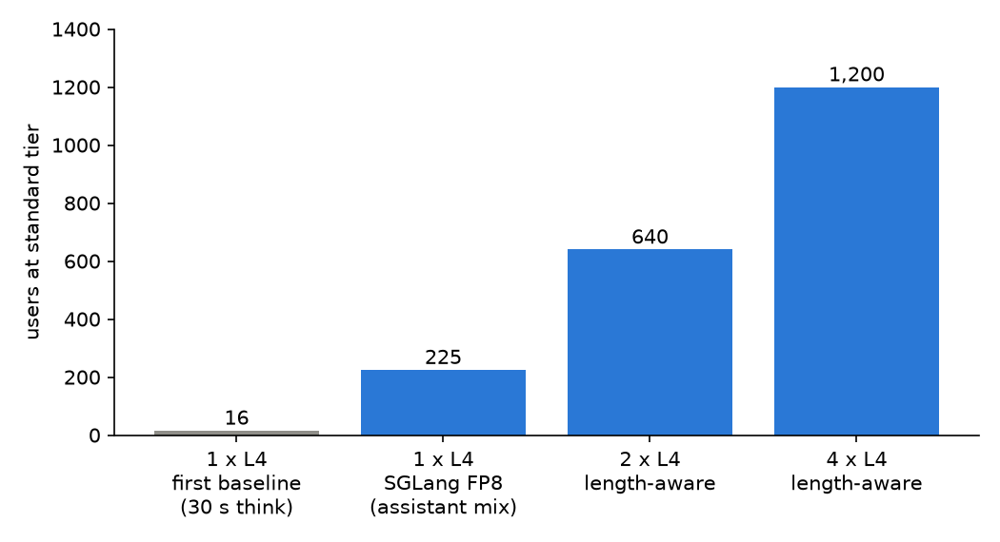

We serve one language model, Qwen3-4B-Instruct-2507, to a chat, retrieval and code workload on NVIDIA L4 GPUs (24 GB each), and ask how many users one card, two cards and four cards carry before latency limits break. This post gives the answer first, then a map of the rest.

## Key results

Standard tier: time to first token (TTFT) at most 1 s for chat, 2 s for rag and code; time per output token (TPOT) at most 50 ms. A level passes when 0.90 of requests meet both. Workload: mean prompt 2,004 tokens, mean answer 96 tokens, mean think time 351.5 s. SGLang 0.5.20, FP8 weights and KV cache, chunk 256 (measured).

| Setup | Highest passing level | Standard attainment | Seeds |
|---|---|---|---|
| 1 x L4, first baseline (bf16, synthetic, 30 s think) | 16 users | 0.966 | 1 |
| 1 x L4, SGLang | about 225 users, borderline | 0.906 ± 0.017 (one seed: 0.956) | 3 |
| 1 x L4, vLLM | about 300 users | 0.912 | 1 |
| 2 x L4, length-aware router | 640 users | 0.931 ± 0.014 | 3 |
| 4 x L4, length-aware router | 1,200 users | 0.923 ± 0.008 | 2 |

Per card (computed): 640 / 2 = 320 and 1,200 / 4 = 300 users, above the 225 of one SGLang card alone.

*Users that passed the standard tier. The first bar uses a 30 s think time and is not comparable with the others.*

## 1. The project

An LLM server is a GPU, a serving engine (SGLang, vLLM or TensorRT-LLM) and settings. We keep the model and the workload fixed and change the rest. The unit is the L4 because its cost per hour is small and its memory is tight: 24 GB holds 4.30 GB of FP8 weights and a KV cache of 200,084 tokens (measured).

## 2. The question

How many users does a setup carry while 0.90 of requests meet the latency limits, and what does each user cost? A user is a closed loop: send a turn, wait, think, send again, so we report users, with the think time beside them. We also test the strict tier (TTFT 0.5 s, TPOT 30 ms), which no L4 setup of the text model passed at 0.90 in any closed-loop user run.

## 3. What the numbers say

- The first baseline carried 16 users; the final single card about 225. Weights (bf16 to FP8) and workload (30 s to 351.5 s think time) both changed, so the comparison is not like for like. Our reading is that the workload explains most of it: a Little's-law estimate puts the bf16 setup at about 201 users on the final workload (computed, not measured).
- One seed overstated the single-card edge: 0.956 at 225 users against 0.906 ± 0.017 over three seeds, below the rule (mean minus sd is 0.889).
- Two and four cards scale to about 300 to 320 users per card with a router that sends long prompts to their own replica. Splitting prefill and decode across cards scored lower than two replicas behind that router: 0.617 against 0.951 at 520 users on two cards (one seed each).
- A 30B mixture-of-experts model split across two L4s failed the standard tier at its first level, 160 users (0.669). The 4B model held 640 on the same two cards, but as two replicas behind a router, so the layouts differ.
- Our paper capacity model said 5,301 users for one L4; we measured about 260 to 320, 17 to 20 times lower.

## 4. Reader's map

Foundations:
- "Anatomy of one L4" shows what the card holds and where 225 users come from.
- "KV cache and paged attention" explains the memory that sets capacity.
- "Continuous batching and chunked prefill" and "Prefix caching: hash blocks or a radix tree" cover the scheduler and cache mechanisms.
- "Closed-loop load: users, not requests per second" and "SLO attainment and capacity" define how we measure.

Results that surprised us:
- "Our capacity model was 17 times too optimistic"
- "TRT-LLM and the 256-token budget"
- "Prefill/decode split lost to length-aware routing"
- "pdmux on one L4: four attempts, no measurement"
- "Host KV offload: more cache hits, same SLO"
- "Admission control did not rescue an overloaded gateway"
- "A 30B MoE on two L4s: fast alone, out of users at 160"

Quantisation, memory and vision:
- "INT4 needs a quality gate, and bf16 ran out of memory"
- "GPU memory fraction: 0.75 or 0.60"
- "Serving a vision-language model: the prefill graph we lost"

Running it:
- "Serverless GPU traps for benchmarks"
- "llama.cpp on a Mac as a serving baseline"
- "Bugs from deploying a serving stack on AWS"

Suggested order: "Closed-loop load" and "SLO attainment and capacity" first, then "Anatomy of one L4".

## 5. Limits

- The 225 and 300 user figures sit on the pass line; the 3-seed single-card level misses it by the rule.
- vLLM at 300 users is one seed; at 320 users three seeds scored 0.861 ± 0.045 and failed.
- The 4 x L4 level used two seeds, the other multi-card levels one or three.
- The first-baseline row has a different workload and is shown only for history.
- One model, one workload, one cloud family of L4 cards; we did not test other models or hardware for the headline.

## 6. Reproduce

Any engine works. Serve Qwen3-4B-Instruct-2507 (FP8 checkpoint) on one L4; run closed-loop users with a lognormal think time (mean 351.5 s), a 30 s warm-up, a 600 s scoring window and 3 seeds; step users up and score each level with the tiers above. A custom load generator is needed; the later posts show its loop. For several cards, run one replica per card behind a router that sends prompts over 3,000 tokens to a fixed replica.

## 7. Sources

- Qwen3-4B-Instruct-2507: https://huggingface.co/Qwen/Qwen3-4B-Instruct-2507.
- SGLang: https://docs.sglang.io; vLLM: https://docs.vllm.ai.
- Our runs, September and October 2026: per-request records behind every measured number above.

Written with Claude Code. Numbers checked against the runs under Sources.
