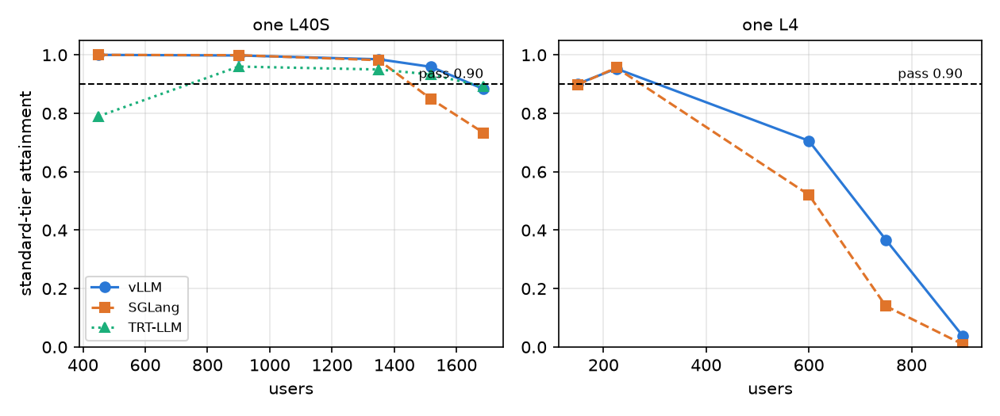

Three open serving engines run the same model, and each ships its own scheduler. We ran vLLM, SGLang and TensorRT-LLM (TRT-LLM, NVIDIA's engine) on the same assistant workload and asked how many users each carries, and where each loses. Only matched setups are compared below; one comparison we could not match is listed in Limits.

## Key results

Standard tier = time to first token (TTFT) at most 1 s and time per output token (TPOT) at most 50 ms (rag and code get 2 s TTFT); a level passes at 0.90 attainment. One seed per cell. Qwen3-4B-Instruct-2507, FP8 weights and KV cache, same request stream.

| one L40S, users | vLLM | SGLang | TRT-LLM |
|---|---|---|---|
| 450 | 1.000 | 1.000 | 0.79 |
| 1,350 | 0.985 | 0.982 | 0.950 |
| 1,518 | 0.959 | 0.849 | 0.933 |
| 1,687 | 0.883 | 0.733 | 0.891 |


| one L4, users | vLLM | SGLang |
|---|---|---|
| 150 | 0.901 | 0.898 |
| 225 | 0.953 | 0.956 |
| 600 | 0.706 | 0.521 |
| 750 | 0.367 | 0.140 |

On both cards vLLM and SGLang tie at moderate load; SGLang falls faster past the knee. TRT-LLM matched vLLM on the L40S from 1,350 users up, and only after we changed one flag; at 450 users it failed on TPOT.

## 1. What "matched" means

Same model and quantization, same trace-derived request stream (seed 0 on the L40S), same closed-loop users with a mean think time of 351.5 s, same tiers, same 10-minute levels. Engine flags are the part that cannot be identical. We set the per-step token budget, the cap on tokens fed to the GPU in one engine step, to 256 for vLLM (`--max-num-batched-tokens 256`) and SGLang (`--chunked-prefill-size 256`). For TRT-LLM we first used 256 too and later 2,048 (Section 3). We call a comparison matched when only the engine differs and its budget has been tuned.

```bash
vllm serve <model> --max-num-batched-tokens 256 --linear-backend triton
python -m sglang.launch_server --model-path <model> --chunked-prefill-size 256 \
  --kv-cache-dtype fp8_e4m3 --attention-backend flashinfer --enable-mixed-chunk
trtllm-serve serve <model> --max_num_tokens 2048 --max_batch_size 256   # fp8 KV, chunked prefill in the options file
```

## 2. Capacity on one L40S

At 450 and 900 users vLLM and SGLang scored 0.998 or more on standard. TRT-LLM at budget 2,048 scored 0.79 and 0.96 there: its TPOT p90 was 66 ms, above the 50 ms limit. These two TRT-LLM levels ran in a separate session, and our log does not confirm they used the same request stream. At 1,350 users the three sit within 0.035 of each other. The split starts at 1,518: vLLM 0.959, TRT-LLM 0.933 and SGLang 0.849. At 1,687 TRT-LLM (0.891) and vLLM (0.883) are just under the 0.90 gate and SGLang is at 0.733.



*One seed per point; dashed line = 0.90 pass. TRT-LLM at token budget 2,048; its 450 and 900 points may use a different request stream.*

Single runs move by 0.02 to 0.05 for us, so vLLM and TRT-LLM tie at 1,518 and 1,687. The SGLang gap (0.11 at 1,518, 0.15 at 1,687, computed) is larger than that noise.

Strict tier (TTFT 0.5 s) shows the same order at 1,518: TRT-LLM 0.804, vLLM 0.801, SGLang 0.617. At 450 users SGLang's strict score was marginally higher, 0.988 against 0.983.

## 3. Capacity on one L4

On the L4 the engines carry about the same users where it matters. With three seeds each at their own edge levels, SGLang scored 0.886 ± 0.021 at 260 users and vLLM 0.861 ± 0.045 at 320; neither passes, and the two are within noise, but the user counts differ, so vLLM's edge sits somewhere above SGLang's. At 225 users (one seed) both pass, 0.956 and 0.953.

Past the knee the order from the L40S repeats: at 600 users vLLM 0.706 against SGLang 0.521, at 750 0.367 against 0.140. SGLang's strict tier was higher at 225 users, 0.717 against 0.665.

TRT-LLM is not in the L4 table because its L4 run is not matched. It used budget 256 and scored 0.667 and 0.672 at 260 and 320 users, one seed; a single stream alone ran at 80.7 ms per token against about 23 ms for vLLM. We do not know why, and a rerun with 2,048 has not run.

## 4. What each did best and worst

**vLLM** was the most even. Its worst result is the L40S at 1,687 users, where it is also just under the gate. **SGLang** was best at light load on strict and worst past the knee on both cards. **TRT-LLM** was worst when we copied budget 256: standard 0.001 at 1,350 and 1,518 users with the GPU 48 % utilised; with 2,048 it was within noise of vLLM on the L40S from 1,350 users up. Its TPOT stayed high: median 29.6 ms and p90 66 ms at 450 and 900 users, and a single stream alone ran at 28.6 ms per token; we did not find the cause.

Why, our reading and not a profile. A budget of 256 means different work per step: in TRT-LLM decode tokens share it and one step took about 30 ms, so a 6,000-token prompt needed about 24 steps (computed). That fits the TTFT growing from 0.14 s to 1.02 s with prompt length. For SGLang's decline past the knee we have no measured cause: client lag was 37 ms p99 at its L40S edge against 29 to 30 ms for vLLM, but we did not profile its scheduler or queueing.

## 5. Limits

Every cell is one seed unless stated; the noise of 0.02 to 0.05 is our estimate from repeats. TRT-LLM at budget 2,048 ran at 450 and 900 users on the L40S in a separate session whose request stream we cannot confirm as matched, and never on the L4. SGLang and vLLM used budget or chunk 256 and were not tuned per engine; a different value might move them, and the TRT-LLM result shows the flag matters. The L40S numbers were checked against run-time summaries, not raw logs. Prefix caching, offload, LoRA and a vision model were separate experiments and are not in these tables.

## 6. Reproduce

Our runs, October 2026: vLLM 0.30.0, SGLang 0.5.20, TensorRT-LLM 1.3.0rc29, Qwen3-4B-Instruct-2507 FP8, one L4 and one L40S. Server commands as in Section 1. Load: closed-loop users with trace-sampled prompts, mean think time 351.5 s, 10-minute levels after warm-up, one seed (three for the L4 edge levels), tiers as in the Key results. Needs a custom load generator that records send, first-token and last-token times per request, then scores each request against the tier.

## 7. Sources

- vLLM `serve` arguments: https://docs.vllm.ai/en/latest/cli/serve/.
- SGLang server arguments and RadixAttention paper (Zheng et al., 2023): https://docs.sglang.io/advanced_features/server_arguments.html.
- TensorRT-LLM `trtllm-serve` and tuning guide: https://nvidia.github.io/TensorRT-LLM/latest/commands/trtllm-serve/trtllm-serve.html.
- PagedAttention (Kwon et al., 2023).
- Qwen3-4B-Instruct-2507 FP8 model card: https://huggingface.co/Qwen/Qwen3-4B-Instruct-2507-FP8.
- Our runs, October 2026.


Written with Claude Code. Numbers checked against the runs under Sources.
