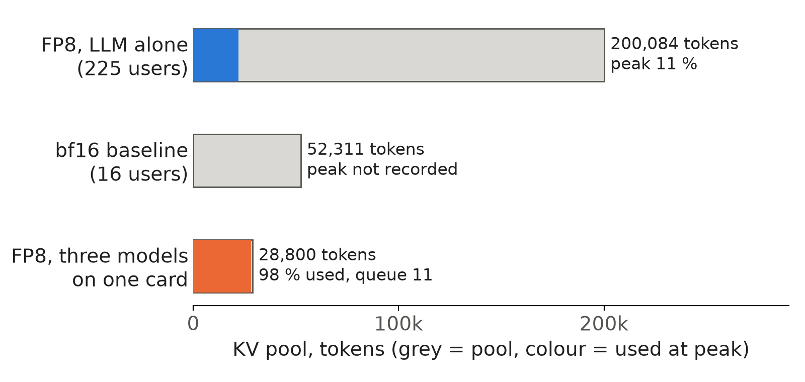

A serving engine reserves its KV pool (the memory that holds the keys and values of every token in flight) once, at start. Here we show how to compute the pool for a 24 GB card before launching, how to turn it into users, and the runs where it ran short.

## Key results

| what | number | kind |
|---|---|---|
| usable memory of one L4 | 22.49 GiB | measured |
| FP8 weights, Qwen3-4B | 4.30 GiB | measured |
| everything else (before start, activations, graphs, pool extras, free) | 4.45 GiB | computed |
| KV pool left | 13.74 GiB = 200,084 tokens at 72 KiB | measured, computed |
| FP8 KV against bf16 KV in the same space | about 2 x tokens (200,084 against about 100,000) | computed |
| peak pool use at 225 users | 11 % | measured |
| pool with three models on one card | 28,800 tokens, 98 % used | measured |


## 1. From 24 GB to a pool

### 1.1 The walk

The pool is what remains after everything else has a fixed claim:

```
pool bytes = usable - already in use - weights - activations and graphs - safety margin
tokens     = pool bytes / bytes per token
```

Round numbers first: 22 GiB usable, 1 GiB in use before the engine starts, 8 GiB of bf16 weights, 3 GiB for activations and graphs, 1 GiB margin leave 9 GiB. At 144 KiB per token that is 65,536 tokens; at 72 KiB (FP8) 131,072 (hypothetical).

Our FP8 start-up log gives the same walk with real values. The card reports 23,034 MiB, 22.49 GiB. The log shows about 0.67 GiB in use before SGLang starts, 4.30 GiB of weights, 3.07 GiB for the pool step beyond K and V, unnamed gaps, CUDA graphs and decode warm-up, and 0.71 GiB left free at the end. What remains is 22.49 - 0.67 - 4.30 - 3.07 - 0.71 = 13.74 GiB, and 13.74 GiB / 72 KiB is the logged pool of 200,084 tokens (computed).



*Figure 1. KV pool from the start-up logs, with peak use where we recorded it. Peak use is 11 % of 200,084 and 98 % of 28,800 (computed from those shares).*

### 1.2 What FP8 buys

FP8 helps twice. The weights shrink from 7.71 to 4.30 GiB, which frees 3.4 GiB, and the cache bytes per token halve from 144 to 72 KiB (computed from 36 layers x 8 KV heads x 128 x 2 x bytes). In the same 13.74 GiB a bf16 cache would hold about 100,000 tokens (computed), half of the FP8 pool. The bf16 baseline logged 52,311 tokens because it also had less room: larger weights and a larger prefill chunk, which reserves more working memory (our reading).

The margin is real. A start with the LLM last among three processes at memory fraction 0.75 died in CUDA-graph capture with 0.52 GiB free, and a decode-overlap experiment at 0.80 died the same way with 22.01 of 22.03 GiB used. The pool is the only item the engine sizes for you; the others must fit in what you leave.

## 2. From pool to users

### 2.1 Tokens per request

A request holds KV for its prompt plus the tokens it has generated. Our assistant mix averages 2,004 prompt and 96 answer tokens: about 2,100 tokens, 148 MiB at 72 KiB (computed). A 200,084-token pool holds 95 of them at once. A long conversation costs more: 8,192 tokens is 576 MiB, so the same pool holds about 24 of them (computed).

### 2.2 Requests are not users

Users spend most of their time thinking. With a mean think time of 351.5 s and a response of about 3 s, a closed-loop user has a request in flight under 1 % of the time (computed: 3.2 / (3.2 + 351.5)). Little's law gave about 2 requests in flight at 225 users, so the pool needs room for a handful of requests, not for 225 histories.

The measured peak agrees: 11 % of 200,084 is about 22,000 tokens, roughly 98 tokens per user across 225 users (computed). Earlier runs with a 137k-token pool and the 200k pool peaked at 15,000 to 28,000 tokens. The pool was never the limit there; the limit was first-token latency under prefill queueing (our reading, see part 3 of this series).

### 2.3 What the pool does keep

Spare pool is not wasted: with prefix caching, finished histories stay resident until space is needed. The catch is time. At 260 users the pool holds 2 to 4 minutes of new KV traffic, at 520 users about 2 minutes, while the median think time is 116 s and the mean 351.5 s. Most histories are evicted before the user returns (a simulation of our trace, not a GPU measurement). So a bigger pool or a host-RAM tier raised the prefix hit rate by 11.5 to 12.7 points (measured, one seed, vLLM host offload at 320 and 520 users) without a clear gain in attainment, which stayed within noise.

## 3. Where the pool ran out

Three times in our runs the pool, or the memory around it, was the problem.

| case | what happened | pool |
|---|---|---|
| three models on one card, fraction 0.60 | pool 98 % used, queue up to 11; LLM standard attainment 0.508 against 0.906 alone | 28,800 tokens |
| same, fraction 0.75 | out of memory in graph capture, 0.52 GiB free | 52k planned |
| two GPUs, prefill and decode split | decode pool 0.79 full with 72-77 requests waiting; 29-57 failed from minute 45 | not logged |

In the first case the pool had shrunk 7 times against the LLM-alone run (200,084 / 28,800 = 6.9, computed) and sat at the peak of earlier runs, so every extra request queued. The three-model run cannot separate KV pressure from GPU time taken by the other models. In the split case the pool was not full yet; we read the failures as a decode side that could not drain its transfers, which we did not prove.

## 4. A sizing rule

1. Compute bytes per token from the model config and the cache dtype.
2. Subtract weights, about 3 GiB for activations and graphs, and a margin from the usable card; read the real split from the start-up log once.
3. Divide, then compare with demand: requests in flight times tokens per request, not users times history.
4. If the pool will sit near the peak of demand, shrink demand (shorter context, FP8 cache) before adding hardware.

## 5. Limits

- Pool and peak numbers come from one card type (24 GB L4) and one model; the 3 GiB reserve is what our flags left, not a rule.
- Peak use at 225 users comes from the three-seed runs; the bf16 baseline peak was not recorded.
- The three-model run changed more than the pool, so its attainment drop is not all KV.
- The eviction timing in Section 2.3 comes from a CPU simulation.

## 6. Reproduce

Our runs, October 2026: SGLang 0.5.20, one L4 24 GB, Qwen3-4B-Instruct-2507 FP8.

1. Launch: `python -m sglang.launch_server --model-path Qwen/Qwen3-4B-Instruct-2507-FP8 --kv-cache-dtype fp8_e4m3 --chunked-prefill-size 256 --attention-backend flashinfer --enable-mixed-chunk 2>&1 | tee server.log`.
2. Read the split: `grep -E "avail mem|KV Cache is allocated" server.log`, plus `nvidia-smi --query-gpu=memory.total --format=csv`.
3. Check the walk: tokens x bytes per token should equal K plus V in the log.
4. Peak use: log the engine's `token usage` while a closed-loop load (225 users, lognormal think time, mean 351.5 s) runs for 600 s.
5. Cost: reading the log is free of load; the three-seed 225-user run took about 40 minutes of one L4 (estimate).

## 7. Sources

- SGLang server arguments (`--mem-fraction-static`, `--kv-cache-dtype`, `--chunked-prefill-size`): https://docs.sglang.io/advanced_features/server_arguments.html.
- Kwon et al., "Efficient Memory Management for Large Language Model Serving with PagedAttention", SOSP 2023: https://arxiv.org/abs/2309.06180.
- vLLM documentation, `--gpu-memory-utilization` and KV cache offloading: https://docs.vllm.ai.
- Qwen3-4B-Instruct-2507 FP8 model card: https://huggingface.co/Qwen/Qwen3-4B-Instruct-2507-FP8.
- Little, "A Proof for the Queuing Formula: L = λW", Operations Research 9(3), 1961.
- Our runs, October 2026: SGLang start-up logs and per-request records behind every measured number.


Written with Claude Code. Numbers checked against the runs under Sources.
