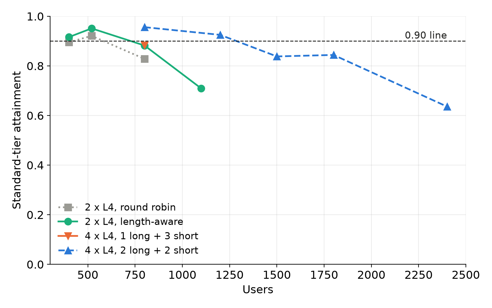

One L4 serves a fixed number of users. The obvious next step is to add GPUs and put a router in front. Here we show how far that went for Qwen3-4B on 1, 2 and 4 L4s, and which router decided it.

## Key results

| layout | router | standard-tier edge (users) |
|---|---|---|
| 1 x L4 | none | about 225 (3 seeds, borderline) |
| 2 x L4 | round robin | between 520 and 800 (1 seed) |
| 2 x L4 | length-aware | about 640 (3 seeds, mean minus sd: 0.917 at 640, 0.884 at 800) |
| 4 x L4, 1 long + 3 short | length-aware | no gain over 2 x L4 at 800 (0.883) |
| 4 x L4, 2 long + 2 short | length-aware | 1,200 holds (3 seeds, 0.924 +- 0.006), 1,500 fails (1 seed) |

The edge is the largest user count whose standard-tier attainment stays at 0.90 or above (rule: mean minus one sd, 3 seeds). Going from 2 to 4 GPUs gave about 1.9 times the users (1,200 against 640, computed); 1,500 failed, so the gain stays under 2.3 times.

## 1. The routers

A replica is one full copy of the model on one GPU, with its own KV cache. A router receives each request and picks a replica. We wrote four policies:

```python
def pick(policy, replicas, req):
    if policy == "round_robin":
        return next(cycle)                                   # ignores load
    if policy == "least_loaded":
        return min(replicas, key=lambda r: r.in_flight)      # fewest open requests
    if policy == "length_aware":                             # long prompts to a fixed group
        group = LONG if req.prompt_tokens >= 3000 else SHORT
        return min(group, key=lambda r: r.in_flight)
    if policy == "prefix_hash":                              # same conversation, same GPU
        return replicas[hash(req.conversation_id) % len(replicas)]
```

Our workload has a long tail: about 29 % of requests carry 3,000 or more prompt tokens (measured). A long prefill occupies a GPU for seconds, and every short request queued behind it waits. Length-aware routing keeps the two kinds apart. Prefix-affinity (`prefix_hash`) keeps one conversation on one GPU so the radix cache can reuse its history.

## 2. Two GPUs

At one seed per point, standard attainment on 2 x L4 was:

| users | 400 | 520 | 800 | 1,100 |
|---|---|---|---|---|
| round robin | 0.895 | 0.921 | 0.828 | not run |
| length-aware (3,000 tokens) | 0.916 | 0.951 | 0.882 | 0.709 |

Round robin and length-aware were 2 to 3 points apart at 400 and 520, inside the noise of one seed. At 800 the gap was 5 points. Three seeds of length-aware gave 0.931 at 520 and 0.894 at 800, with the edge about 640. One L4 carried about 225 users on the same workload and think time, so two GPUs gave about 2.8 times (computed). Read that as "more than double", not as better than linear: the one-GPU 225 is borderline (mean minus sd 0.889), was measured in a separate session, and neither edge is pinned between its levels.

Splitting the GPU roles another way lost badly: prefill/decode disaggregation scored 0.243 at 520 users (see the earlier post on it). Tensor parallelism over two cards (TP=2) was the worst layout, 0.872 at 520 and 0 at 1,100. Our reading, not measured directly: the L4s have no NVLink, so every layer's all-reduce crosses PCIe.

## 3. Four GPUs

A first guess is 1 long and 3 short replicas. At 800 users it scored 0.883, no better than 2 x L4 (0.882 to 0.894). The long replica was the bottleneck: TTFT p50 1.45 s but p90 16.5 s, while the short replicas had p50 0.2 s. Three short replicas sat nearly idle while one long replica queued.

Moving to 2 long and 2 short lifted 800 users to 0.956 and cut long-replica p90 TTFT to 1.8 s. The search then passed at 1,200 (three seeds: 0.924 +- 0.006) and failed at 1,500 (0.838, one seed). Standard attainment at 1,800 was 0.844 and at 2,400 0.636, so the curve is not monotonic at the edge, which we read as noise.



*Figure 1. Standard-tier attainment on 2 and 4 L4s, one seed per point. Dashed line: 0.90.*

Capacity was near-linear from 2 to 4 GPUs, and it took the right split of GPUs between the long and the short group to get there.

## 4. What limited it

Strict attainment (the tightest latency tier) never passed on any layout: the best 2 x L4 value was 0.724 and 4 x L4 stayed between 0.19 and 0.77. Our reading: a request with a 3,000-token prompt cannot meet the strict first-token target even on an idle GPU, so more replicas do not remove that ceiling.

Prefix-affinity did not help where we tested it. A CPU simulation of our own load generator predicted the prefix hit share on 4 x L4 at 520 users would rise from 14.1 % under round robin to 39.4 % with sticky routing (simulated). On the GPUs at 1,500 users, sticky routing inside the groups scored 0.834 against 0.838 for least-loaded, and a 4,000-token threshold 0.845: all within noise. About 53 % of prompt tokens are re-sent history, but users think for minutes, longer than the cache keeps a history, so the reuse arrives after eviction (simulation). Moreover 45 % of the long requests are first turns, which no cache can hold.

The load generator also needed attention: one process serving 4 engines, the router and the client showed client lag p99 of 32.7 and 42.6 ms at 800 users, near the 50 ms gate, so 4 x L4 runs used four client processes (lag p99 5 to 30 ms).

## 5. Lesson

Add replicas, then route by cost, not by count: size the long group from where the queue builds (the long replica's p90 TTFT) rather than by an even split. Check the router before the hardware: on 2 GPUs it was worth more than the layout around it.

## Limits

- Most points are one seed; gaps under about 3 to 5 points are noise. Only the 2 x L4 edge (3 seeds) and 4 x L4 at 1,200 (3 seeds) have more.
- The 4 x L4 edge lies between 1,200 and 1,500; we did not test between them.
- The 1 x L4 edge was measured in a different session, and its 225 is borderline.
- Prefix-affinity was tested at one level (1,500); the hit-share figures come from a simulation, not from engine logs.
- One workload, one model, SGLang only, Modal L4 machines.

## Reproduce

SGLang 0.5.20 per GPU: `python -m sglang.launch_server --model-path Qwen/Qwen3-4B-Instruct-2507-FP8 --kv-cache-dtype fp8_e4m3 --chunked-prefill-size 256 --port 3000N` with `CUDA_VISIBLE_DEVICES=N`, one process per GPU, and a small HTTP proxy in front that applies the `pick` function above and counts open requests per replica. Load: closed-loop users with think time (mean 351.5 s), 10-minute window per level, a multi-process client for 4 GPUs, 3 seeds around the edge. Cost: about 1 to 3 USD per 4 x L4 session of one to three levels (estimates, our runs, Oct 2026).

## Sources

- SGLang docs, router and RadixAttention; Kwon et al., PagedAttention (2023); Zheng et al., SGLang (2023).
- Our runs, Oct 2026.
<!-- runs: 15a, 15b, 15c, 15d, 15f, 18e, 18g, 18h, 18l, 18s; CHANGELOG Steps 67, 80, 84, 87, 91; note 16 -->

Written with Claude Code. Numbers checked against the runs under Sources.
