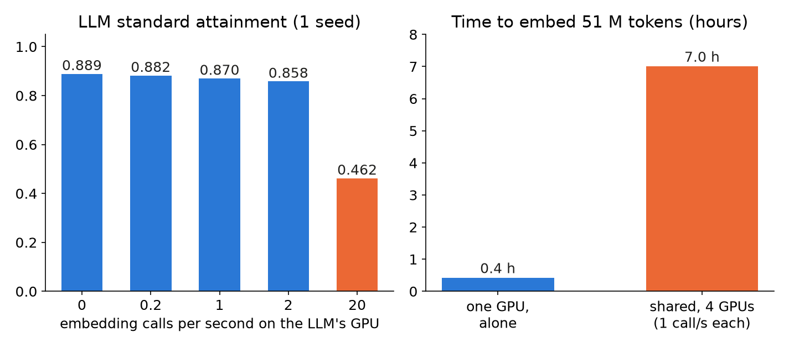

A serving fleet runs more than one model: a chat LLM, an embedding model (turns text into vectors for search) and sometimes a vision-language model (VLM). Each could get its own GPU, or share one. Here we show what we measured when they shared one 24 GB L4 with Qwen3-4B-Instruct-2507 FP8 as the LLM.

## Key results

| setup on one L4, 225 LLM users | LLM standard attainment | note |
|---|---|---|
| LLM alone | 0.906 (sd 0.017, 3 seeds) | baseline |
| + embedding, 0.2 calls/s | 0.904 (sd 0.020, 3 seeds) | embedding p95 54 to 63 ms |
| + embedding, 20 calls/s | 0.462 (1 seed) | embedding p95 319 ms, p99 5,876 ms |
| + embedding + VLM | 0.508 (sd 0.028, 3 seeds) | VLM at 0.05 requests/s |

Standard attainment is the share of requests with time to first token at most 1 s and time per output token at most 50 ms; 0.90 passes. Our rule for the LLM was a drop of at most 0.02.

## 1. Two kinds of embedding work

Query embedding is one call per retrieval question and needs low latency: we set p95 at most 100 ms for 512 input tokens. Indexing embeds a whole corpus in the background and needs throughput only.

The load differs by orders of magnitude. On our request mix 13.4 % of requests retrieve, which gives about 0.08 embedding calls/s at 225 users (computed from the trace mix). An indexing job of 10,000 files x 10 chunks x 512 tokens is 51 M tokens (computed).

## 2. The embedding model alone

We measured Qwen3-Embedding-0.6B alone on one L4 with closed-loop clients (each sends its next call when the last returns), 512-token inputs, prefix cache off, one run per engine.

| engine | single calls: calls/s at p95 at most 100 ms | batch of 32: saturation tokens/s |
|---|---|---|
| SGLang 0.5.20 | 59.8 (p95 82 ms) | 36,591 |
| vLLM 0.30.0 | 68.8 (p95 60 ms) | 33,856 |

Both reach about 36k tokens/s. Query load of 0.08 calls/s is about 750 times below SGLang's single-call capacity of 59.8 (computed); even a fleet at 1,200 users, about 0.4 calls/s, sits about 150 times below it. Indexing 51 M tokens alone takes about 24 to 26 min at 34 to 36k tokens/s (computed).

## 3. Co-locating embeddings with the LLM

We ran the embedding model as a second SGLang process (`--is-embedding`) on the LLM's GPU, with no GPU partitioning: the two processes time-slice. The embedding process started first with memory fraction 0.12, the LLM at 0.75.

At 0.2 calls/s (334 calls, none failed) the LLM did not move: 0.904 against 0.906, paired per seed -0.007, -0.006, +0.006. The embedding p95 stayed at 54 to 63 ms. We then raised the rate, one seed each:

| embedding calls/s | LLM standard attainment (seed 1) | drop |
|---|---|---|
| 0 | 0.889 | - |
| 0.2 | 0.882 | -0.007 |
| 1 | 0.870 | -0.019 |
| 2 | 0.858 | -0.031 |
| 20 | 0.462 | -0.43 |

*Measured, one L4, 225 LLM users, one seed per rate. Right panel: about 25 min from the dedicated-GPU rate, about 7 h computed from 512 tokens/s per shared GPU.*

The drop crosses our 0.02 bar near 1 call/s. At 20 calls/s the extra prefill was about 10k tokens/s, and time-slicing gave the LLM no protection. So the ceiling of about 1 call/s is set by harm to the LLM; the embedding model alone could do 60. Seed noise is about 0.03, so the 1 and 2 calls/s rows only suggest a trend.

Our rule from this: query embedding may share a GPU while a rate guard keeps it under about half the ceiling. Bulk indexing may not: at 1 call/s x 512 tokens a shared GPU embeds about 512 tokens/s (computed), so 51 M tokens take about 7 h on 4 GPUs, against about 25 min on one dedicated GPU.

## 4. Adding a VLM

We added Qwen3-VL-4B-Instruct FP8 beside the LLM and embedding: open-loop image requests at 0.05 per second, each a 1024 x 1024 image with 200 text tokens and 300 output tokens. LLM attainment fell to 0.508 (sd 0.028, 3 seeds) from 0.904.

Two things changed at once. The memory split shrank the LLM's KV pool: with three processes the reserve rule left a pool of 28.8k tokens at fraction 0.60 (it crashed at 0.75), while the LLM's own peak at this load was 15k to 28k tokens; the pool ran 98 % full with a queue up to 11 (measured). And a VLM request decodes for about 15 s, so about one was running at any time (computed: 0.05 x 15). Our run cannot separate the two causes; we dropped a rerun at fraction 0.70.

The VLM has a second cost even when idle of images: on SGLang its text-only prefill was 35 % slower than the text model's, because SGLang turns off the prefill CUDA graph for any multimodal model (its log says so; see the prefill lesson). A rarely used VLM is therefore a poor tenant of the LLM's GPU.

## 5. Borrowing a GPU

For a pool of K GPUs we drew up the following rules; they are a design and were never deployed:

- Query embedding stays on the shared path with a rate guard, for K up to 3.
- Bulk indexing borrows one GPU from the LLM pool off-peak at low priority, checkpoints per chunk, and returns it.
- The VLM gets no GPU at K of 1 or 2. At K of 3 or more it borrows one on the first image request and returns it after 10 minutes idle.

The borrowed GPU costs the LLM pool capacity: we plan with about 300 users at standard per GPU times (K minus borrowed GPUs), measured at 1, 2 and 4 GPUs and extrapolated elsewhere. We did not run the borrow and return logic against live traffic; the start-up time of a borrowed engine is the open cost.

## 6. Lesson

Co-locate on rate, not on size. A 0.6B embedding model costs the LLM nothing at the rate retrieval needs, and half its attainment at 100 times that rate. Before sharing, find the rate where the neighbour moves the LLM, then give any job above it, such as indexing or images, its own or borrowed GPU.

## 7. Limits

All on one L4 with time-slicing; no MPS or other partitioning was tried. The 0.2 calls/s result has 3 seeds; the rate ladder is one seed per point, and the break between 2 and 20 calls/s is not pinned. The VLM run changed memory fraction and GPU time together. Embedding quality was not measured. Borrow-and-return is a design.

## 8. Reproduce

Our runs, October 2026: SGLang 0.5.20 and vLLM 0.30.0 on one L4, Qwen3-4B-Instruct-2507 FP8 (FP8 KV, `--chunked-prefill-size 256 --enable-mixed-chunk --attention-backend flashinfer`), Qwen3-Embedding-0.6B bf16, Qwen3-VL-4B FP8.

1. Start the embedding server first, then the LLM: `--is-embedding --mem-fraction-static 0.12`, then `--mem-fraction-static 0.75`. Each process keeps about (1 - fraction) of what is free when it starts.
2. Load: 225 closed-loop LLM users with think time, 600 s window, 3 seeds; an open-loop Poisson stream of 512-token embedding calls at 0.2, 1, 2 and 20 per second (a custom script is needed).
3. Alone-capacity: closed-loop clients, 1 to 256 concurrent, 10 s warm-up, 45 s window, single and 32-input batches.
4. Cost: about $0.4 per embedding probe, $0.9 for three seeds (estimates).

## 9. Sources

- SGLang server arguments and embedding mode: https://docs.sglang.io/advanced_features/server_arguments.html.
- vLLM pooling models documentation: https://docs.vllm.ai.
- Qwen3-Embedding and Qwen3-VL model cards on Hugging Face.
- Our runs, October 2026: server logs and per-request records behind every measured number.

Written with Claude Code. Numbers checked against the runs under Sources.
