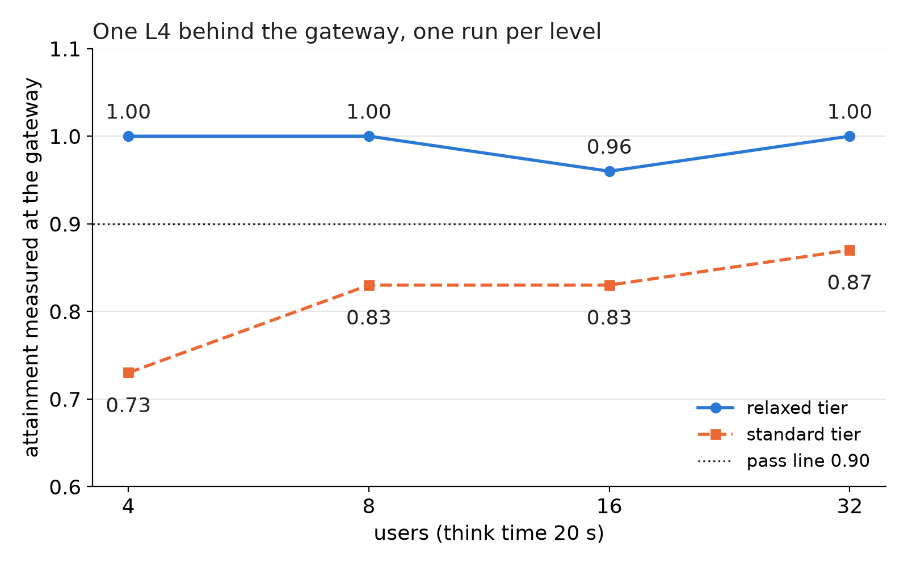

A GPU pool answers requests; it does not decide who may ask, in what order, or how many. A public endpoint adds those decisions in front of the pool. Here we list the six parts of our gateway, why each exists, and what each cost or gave in our measurements.

## Key results

| part | what it does | what we measured |
|---|---|---|
| bounded queue, deadline 30 s | waits instead of refusing at once | queue not tested; the refuse-at-once cap it replaces cut standard attainment from 0.838 to 0.751 at 1,500 users (4 x L4, 1 seed) |
| length-aware router | prompts of 3,000+ tokens go to a long group | about 2.8x the users of one GPU on 2 GPUs (earlier measurement) |
| fair-share rate limit | 429 over a department's share | a tight client retry loop drew about 249,000 refusals in one test |
| SLO meter | TTFT, TPOT, queue wait per request | standard 0.73 to 0.87 at 4 to 32 users on one L4, relaxed 0.96 to 1.00 |
| entry path (Modal) | public HTTPS in front of the GPU | TTFT +0.13 s same region, +0.2 to +0.5 s across regions; TPOT unchanged |

## 1. The shape of the gateway

```
client -> 1 auth -> 2 rate limit -> 3 bounded queue -> 4 router -> pool of replicas
                                                        5 meter (TTFT, TPOT, wait)
                                     6 controller reads queue age, in-flight, attainment
```

The gateway is stateless, so a copy that dies loses only its open connections. Queue and slot counters live in a shared store (Redis); without it, order and fairness would hold only inside each copy.

## 2. Auth

An API key maps to a department. Everything after it (limits, priority, the SLO meter) is per department, so auth is the key that the other five parts index on. A probe showed that the GPU platform rejects a call without the pool's proxy token with 401, and also a call with a wrong one.

## 3. Fair-share rate limit

Peak load is high by day and low by night. A fixed cap per department would block idle capacity at night, so the limit is work-conserving: a department may use more than its share while others are quiet, and is cut back when the fleet is contended. A hard cap applies only above about 3x the fair share (our design choice). Two classes exist: chat before batch. An over-limit call gets 429 with `Retry-After`; 503 is reserved for the fleet's own capacity, so the client can tell "your quota" from "our capacity".

```python
def limit(dept, in_use, share, contended):
    """Return 429 when the department is over what it may use right now."""
    allowed = share[dept] if contended else 3 * share[dept]   # 3x = our hard cap
    return (429, {"Retry-After": "2"}) if in_use[dept] >= allowed else None
```

What it cost: our first load test of this limiter had 40 workers retry in a tight loop on 429, and the limiter answered about 249,000 times. The limiter held; the test was wrong. Clients must sleep on `Retry-After`, and our workers now sleep 2 s. The same lesson appeared earlier with admission control: users who retry at once inflate the load.

## 4. Bounded queue

When all slots are taken, a request waits for at most T = 30 s while the stream sends `status: queued` frames, then gets 503 with `Retry-After`. We chose waiting over an instant refusal because of one measurement: on 4 x L4 at 1,500 users, a cap that refused at once rejected 458 of 3,069 requests (14.9 %) and standard attainment fell from 0.838 to 0.751 (one seed). A refused request counts as failed. We never ran the deadline queue under overload; that it refuses fewer requests the engines could still serve is our reading.

Slots matter too. The gateway grants a call only if in-flight is below capacity (containers x slots per container), so several gateway copies cannot send more than the pool takes. Containers still starting are not counted in capacity, so requests wait in our queue and not inside the platform's, which has no priority (measured: TTFT grew from 0.7 s to 10 s under 1,000 streams).

## 5. Length-aware router

About 29 % of prompts in our trace are 3,000 tokens or longer, and one such prefill delays every short request behind it on the same GPU. The router sends long prompts to one group of replicas and short ones to another, least loaded inside each group. On 2 GPUs this gave about 2.8x the users of one GPU (earlier measurement, standard tier). On 4 x L4 the split of 2 long and 2 short passed standard at 1,200 users (0.924 over 3 seeds) and failed at 1,500 (0.838). Prefix-aware sticky routing gave 0.834 at 1,500 users against 0.838, so it stays off by default; on our trace it gave no gain (one seed).

## 6. SLO meter

The gateway records TTFT, TPOT and queue wait per request and reports attainment per tier and class over a 5-minute window. We use the gateway because it sees what the user sees, including queue wait, with the same metric as our benchmarks. Alerts: standard below 0.90 for 5 minutes, queue at the deadline, 503 above 1 %.



*One run per level, 22 to 158 requests each, laptop client to a cloud L4. Standard stays below 0.90 even at 4 users.*

The first measurement through the real path used a bf16 engine with 8 slots, think time 20 s, a 120 s window, 0 failed and no 429 or 503. Standard failed even at 4 users, so load was not the cause: mean concurrency at 32 users was 2.4 and peak in-flight 7 of 8 slots. Median TPOT was 34 to 37 ms, above the 30 ms strict level. Median TTFT was 0.45 to 0.47 s; an earlier engine-only probe gave 0.13 s, so roughly 0.3 s was added on the way (different runs, so a rough gap). We think the laptop-to-cloud network and the proxy account for it, but we did not split them. Per-request latency set the result, and with 8 slots, a 1.8 s response and 20 s think time, one GPU holds only about 90 users before requests queue (computed).

The entry path itself was measured separately with a streaming client: TPOT was the same direct and through the public URL (25 to 52 ms), and TTFT rose by 0.13 s at p50 in the same region and 0.2 to 0.5 s across regions (one run per cell). Half a second is half of the 1 s TTFT budget, so pools are pinned to the gateway's region.

## 7. Controller

The controller starts and drains replicas from three signals: in-flight above 70 % of the current state's capacity for 60 s, or median queue wait above 5 s, scales up; an empty queue below a low user count for 10 min scales down, with a drain of at most 120 s. Down is slower than up because a start takes minutes (about 4 min cold start). Reactive rules are late, so we also keep a warm window on a schedule. On real L4s, a burst from 1 to 4 replicas passed with 71 % of requests answered 200 while scaling; a restarted gateway kept capacity because it lives in the shared store; an idle pool went to 0; a warm schedule gave capacity 8 before any request and a first chat in 1.7 s. One real bug: batch tasks queued before their batch was marked in progress were dropped, 20 of 200 done after 30 min; after the fix 200 of 200 in 28 s.

## 8. Lesson

Build each part from the failure it prevents, and measure the cost of the gateway itself: here about 0.13 s to 0.5 s of TTFT, which is a visible share of a 1 s budget.

## 9. Limits

All gateway measurements are single runs with small samples; read the ranking, not the third digit. The through-gateway run used a different engine configuration (bf16, 8 slots) from the capacity tables (FP8), so it does not test the 225-user edge. We did not measure more than 32 users, several GPUs, the deadline queue under overload, or the fair share under real contention; those parts are validated by behaviour tests, not by attainment. The 3x cap is a design value, and the 4 min cold start is a rough figure from an earlier probe.

## 10. Reproduce

Our runs, October 2026: SGLang 0.5.20, Qwen3-4B-Instruct-2507, one L4 per replica, a cloud function platform for the GPU, a gateway in Python with a shared Redis store.

1. Put a gateway in front of the pool with the six parts of Section 1; any OpenAI-compatible proxy covers auth and relay; the queue with a deadline and the SLO meter need custom code.
2. Load: simulated users, exponential think time of 20 s, 20 s warm-up, 120 s window, streaming chats; report TTFT, TPOT and attainment per tier; make workers sleep on 429 and 503.
3. Entry overhead: compare the same streams from inside the GPU container and through the public URL.
4. Cost: a few dollars of platform credit in total.

## 11. Sources

- Qwen3-4B-Instruct-2507 model card: https://huggingface.co/Qwen/Qwen3-4B-Instruct-2507.
- SGLang docs: https://docs.sglang.io.
- RFC 9110, 429 and 503 with `Retry-After`: https://www.rfc-editor.org/rfc/rfc9110.
- LiteLLM proxy docs: https://docs.litellm.ai.
- Our runs, October 2026.


Written with Claude Code. Numbers checked against the runs under Sources.
