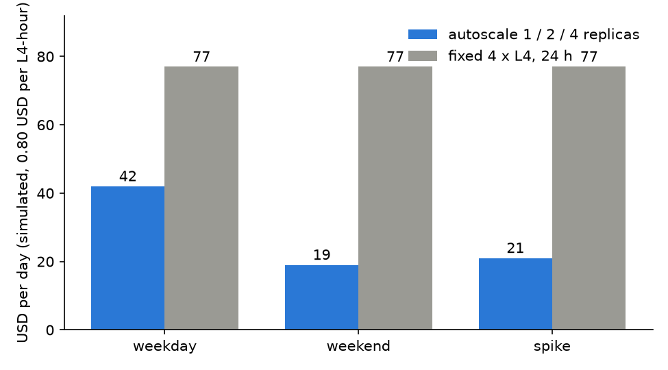

A serverless GPU platform bills per second of container time and starts containers on demand. We ran our serving stack on one (Modal, L4 cards) and asked what that buys over a fixed fleet, and what it costs in latency.

## Key results

| | value | kind |
|---|---|---|
| L4 price used | 0.80 USD per hour (0.222 USD per 1,000 s) | list price at the time |
| Cold start, one SGLang replica | about 257 s; 291 s when it also writes a GPU memory snapshot; 26 s and 14 s on two restores | measured, one each |
| First chat on an empty pool (full stack, one run) | 200 after 28 s | measured, one run |
| Scale 0 to 1 replica | within 17 s of the first refused request, then the engine start-up | measured |
| Output-token cost at 225 users on one L4 | about 3.6 USD per 1M output tokens | computed, 2 s answer time assumed |
| Day cost, autoscale vs fixed 4 x L4 | 42 / 19 / 21 vs 77 USD (weekday / weekend / spike) | simulated, not run |

Our reading: scale-to-zero pays on bursty load, and the cold start is the engine's, not the platform's.

## 1. What serverless changes

On a rented fixed fleet, a GPU costs money whether it serves or not. On a serverless platform a function is a container that starts when a request arrives and stops after an idle window. You pay per second of that container. State is not kept: weights come from a persistent disk or a remote store each time.

Three properties matter for serving:

1. A container can be preempted. A restarted container must resume, not start over.
2. A replica is a full engine process. Loading a 4B model, building CUDA graphs and warming up is the cold start.
3. The platform adds containers gradually, so the scaler must stay ahead of the load.

## 2. Cold start

### 2.1 The numbers

An earlier post in this series covers the cold start in detail. In short, our SGLang replica (Qwen3-4B, FP8) on one L4 needed about 257 s to the first healthy chat reply, and 291 s on the start that also writes a GPU memory snapshot (an alpha feature). Restores from the snapshot took 26 s and 14 s, but a redeploy invalidates it. For the scaler, the number to plan with is the full 291 s.



*Figure 1. Simulated cost per day at 0.80 USD per L4-hour. The simulation uses an assumed 4-minute start-up, scale-up above 70 % of a replica group's capacity and scale-down after 10 idle minutes.*

### 2.2 What a cold request feels like

We tested a pool with no ready container using a fake engine on CPU whose start-up was 240 s. The platform answered HTTP 303 after 151 s if the client did not follow redirects. With redirects followed, the same request finished with 200 after 246 s: 240 s of start-up plus the call. With one warm container it took 2.5 s. A cold request is held, not lost, but the caller waits as long as the engine takes to start. With our real stack, behind a gateway and queue, the first chat on an empty pool returned 200 after 28 s in one run (cause of the short time not checked); after a fresh deploy, the first capacity came about 5 min later, and the gateway, which waited 90 s for a cold start, answered 503 first.

### 2.3 Idle window

The scale-down window is a floor: across four settings (60 to 1,200 s) a container lived 54 to 68 s past it (CPU probe, one container per setting). On an L4 at 0.222 USD per 1,000 s that tail is about 0.015 USD per idle period (computed), small next to a 60 s window that wakes the engine again for the next burst.

## 3. Scale-to-zero and autoscaling

With a real pool of L4 replicas (8 request slots each, at most 4) behind a Lambda, queue and scaler stack on AWS, the scaler went 0 to 1 replica within 17 s of the first refusals, then 1 to 2 to 3 under load, and back to 0 when idle. Each platform call that sets the replica count took 0.5 to 0.7 s. The delay is the engine's start-up, not the call.

It did not pass its gates. A doubling from 1 to 2 replicas raised capacity from 8 to 16 slots as designed, but only 71 % of 193 requests returned 200 (gate 80 %): the gateway had no queue, so extra callers got 503 while capacity was still 8. A mixed batch and chat test finished 194 of 200 batch items in the 1,800 s limit with 0 failures, and chat stayed at 100 % 200s. When idle, capacity followed the last replica leaving by 1 to 2 scaler ticks. One run per case; no variance.

Our reading: the scaler logic works, but a pool that starts from zero needs a queue longer than the cold start, or a warm floor.

## 4. Cost per run and per 1M tokens

### 4.1 Per run

A session that holds one L4 for 40 min costs about 0.53 USD at 0.80 USD per hour (computed). The larger waste was failed attempts, which are billed in full; the earlier post gives one 4 x L4 run where they added about half again to the bill (estimate).

A cold start itself is cheap: 291 s at 0.222 USD per 1,000 s is 0.065 USD per wake (computed, GPU only). Its cost is the wait, not the money.

### 4.2 Per 1M tokens

Our standard tier let one L4 carry about 225 users on an assistant workload with mean think time 351.5 s and 96 answer tokens. Assume a 2 s answer time:

```python
users, think_s, answer_s, out_tokens = 225, 351.5, 2.0, 96
tok_per_s = users * out_tokens / (think_s + answer_s)     # 61 output tokens per second
tokens_per_hour = tok_per_s * 3600                        # 220,000
usd_per_1m = 0.80 / (tokens_per_hour / 1e6)               # 3.6 USD per 1M output tokens
```

That is 3.6 USD per 1M output tokens at the edge of capacity (computed; the 2 s answer time is assumed, prompt tokens are not counted). The assumption barely moves it, because think time dominates: a 10 s answer gives 3.7 USD (computed). The same view gives 281 users per USD per hour at 0.80 USD, or 3.6 USD per hour per 1,000 users. This price holds only while the card is full. A fixed GPU at 10 % of that load costs 10 times more per token (computed). Serverless pays off when idle time is large.

### 4.3 Against a fixed fleet

We simulated (did not run) a day for three load profiles with measured capacity edges (225, 640 and 1,200 users for 1, 2 and 4 L4s). Autoscaling cost 42, 19 and 21 USD for the weekday, weekend and spike profiles against 77 USD for a fixed 4 x L4 fleet (24 h x 4 x 0.80, computed). A fixed 1 x L4 is cheapest at 19 USD per day but failed the standard tier for 563 minutes on the weekday profile; on the spike profile autoscaling spent 5 minutes over the edge (assumed 4-minute start-up). Our reading: the saving comes from not holding 4 cards at night, and the cost is a few minutes over capacity at each rise.

## 5. Lesson

Scale-to-zero is a trade between money and the first user's wait. If the target is a few seconds, keep one warm replica and add more on demand; the remainder of the fleet can scale to zero. Count the cold start (about 291 s here) in the scaler's lead time, set the gateway's cold-start wait above it, and follow redirects.

## 6. Limits

All cold starts are one measurement each on one L4. Several simultaneous containers were untested, and snapshot billing was not visible in the bill. The autoscaling day is a simulation from measured edges, not a run. Cost per token is computed with an assumed answer time and counts output tokens only. The pool cases ran once per case, so we have no variance. We did not measure a vLLM cold start on the same pool, and the L4 price of 0.80 USD is the platform rate at the time, not a quote.

## 7. Reproduce

Our runs, October 2026: Modal SDK 1.6.1, L4 GPU, SGLang 0.5.20 and vLLM 0.30.0.

1. Cold start: time from container start to the first healthy chat reply, with and without a memory snapshot; repeat after a redeploy.
2. Idle window: set `scaledown_window`, stop sending, poll the container list until it is gone.
3. Cost: GPU seconds x price per second, plus the failed attempts; divide by output tokens in the window.
4. Autoscale simulation: one step per minute, a start-up delay, an up threshold and a down delay applied to a daily user curve.

## 8. Sources

- Modal docs: GPU guide https://modal.com/docs/guide/gpu, preemption https://modal.com/docs/guide/preemption, "truly serverless GPUs" https://modal.com/blog/truly-serverless-gpus.
- Our runs, October 2026.


Written with Claude Code. Numbers checked against the runs under Sources.
