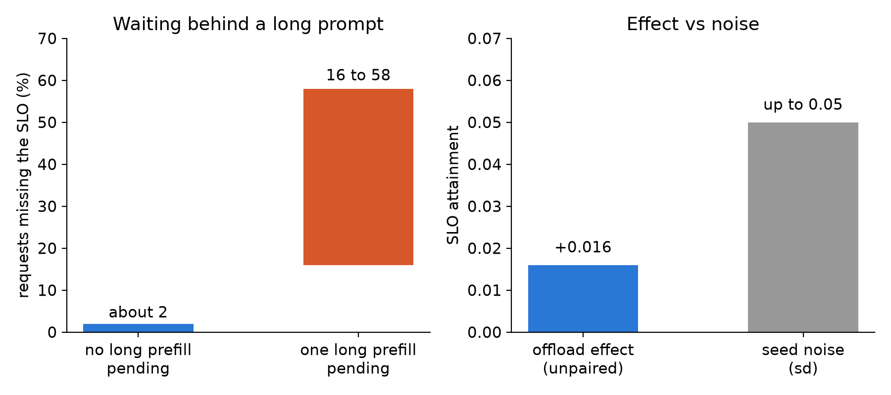

Everything below is a proposal. We have not run any of it. Each item names the number it has to move and why we expect that, so a reader can tell a result from a hope.

## Key results

| | now (measured) | proposed target (not run) |
|---|---|---|
| standard edge, 1 x L4, SGLang FP8 | about 225 users, 3 seeds | 260 or more with short-first scheduling |
| miss rate, no long prefill pending | about 2 % | - |
| miss rate, one long prefill pending | 16 to 58 %, per run | table by prompt-length bucket |
| host KV offload effect at 520 users | +0.016, unpaired | paired interval that excludes or contains 0 |
| VLM standard attainment, SGLang | 0.958 at 350 users (1 seed), 0.65 to 0.76 at 400 | edge versus image tokens |



*Measured numbers behind the plan: where misses come from, and how small our cache effects are next to the noise.*

## 1. What we think limits one L4

Of the requests that missed the standard SLO (1 s to first token, 50 ms per token), 74 to 94 % missed on the first token at up to 300 users (measured). Requests that arrived with no prompt of 3,000 tokens or more pending missed about 2 % of the time; with one pending, 16 to 58 % (measured, per run). Our reading: the pool is prefill-bound and short requests wait behind long ones.

Two other numbers fit that reading. Single-stream decode ran at 43 to 46 tokens per second against a bandwidth ceiling of about 75 (computed), so decode is near its roof. Prefill ran at about 0.2 ms per token, roughly 5,000 tokens per second (measured on requests that met an idle card). Chunk size, prefix caching and host offload each failed to move the edge much, which also fits.

## 2. Experiments, in order

Each item is not run. "Number" is what must change; "why" is our expectation, not a result.

### 2.1 Short-first scheduling

- Number: the 225-user edge to 260 or more, plus a table of first-token wait by prompt-length bucket (under 1k, 1 to 3k, 3k and over).
- Why: the only mechanism our data ties to the edge is the wait behind a long prefill. vLLM has a priority scheduling policy; the gateway would set the priority from the prompt length, which is known at admission. The 225 edge is SGLang's; vLLM on the same card passed at 300 users in one seed and failed at 320 in three (0.861), so the baseline must be remeasured on whichever engine we schedule. We still have to check the policy in the version we run and how it interacts with chunked prefill.
- Cost: long requests wait longer. We would report the long-bucket cost next to the short-bucket gain. Stop rule: no gain beyond seed noise after 3 seeds is a negative result.

### 2.2 Bucket the data we already have

- Number: a wait table by bucket and engine from stored logs, no GPU.
- Why: the 2 % versus 16 to 58 % is per run. A table tells us who is hurt and bounds what 2.1 can gain. The same pass can say whether the 12-point higher cache hit under offload landed on short or long prompts. If it landed on short ones, that explains an SLO that stayed flat.

### 2.3 Paired runs

Our deltas of 0.01 to 0.03 sit inside seed noise (sd 0.02 to 0.05), and each container can get a different card. A paired design alternates A and B inside one container (A B B A), same seed per pair, and reports the difference with a bootstrap interval.

```python
import random

def paired_ci(diffs, n=10000, alpha=0.05):
    """Bootstrap interval of the mean paired difference B - A."""
    means = sorted(sum(random.choices(diffs, k=len(diffs))) / len(diffs) for _ in range(n))
    return means[int(n * alpha / 2)], means[int(n * (1 - alpha / 2))]
```

- Number: offload at 520 users, +0.016 unpaired, becomes an interval over 3 rounds. If it contains 0 we write "no SLO effect".
- Why: pairing removes machine drift, the largest noise source we can name.

### 2.4 Load shapes

Our generator is closed-loop: users wait for the answer, think, then send again. A closed loop slows itself when the server slows, so its edge is probably optimistic. Three shapes to add:

| shape | question | number |
|---|---|---|
| open-loop Poisson at the mean request rate of 225 users | does the edge hold when arrivals do not wait? | edge versus the closed-loop 225 |
| burst start, all users in one second | what does the first minute look like? | first-minute TTFT p90 |
| 60-minute soak at about 200 users | does anything drift? | per-minute TTFT p90, memory |

The request rate for the Poisson run is users divided by mean think time plus mean turn time (computed from our logs). If the open-loop edge is lower, we would report both and keep the closed-loop one as the comparable headline.

### 2.5 VLM image tokens

The VLM pool edge depends on how many visual tokens each image costs. We would sweep the maximum pixel setting at three sizes, rerun the capacity search, and score accuracy on the image tasks at each size.

- Number: edge versus tokens per image, with accuracy next to it.
- Why: fewer tokens mean less prefill and less cache per request. Risk: small text may become unreadable. We would pick the loss limit before the run, for example 2 points per task.

### 2.6 Offload, TRT-LLM and the hardware picture

- Offload at 520 users: covered by 2.3. We expect no effect, because the extra hits may be on prompts that were never the problem.
- TRT-LLM on one L4 scored 0.667 standard at 260 users (one seed) with a 256-token budget, the setting that wrongly collapsed it on another card. Rerun with 2,048. Number: standard of 0.861 or more at 320 users to match vLLM; below that, the earlier "stops" stands with a valid comparison.
- Telemetry: log SM clock, throttle reasons and engine CPU per second. The card sat at its 72 W cap from 225 users and we never logged clocks. If clocks drop, part of the knee is the power cap.

## 3. What we will not repeat

INT4 weights failed the quality gate. Chunk sweeps, attention backends, prefill-decode split on two cards and speculative decoding are measured or aimed at decode, which is not what fails. Re-running them would cost money for no new number.

## 4. Limits

- Every target above is an estimate. The plan's cost estimate of 19 to 23 USD for the GPU batches is a plan number, not a bill.
- The miss rates by pending long prefill are per run, from two earlier sessions; they are not yet a table by bucket and engine.
- Our reading that decode is at its roof rests on single-stream numbers; we did not profile under load.
- The 5,000 tokens per second figure was measured on an idle card, not under load.

## 5. Reproduce

Nothing here has results to reproduce. The two pieces a reader can build now:

```bash
# vLLM: priority scheduling (check your version supports it), then set "priority" per request
vllm serve Qwen/Qwen3-4B-Instruct-2507-FP8 --scheduling-policy priority
# GPU telemetry once per second
nvidia-smi --query-gpu=utilization.gpu,clocks.sm,power.draw,clocks_throttle_reasons.active --format=csv -l 1
```

Method: closed-loop users with think time, 10-minute windows, 3 seeds, A B B A inside one container. Our runs, October 2026.

## 6. Sources

- Kwon et al., "Efficient Memory Management for Large Language Model Serving with PagedAttention", SOSP 2023: https://arxiv.org/abs/2309.06180.
- vLLM docs, scheduling policy and chunked prefill: https://docs.vllm.ai.
- guidellm, rate types (concurrent, constant, poisson, sweep): https://github.com/vllm-project/guidellm.
- Our runs, October 2026.


Written with Claude Code. Numbers checked against the runs under Sources.
