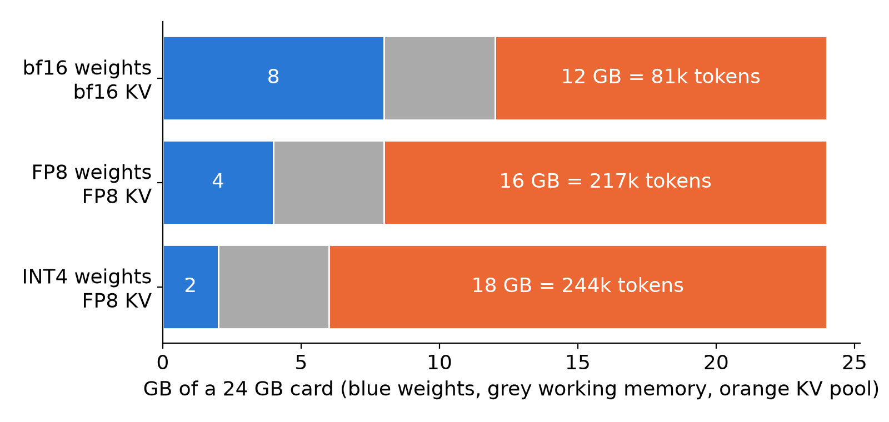
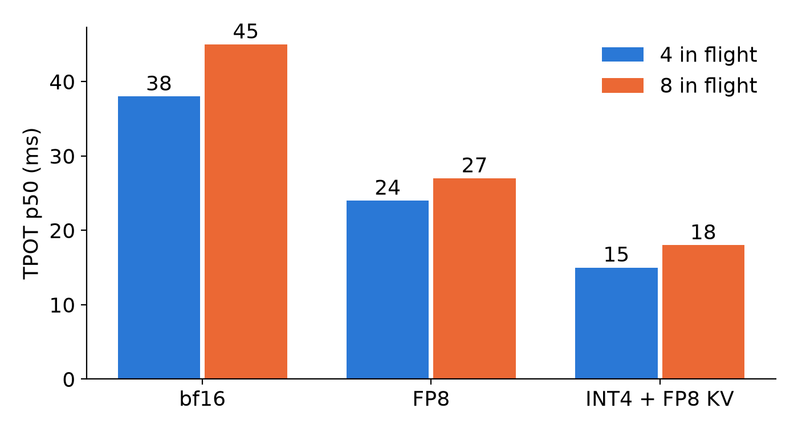

Quantization stores numbers in fewer bits. A 4-billion-parameter model has two big memory consumers, the weights and the KV cache (the stored keys and values of earlier tokens), and each can be shrunk on its own. Below we do the bytes arithmetic with round numbers, then show what we measured on one NVIDIA L4 (24 GB) with Qwen3-4B.

## Key results

| what | number | kind |
|---|---|---|
| weights, 4B parameters | 8 GB bf16, 4 GB FP8, 2 GB INT4 | computed |
| weights as loaded | 7.71 GiB bf16, 4.30 GiB FP8 | measured |
| KV pool, FP8 weights, cache bf16 then FP8 | 77,171 then 154,343 tokens (2.0 times) | measured |
| KV pool, bf16 baseline and final FP8 config | 52,311 and 200,084 tokens; memory settings differ, so not a dtype effect | measured |
| decode time per token (TPOT p50), 4 / 8 requests in flight | bf16 38 / 45 ms, FP8 24 / 27 ms, INT4 15 / 18 ms | measured |
| perplexity against bf16 | FP8 +0.1 to +0.8 %, INT4 +5.3 to +10.9 % | measured, 50 tasks per kind |


## 1. The arithmetic

A parameter in bf16 takes 2 bytes, in FP8 1 byte, in INT4 half a byte. For 4 x 10^9 parameters that is 8 GB, 4 GB and 2 GB (computed; INT4 also stores scales, which we ignore). Our logs show 7.71 and 4.30 GiB, not 8 and 4 GB; our reading is that the model has a little over 4B parameters and keeps some layers in 16-bit.

The KV cache has its own dtype. Qwen3-4B has 36 layers, 8 KV heads and head size 128, so one token costs 2 x 36 x 8 x 128 x 2 bytes = 144 KiB in bf16 and 72 KiB with an FP8 cache (computed).

Now assume a 24 GB card with 4 GB of working memory (assumed). What is left is the KV pool:

- bf16 weights, bf16 KV: 24 - 4 - 8 = 12 GB, or 81,380 tokens.
- FP8 weights, FP8 KV: 16 GB, or 217,014 tokens.
- INT4 weights, FP8 KV: 18 GB, or 244,141 tokens.



*Computed budget for a 4B model on 24 GB, with assumed 4 GB working memory.*

The lesson of the arithmetic: weights matter less than the cache. Going from FP8 to INT4 frees 2 GB of weights and adds 12 % more tokens, while going from bf16 to FP8 added 2.7 times in this sketch.

## 2. What we measured

### 2.1 Memory

In a feasibility test, FP8 weights with a bf16 cache gave a pool of 77,171 tokens and switching the cache to FP8 gave 154,343: a factor of 2.0, as the bytes say.

**Do not read the headline pair as a dtype effect.** SGLang logged 52,311 tokens for our bf16 baseline and 200,084 for the final FP8 config, 3.8 times more, but those two runs used different memory settings. A probe that changed only the prefill chunk, 4,096 to 256 tokens, raised the automatic memory fraction from 0.684 to 0.827 and the pool from 154,343 to 199,770 (measured). Part of the 3.8 is that chunk, not the bits.

### 2.2 Speed

At low load a decode step is limited by reading the weights, so fewer bytes mean faster tokens. In one probe on one day, with the same flags apart from the dtype, the standard-SLO share at 4 and 8 requests in flight: bf16 0.82 and 0.62, FP8 0.94 and 0.92 (measured, 1 run each).



*TPOT p50 on one L4, SGLang. INT4 ran in a later session the same day as bf16; an FP8 re-run in that session agreed within 1 ms.*

INT4 halves the weight bytes again, and TPOT fell by a third against FP8: 15 against 24 ms at 4 in flight, 18 against 27 at 8. The edge vanished at 16 and 32 in flight: INT4 gave 250 and 264 tokens per second against 267 and 305 for FP8. Our reading, not profiled: the INT4 kernel converts weights to 16-bit before multiplying, while FP8 uses FP8 tensor cores, so at high load the math, not the bytes, is the limit.

### 2.3 Quality

We scored each variant against bf16 on the same 50 prompts per kind (chat, rag, code) with next-token accuracy and perplexity. FP8 moved accuracy by -0.5, -0.3 and -0.0 points and perplexity by +0.1, +0.3 and +0.8 %. INT4 moved accuracy by about -1.1 points and perplexity by +10.9, +5.3 and +5.3 %. Running bf16 against itself moves them 0.1 point and 0.1 %. INT4 is far outside that noise; FP8 sits a few tenths of a point outside it on accuracy, close enough that we treat it as equal to bf16.

### 2.4 Capacity

With FP8, the pool was not the limit: at 225 users peak use was 11 % of 200,084 tokens, and standard attainment was 0.906 (3 seeds). Our reading is that prefill compute limited us. INT4 did not raise standard capacity either; both passed up to about 8 requests in flight. It helped only the strict tier at low load, where strict attainment at 4 and 8 in flight was 0.80 and 0.72 against 0.67 to 0.70 and 0.54 to 0.57 for FP8.

## 3. A rule for choosing

Try FP8 first for both weights and cache: half the bytes, quality within a few tenths of bf16, and a higher standard-SLO share than bf16 at 4 to 32 requests in flight. Use INT4 weights only when the workload is low-load and latency-strict, and gate it on a quality check with a noise floor. A gate must say "invalid" when its bf16 reference is broken; ours once passed FP8 against a reference where 353 of 400 tasks had run out of memory.

```python
def pool_tokens(card_gb, work_gb, params_b, bytes_per_param, kv_bytes_per_token):
    """Round-number KV pool: what is left after weights and working memory."""
    left = (card_gb - work_gb - params_b * bytes_per_param) * 1e9
    return int(left / kv_bytes_per_token)

print(pool_tokens(24, 4, 4, 1, 73728))   # FP8 weights + FP8 KV -> 217013
```

## 4. Limits

One model (Qwen3-4B), one GPU, one INT4 checkpoint, each label run once with 50 tasks per kind (two tasks is 4 points on code validity). INT4 was only measured with an FP8 cache, so weight and cache effects are not separable. We compared the FP8 cache with a bf16 cache only on pool size, never on speed or quality. The text-agreement check failed FP8 at 12 % against a fixed threshold, but bf16 against itself reached only 68 %: one different token changes a long greedy answer, so we do not use it as a gate. The arithmetic in Section 1 is a sketch with an assumed working memory.

## 5. Reproduce

Our runs, October 2026: SGLang 0.5.20 on one L4, Qwen3-4B-Instruct-2507 in bf16 and FP8, plus the public W4A16 INT4 checkpoint served with `--kv-cache-dtype fp8_e4m3`.

1. Serve each variant and read the logged KV pool size and weight memory at startup.
2. Probe with a fixed number of requests in flight (4, 8, 16, 32) and record TPOT p50.
3. Score 50 prompts per kind at temperature 0 for accuracy and perplexity; run bf16 twice for the noise floor.

## 6. Sources

- Frantar et al., GPTQ: https://arxiv.org/abs/2210.17323.
- Micikevicius et al., FP8 formats for deep learning: https://arxiv.org/abs/2209.05433.
- SGLang quantization docs: https://docs.sglang.io/advanced_features/quantization.html.
- Qwen3-4B-Instruct-2507 model card: https://huggingface.co/Qwen/Qwen3-4B-Instruct-2507.
- Our runs, October 2026.


Written with Claude Code. Numbers checked against the runs under Sources.
