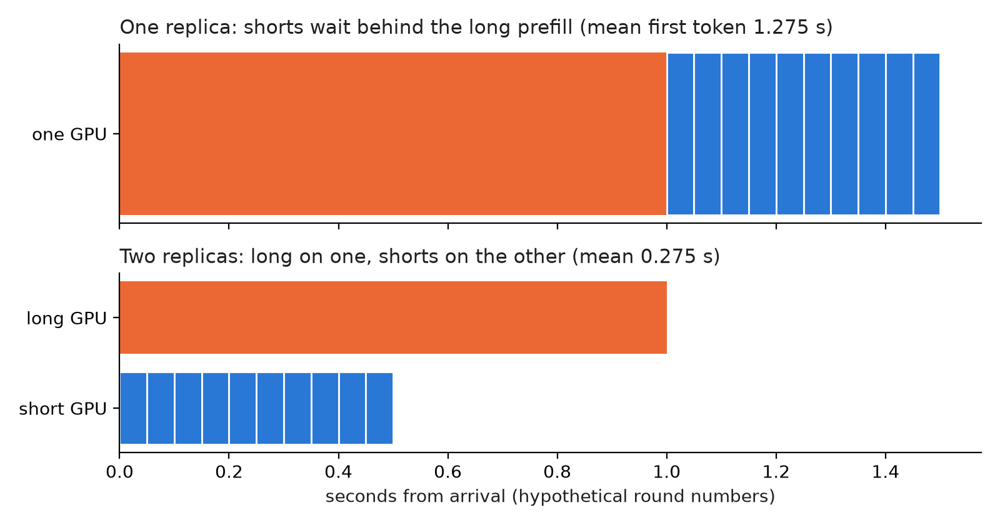
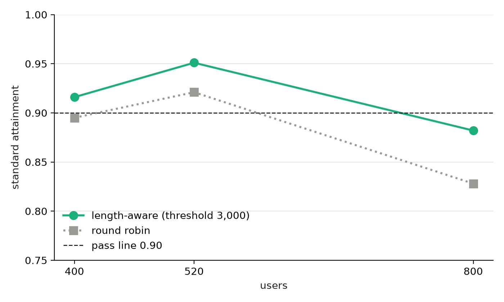

On an empty L4, the prefill of one 4,000 to 8,000-token prompt took 1 to 1.4 s (measured), and in that time the GPU served nothing else. Every short request that arrives in that second waits. Length-aware routing keeps the long prompts on their own replica so the short ones never queue behind them. Below: a worked example, then what it gave us on L4s, and where it did nothing.

## Key results

Standard attainment (share of requests meeting the standard SLO tier: first token within 1 s for chat and 2 s for rag and code, 50 ms per output token; a level passes at 0.90), 2 x L4, SGLang 0.5.20, Qwen3-4B FP8:

| users | round robin | length-aware | kind |
|---|---|---|---|
| 400 | 0.895 | 0.916 | measured, 1 seed |
| 520 | 0.921 | 0.951 | measured, 1 seed |
| 800 | 0.828 | 0.882 | measured, 1 seed |

3 seeds, length-aware: 0.931 mean at 520 and 640 users, 0.894 at 800. Edge about 640 users (measured). On 4 x L4 with 2 long and 2 short replicas: 0.924 +- 0.006 at 1,200 users (3 seeds, measured).


## 1. Head-of-line blocking, with round numbers

Assume (hypothetical) one long prompt whose prefill takes 1.0 s, followed at once by 10 short prompts whose prefills take 0.05 s each. First come, first served on one GPU: short number i gets its first token at 1.0 + 0.05 i seconds, so the mean is 1.0 + 0.05 x 5.5 = 1.275 s. Put the long prompt on a second GPU and the shorts finish at 0.05 i, a mean of 0.275 s. That is a 1 s saving per short request, equal to the whole standard first-token budget of chat.



*Hypothetical round numbers, not measured. Chunked prefill softens the effect by cutting the long prompt into pieces, but the shorts still share the GPU with it.*

Our logs agree on the scale: short requests were seen waiting behind those 1 to 1.4 s prefills on one L4 (measured). At 450 users the queue also hurt requests that had no long prompt ahead of them, 6 % of them (measured).

## 2. The router

The router counts prompt tokens and picks a pool. It needs no model, only a tokenizer or a length estimate:

```python
def route(prompt_tokens, long_pool, short_pool, threshold=3000):
    pool = long_pool if prompt_tokens >= threshold else short_pool
    return min(pool, key=lambda r: r.in_flight)   # least loaded inside the pool
```

On our assistant-style mix, prompts of 3,000 tokens or more were 29 % of requests but about 60 % of prompt tokens (from the workload distribution). The long replica therefore does more than half the prefill work for under a third of the requests, and it saturates first.

## 3. What we measured



*One seed per point. Gaps under about 3 to 5 points are noise at this sample size.*

Same hardware, load and seeds-per-cell on both layouts, so the comparison is fair, but it is one seed. Length-aware led by 2 to 5 points at every level. That is at the edge of the noise: the 3-seed spread at 520 users was 0.902 to 0.956, so the 0.951 above was the top of the range and the real value is about 0.93 (measured). With 3 seeds the standard edge reads about 640 users on 2 x L4, against about 225 on one L4 (3 seeds each): more than 2x for 2x the GPUs.

Four L4s showed the value of sizing the pools. With 1 long and 3 short replicas, standard at 800 users was 0.883 and the long replica's p90 first-token time was 16.5 s. With 2 long and 2 short, it was 0.956 and 1.8 s (measured, 1 seed each). The long pool needed more capacity, as the 60 % share predicts.

## 4. Thresholds and where it did not help

- **Threshold 4,000 instead of 3,000** lost on 2 x L4: 0.930 against 0.951 at 520 users and 0.824 against 0.882 at 800 (1 seed; the 3,000 value sits at the top of its seed range, so the 520 gap is partly noise). On 4 x L4 at 1,500 users it tied: 0.845 against 0.838. We kept 3,000 and never tried a value below it.
- **Sticky routing** (keep a conversation on one replica for prefix-cache hits) tied plain least-loaded in the 2 + 2 layout at 1,500 users: 0.834 against 0.838, within noise.
- **Strict tier** never passed for any layout (best 0.724 on 2 x L4; on 4 x L4, 0.770 at 800 users and 0.669 at 1,200). Our reading is that the long prompts themselves, not the queue, set the strict first-token limit; we did not test that.
- **Prefill/decode split** was far worse than length-aware on the same two GPUs: 0.243 at 520 users, 0.617 with a larger prefill chunk, against 0.951 (1 seed each). Our reading: the single prefill GPU became the queue.
- **Low load**: 0.916 against 0.895 at 400 users is inside the noise, so we cannot claim a gain there.

## 5. Limits

Round robin was measured with one seed per level and no 3-seed repeat, so the gain over it is not confirmed beyond about 3 points. The threshold was compared only at 3,000 and 4,000, on one seed. The 29 % and 60 % shares come from one workload mix; another mix needs another threshold. Mechanism for the saturation of the long replica is our reading from latency logs. One router process handled all requests; we did not test router overhead at larger scale.

## 6. Reproduce

Our runs, October 2026: Qwen3-4B-Instruct-2507 FP8 weights and FP8 KV cache, SGLang 0.5.20, chunked prefill 256, 2 x L4 (and 4 x L4 for the pool-sizing runs).

1. Start one server per GPU, each on its own port, e.g. `python -m sglang.launch_server --model-path Qwen/Qwen3-4B-Instruct-2507 --port 3000X --chunked-prefill-size 256` with `CUDA_VISIBLE_DEVICES=X`.
2. Put a router in front with the `route` function above (a custom script is needed; plain HTTP forwarding is enough).
3. Load: closed-loop users with a mean think time of 351.5 s, 10 minutes per level, one to three seeds; measure per-request first-token time and per-token time and compute attainment per tier.
4. Cost: on the order of 1.2 h of GPU time for a one-seed screen on two L4s (estimate).

## 7. Sources

- SGLang router and data-parallel docs: https://docs.sglang.io/.
- Sarathi-Serve (Agrawal et al., OSDI 2024), chunked prefill and head-of-line interference: https://arxiv.org/abs/2403.02310.
- DistServe (Zhong et al., OSDI 2024): https://arxiv.org/abs/2401.09670.
- Our runs, October 2026.


Written with Claude Code. Numbers checked against the runs under Sources.
