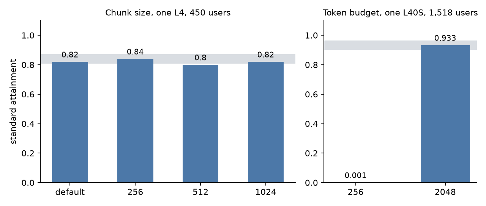

## Key results

| knob sweep | values | standard attainment | verdict |
|---|---|---|---|
| prefill chunk, one L4, 450 users | default / 256 / 512 / 1,024 | 0.82 / 0.84 / 0.80 / 0.82 | all within noise |
| token budget, TRT-LLM, one L40S, 1,518 users | 256 / 2,048 | 0.001 / 0.933 | 256 broken, 2,048 fine |
| memory fraction, one L4 shared by 3 processes | 0.75 / 0.60 | crash at start / starts | pool 52k vs 28.8k tokens |

All measured, 1 seed per cell. Standard attainment is the share of requests that meet the standard first-token and per-token latency limits.

## 1. The rule

An engine has dozens of knobs and the interactions are unknown, so we tune like a lab experiment: change one knob, hold everything else, and compare paired runs. Paired means the same load, the same request stream and the same hardware, run back to back. A gap counts only if it clears the noise band. Our rule puts it at about 3 points of attainment (a choice, not a statistical test), based on a seed-to-seed sd of 0.017 to 0.021 near the edge (measured, 3 seeds) and a single-seed run that read 0.956 where the three-seed mean was 0.906.

## 2. Decision procedure

```
1. Fix the load: users, think time, request stream (seed), window, warm-up.
2. Run the baseline twice. The gap between the two runs is a first noise estimate.
3. Pick the knob from a symptom (a stall, a half-idle GPU, an OOM), not from a list.
4. Change that one knob. Run at the load where the symptom shows.
5. Gap > noise band?  yes -> keep, then re-run at a second load.  no -> revert; the knob does not matter here.
6. Record the value with the engine name: equal numbers across engines are not equal settings.
```

The symptom rule (item 3) matters most. A knob with no symptom behind it costs a GPU hour and usually lands inside the band.

## 3. Example: chunk size

On one L4 at 450 users, the default chunking had a longest token gap (p90) of about 620 ms, so we tried a chunk of 256 (the prefill of a long prompt is cut into pieces of at most that many tokens). The gap fell to about 100 ms. Standard attainment read 0.82 (default), 0.84 (256), 0.80 (512) and 0.82 (1,024). All four are within 0.04, which is the noise band plus one point, so none is a winner by attainment. What did move was the kind of miss: at 256, 5 % of requests missed on per-token time and 13 % on first-token time; at the default, 13 % and 6 % (measured, 1 seed). We kept 256 because it removed the stall, and said so as a choice, not a win.

## 4. Example: token budget

We copied a budget of 256 tokens per step from vLLM and SGLang into TensorRT-LLM on one L40S. Standard attainment was 0.001 at 1,350 and 1,518 users, with the GPU at 48 % use. One TRT-LLM step took about 30 ms and decode tokens share the budget. With an assumed 56 requests decoding, a 6,000-token prompt gets 200 tokens per step and waits 30 steps, about 0.9 s (computed); measured median first-token time was 1.02 s for prompts over 6,000 tokens at light load. With a budget of 2,048, first-token p90 was 0.52 s for those prompts and attainment was 0.950, 0.933 and 0.891 at 1,350, 1,518 and 1,687 users. The gap, 0.93, is far outside any band.



*Figure 1. Left, four chunk sizes sit inside the noise band. Right, one token budget breaks the engine. Measured, 1 seed each; the grey band is 0.03 around the reference bar.*

## 5. Example: memory fraction

The memory fraction is the share of free GPU memory a process may use for weights plus KV pool. With three SGLang processes on one 22.5 GiB L4, the LLM started last and saw 10.5 GiB free. At 0.75 it crashed in CUDA-graph capture with 0.52 GiB free; at 0.60 it started but the pool fell from 52k to 28.8k tokens. The arithmetic predicts it: 0.60 x 10.5 = 6.3 GiB, minus 4.3 GiB of weights, leaves about 2.0 GiB of pool (computed). This knob has no noise band to read: a crash is binary, so the procedure ends at item 4, and the trade (less pool, lower attainment) is then measured as its own change.

## 6. Limits

- The 3-point band is our rule, set from one hardware setup and one workload; a different load may need its own.
- The chunk sweep has 1 seed per value, so its ordering is not established.
- We did not sweep max batch size or memory fraction beyond the two values shown.
- The two TRT-LLM runs differ in hardware from the chunk sweep; do not compare their attainment.

## 7. Reproduce

Our runs, October 2026. Engines: SGLang 0.5.20 (`--chunked-prefill-size 256`, `--mem-fraction-static 0.60`), vLLM 0.30.0 (`--max-num-batched-tokens 256`), TensorRT-LLM (`max_num_tokens` in the LLM API options). Load: closed-loop think-time users, 30 s warm-up, 600 s window, one seed per cell for these sweeps. Run each baseline twice before the first change. Cost: about 10.5 minutes of one GPU per level (computed, 30 s + 600 s).

## 8. Sources

- Agrawal et al., "Taming Throughput-Latency Tradeoff in LLM Inference with Sarathi-Serve", OSDI 2024.
- SGLang, vLLM and TensorRT-LLM server-argument docs.
- Our runs, October 2026.


Written with Claude Code. Numbers checked against the runs under Sources.
