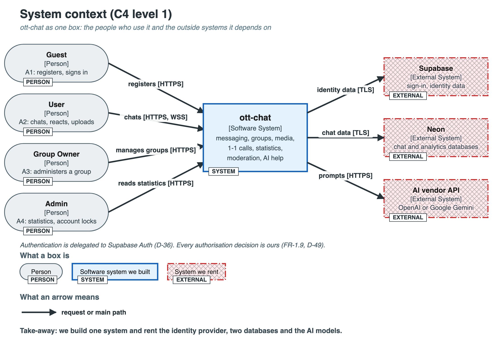
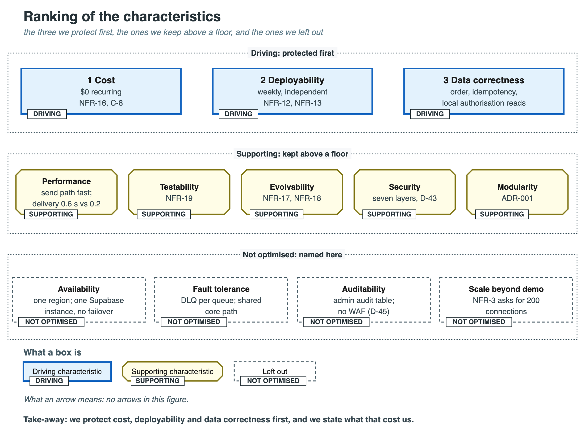

ott-chat is a chat system in the spirit of Zalo. My team of four built it for a software architecture course, from the first requirements on 21 September to the report on 21 November 2026; I led the architecture, the codebase, security and latency work. This post is the map of the series: what we had to build, what we ranked first, the shape that followed, and what it cost. We tore the dev stack down on 22 November 2026, so everything here is past tense.

## Key results

- **54 features, 50 live.** One more (push to a closed app) waited for deploy; e-mail alerts, group calls and an incoming-call ring were not built.
- **Three drivers, in this order.** Cost ($0 recurring), deployability (a cloud release every week, one function at a time), data correctness (no lost, duplicated or misordered message).
- **Eight services, one bus, 17 functions.** Microservices on AWS Lambda, talking through one SNS topic and seven SQS queues.
- **AWS cost $1.17 to $1.43 a month.** Close to the $0 target. The free plans set the real limits.
- **Latency target missed.** A send was acknowledged in 113 ms (median) but reached the other screen in a median 626 ms over 10 scripted runs (QA saw 570 to 600 ms), against a 200 ms target.
- **Capacity is a model, not a test.** About 300 active users comfortably, by estimate. No load test was run.

## 1. What we had to build

*One system we built, three we rented: identity provider, databases, AI model.*

The brief was one line: an OTT messaging system modelled on Zalo. Around it sat eight binding items: accounts and groups, one-to-one and group chat with five content types, activity statistics, all five stages from requirements to deploy, a cloud release every week, a team of three or four, and a report in week 11. The technology list (Java, MySQL, Node.js and others) was only a suggestion.

We wrote 95 functional requirements in 12 groups (39 of them Must) and 21 non-functional ones, and shipped them as 54 features. There were four clients: a React web app, an admin console, an Android shell around the web code (Capacitor) and a native macOS app in Swift. iPhone users installed the web app as a progressive web app, or PWA (D-188).

Three requirements shaped the send path more than any feature. Order comes from a server-assigned number, `seq`, not from arrival time (FR-3.3). A retried send must not create a second message (FR-3.8). And the sender's wait must not grow with the size of the group (FR-4.4).

> **In plain words: "sent" means stored, not delivered**
> When you press send, the server writes the message, gives it the next `seq` and answers "sent". Delivery to other screens comes after and may fail. That is fine: a phone that missed something asks "everything after 41, please" when it reconnects. Store for sure, deliver best effort, repair by `seq` (D-07, D-48).

*Store for sure, deliver best effort, repair by seq.*

## 2. What we ranked first

*The ranking, built from the decision log. Fault tolerance later moved up to supporting.*

Nobody gave us a priority list. So I went through the decision log and asked, for each conflict, which side won.

- **Cost first.** The $0 rule (NFR-16, constraint C-8) removed private networks, NAT gateways (about $43 a month, D-42), load balancers, managed relational databases and a web firewall. Containers behind a load balancer were priced at about $102 a month (D-02).
- **Deployability second.** Each function had its own version and `live` alias, so it shipped and rolled back alone (NFR-12, NFR-13).
- **Data correctness third.** Its failures are silent: a message shown to a removed member raises no error. So order came only from `seq`, a client-made `client_msg_id` stopped duplicates, and permission checks read only the owner's own tables.

Performance sat below those three on purpose. Every hop on the delivery path existed for cost or deployability, and every hop could be cold. [Part 6](/posts/ott-chat/06-scale-latency-cost/) shows the bill.

## 3. The shape

*The whole system on one page, drawn from the Terraform code.*

- **Edge.** Route 53 and CloudFront served the web and admin apps from S3, and media through signed URLs. Uploads went straight to S3, never through a function.
- **Requests.** An HTTP API Gateway, throttled per route, sent `/api/v1/*` to four functions: identity, chat, analytics, ai.
- **Events.** Each function wrote its own database, then published to one SNS topic. SNS copied every event into seven queues, one per consumer. After 5 failed deliveries a message waited 14 days in a dead-letter queue, and an alarm e-mailed a person.
- **Sockets.** Browsers held a WebSocket to a second gateway. Connections lived in DynamoDB, and the realtime consumer posted each new message to the open sockets.
- **Schedules.** EventBridge ran two outbox relays, a daily keepalive, a nightly backup and a daily restore into Sydney.

In total: 17 deployed functions (4 HTTP, 1 WebSocket, 7 queue consumers, 5 scheduled) on Node.js 22 and arm64, one region (Singapore), one environment. Outside AWS we rented Supabase for sign-in and identity data, Neon for the other databases, Gemini for AI and Cloudflare for call relays. [Part 2](/posts/ott-chat/02-architecture-style/) explains why this style; [part 3](/posts/ott-chat/03-codebase-ddd/) shows how the code is organised.

## 4. The decisions that mattered

| Decision | Gained | Cost |
|---|---|---|
| D-01 microservices | many course problems to solve, independent deploys | more moving parts than four people usually run |
| D-02 Lambda, not containers | $0 when idle; API Gateway holds sockets for free | cold starts: 190 to 740 ms, 6 to 10 s after long idle |
| D-42 no private network | no NAT gateway | trust rests on tokens and TLS |
| D-07 answer after the INSERT | sender's wait independent of group size | "sent" is not "received" |
| D-48 order from `seq`, not the bus | plain SNS and SQS (FIFO has no free tier) | only the database can order |
| D-49 chat owns membership | permission checks never read stale data | chat holds more rules |
| D-129 a database per service | one schema change cannot break another service | copies of others' data lag |
| D-162 standby copy in Sydney | daily copy of all data in a second region | manual failover, estimated 2 to 4 h |
| D-164 ECS built, measured, dropped | warm p50 43 ms vs 61 ms on Lambda | money every month for no cold start |

Two rows came from free plans, not from books. Neon's 100 free compute-hours ran out after 17 days because a one-minute poll kept the chat database awake; the relay now runs right after each write (D-145). And on 18 November the account's limit of 10 concurrent functions throttled chat until AWS raised it to 1,000.

## 5. How it ran

| What | Value |
|---|---|
| AWS bill | $1.17 (September), $1.43 (October); AI capped at $2 a day |
| Send acknowledged | p50 113 ms, p95 298 ms |
| Send to the other screen | median 626 ms over 10 scripted runs; 570 to 600 ms in QA |
| Comfortable load (model) | about 300 active users, roughly 1,000 connected |
| Hard limit (model) | free chat database, 600 to 1,900 active users; the system breaks at 1,000 to 2,500 |

The acknowledgement was fast; delivery was not. The edge answered in about 100 ms, so the network was not to blame. The half second after the acknowledgement went somewhere in SNS, SQS, the realtime function and the socket post. We never timed each hop, so I cannot say where.

## 6. The series

| Part | Topic |
|---|---|
| [0](/posts/ott-chat/00-start-here/) | Start here: one-post summary |
| 1 | The whole picture (this post) |
| [2](/posts/ott-chat/02-architecture-style/) | Architecture style: options, Lambda vs ECS, events |
| [3](/posts/ott-chat/03-codebase-ddd/) | Codebase: domain-driven design, adapters, contracts |
| [4](/posts/ott-chat/04-data-events/) | Data and events: databases, outbox, saga, idempotency |
| [5](/posts/ott-chat/05-aws-ha-security/) | AWS, auth, security, availability, CI/CD |
| [6](/posts/ott-chat/06-scale-latency-cost/) | Capacity, latency, cost |
| [7](/posts/ott-chat/07-chat-core/) | Real-time chat: send, receipts, presence, push |
| [8](/posts/ott-chat/08-history-and-calls/) | History archive and calls |
| [9](/posts/ott-chat/09-ai-analytics-moderation/) | AI, analytics, moderation, app builds |

## Limits

- **No load test.** The 300-user figure is a model from published limits and an assumed user (one message every 30 seconds).
- **No per-hop timing.** The delivery figure is end to end, from 10 scripted runs and one QA session.
- **The ranking is our own.** No one confirmed a priority list for us.
- **Failover was never run.** The 2 to 4 hour recovery time comes from reading the runbook.
- **The end state was moving.** Closed-app push and two database moves were merged on the last days but not confirmed deployed.

## Sources

- Final report: §2.1 to 2.6 (requirements, ranking, constraints), §3.1 to 3.7 (style, AWS, Tables 10 and 11), §5.3 to 5.4 (latency, capacity), §7.8 (cost).
- Repository: `docs/requirements.md`, `docs/decisions.md` (D-01, D-02, D-07, D-42, D-48, D-49, D-129, D-145, D-162, D-164, D-188), `terraform/live/dev/`.
- Team slides (capacity table); owner's design notes of 20 September (the "sent means stored" model).
- Richards and Ford, *Fundamentals of Software Architecture*, 2020; the C4 model, c4model.com.
