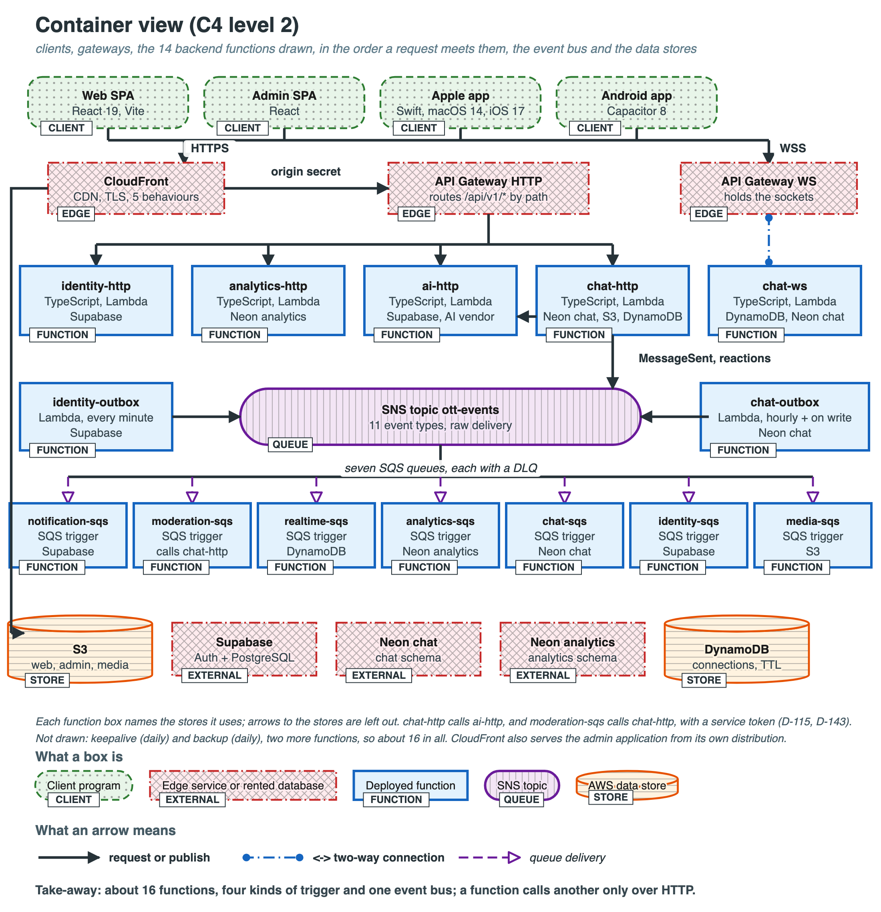

[Part 1](/posts/ott-chat/01-system-design/) showed the shape of ott-chat. This part is about how we got there. On 20 and 21 September 2026 I weighed several ways to cut the system into services, two ways to run it, and two backend languages. Here are the options, what we chose, and what the choice cost.

## Key results

- **Microservices, merged by business area.** A few large core services (identity, chat) and many small consumers. Eight services in the end.
- **Serverless compute.** Lambda was free when idle. Containers were priced at about $102 a month, with a break-even near 3,000 open sockets; the brief asked for 200.
- **Event-driven through SNS and SQS.** One topic, one queue per consumer. Only two direct calls between services.
- **TypeScript, not Go.** Go was chosen and reversed the same day: the work is I/O bound and the clients share the API types.
- **The price: cold starts and lag.** 190 to 740 ms on some calls, 6 to 10 s after a long idle, and copies of other services' data that ran late.

## 1. Three ways to cut the system

```text
B   8 services, ~15 functions   one function per job, one queue per consumer
C   4 units,     6 functions    cut by "user waits" vs "nobody waits";
                                one worker runs all four consumers
C′  core few and large          identity, chat, media
    edge many and small         notification, analytics, moderation,
                                each with its own queue and dead-letter queue
```

**Problem.** The course rewards distributed designs. A team of four had nine weeks. Too many services and we drown in infrastructure; too few and "microservices" is a word on a slide.

**Options.** On 20 September I compared B and C. B was fine-grained: 15 functions, 15 roles, 15 log groups. C cut along the one axis that really existed, synchronous against asynchronous, and was about 7 hours of infrastructure cheaper by our estimate. But C put four consumers behind one queue and one worker. One poison message would then block all four, and a retry would make analytics count twice.

**Decision.** C′ (D-04): merge the core, split the edge. It started as 6 services and 9 functions. By the end it had grown to 8 services and 17 functions, without changing shape.

## 2. What real chat systems do

```text
   CORE: few, large                     EDGE: many, small
   ┌──────────┐ ┌──────────────┐         ┌──────────────┐
   │ identity │ │ chat         │ ─events─►│ notification │
   └──────────┘ │ groups,      │         │ analytics    │  one queue
                │ members,     │         │ moderation   │  + one DLQ
                │ messages     │         │ realtime ... │  each
                └──────────────┘         └──────────────┘
```

I asked what large systems actually do. The answer I got: chat products such as WhatsApp, Slack and Discord keep the message path in a few big services, with many small ones around it for search, push, analytics and abuse. Ours follows the same pattern. That gave a reason better than "to have eight services": the core shares rules about order and permission, so it stays together; the edge fails in separate ways, so it is split.

The report frames the result honestly. Eight coarse services is service-based granularity (the book gives 4 to 12). What makes it microservices is the data: each service owns its schema, with no foreign key and no read across services (D-104, D-129).

> **In plain words: who keeps the member list?**
> Each service has its own database and may not read another's. Say identity owned group members and chat kept a copy. A member is removed at 9:00:00.000; the copy updates 300 ms later; at 9:00:00.100 the removed member sends, and chat, reading its old copy, lets it through. If chat owns the list, the check reads its own table. Rule: data that decides "allowed or not" lives where the decision is made (D-49).

## 3. Lambda or containers


*Serverless as built: 17 deployed functions, no server of ours, nothing billed while idle.*

| Option (plan of 26 September) | Monthly cost |
|---|---|
| A: stay on Lambda | under $0.50 |
| B: everything on ECS Fargate | about $124 (tasks $53, NAT $43, load balancer $16, Redis $12) |
| C: WebSocket path on ECS, rest on Lambda | about $45 to $55 |

**Problem.** The $0 budget ranked first. A chat system needs open sockets, and the classic answer is a container fleet behind a load balancer with a Redis backplane.

**Decision.** Lambda (D-02). API Gateway holds the sockets for free, so no function stays alive between messages. Queue consumers are Lambda too: AWS polls the queue for us, retries and moves failures to a dead-letter queue. The plan kept option A and named when to revisit: sockets in the tens of thousands, or a job that must run all the time.

> **In plain words: Lambda or a container?**
> Lambda is like a ride-hailing app: no ride, no bill, and each ride costs a little. A container is like owning a car: it costs money parked, but extra trips are nearly free. There is always a break-even point. Ours was about 3,000 open sockets (D-02), because API Gateway charges for every minute a socket stays open. We needed 200. Cold starts are a separate problem: they hit when traffic is low, not high.

We tested the rule on 19 November. ECS Fargate served the HTTP services at a warm median of 43 ms against 61 ms on Lambda, both under 90 ms at p95. The only gain was no cold start, for about $6 to $10 a month. We removed it (D-164).

## 4. Events through one topic, one queue per consumer


*Container view, an earlier snapshot (11 event types, about 16 functions). The final count was 16 event types and 17 functions, same shape.*

**Problem.** After a message is stored, five things must happen: fan-out to sockets, notifications, statistics, moderation, and copies of user data. None of them should slow the sender or break the send.

**Decision.** Broker-style events. A service publishes to one SNS topic; SNS copies each event into one SQS queue per consumer. No central component decides who runs next. Commands such as "send" stay synchronous HTTP and answer after the database write; only the work after the commit is asynchronous. Services call each other directly in two places only: chat calls ai, and moderation asks chat to retract a message.

Why a queue per consumer, and not SNS straight to Lambda? A function fed directly by SNS gets two retries and the message is gone. Behind a queue it gets five deliveries and then waits in a dead-letter queue. And one consumer's failure stays its own. Moderation once failed on every call for a whole release because of a missing setting; seven messages sat in its dead-letter queue, and analytics did not lose an event.

**Cost.** Delivery is at least once, so every consumer records `(event_id, handler)` before acting. Order never comes from the bus, only from `seq` (D-48), which let us use plain queues; FIFO has no free tier. And every consumer receives every event, so the noisiest type, presence, was filtered to realtime only (D-181). [Part 4](/posts/ott-chat/04-data-events/) covers the outbox and idempotency.

## 5. TypeScript, not Go

| | Go (D-12, reversed) | TypeScript (D-68) |
|---|---|---|
| Cold start | about 15 ms | about 150 ms, bundled small (D-69) |
| Concurrency | goroutines | `Promise.all`, same result for I/O-bound work |
| API types for the clients | need a code generator | imported directly by the React clients |
| Languages to know | two | one |

I chose Go first: fast cold starts, and I wanted to learn it. It was reversed the same day. Every concurrent operation here waits on the network, where goroutines win nothing. Meanwhile one language let the web, admin and Android clients import the backend's API types, so a renamed field breaks the build, not the demo. Java was out too: its cold starts take 3 to 10 seconds.

## 6. What the style cost

| Cost | Evidence |
|---|---|
| Cold starts | 190 to 740 ms on 4 to 10% of calls; 6 to 10 s after a long idle |
| Late copies | a block reached chat's copy in 59.4 s, then 0.4 s after D-165 |
| Many moving parts | 17 functions, 1 topic, 7 queues, 7 dead-letter queues |
| Account limits | a limit of 10 concurrent functions throttled chat until raised to 1,000 |
| Free-tier meters | a one-minute poll spent Neon's 100 compute-hours in 17 days (D-145) |

The deal was explicit: independent deploys and a $0 bill, paid with lag and cold starts. We kept correctness where it matters. The send, the membership check and the message order sit in one local transaction of the chat database. Copies elsewhere may run late; permission checks never read them.

D-01 states the other reason for microservices plainly: it is the style that "generates the most problems the course teaches how to solve". For a course, that was a fair goal. For a product of this size, the C′ split, not the label, is what I would keep.

## Limits

- **Real-system claims are second hand.** The WhatsApp, Slack and Discord pattern came from a design session, not from my own reading of their engineering posts.
- **Cost figures are estimates.** The ECS prices come from the decision log and a plan of 26 September; only the 19 November ECS test was built and measured.
- **The 7-hour saving of option C** was an estimate from the session, never tested.
- **Cold start samples are small**, and the 6 to 10 s figure is observed, not sampled.

## Sources

- Final report: §3.2 (style, Table 10), §3.4 (events), §3.5 (serverless, D-164), §3.6 to 3.7 (Table 11, account limit).
- Repository: `docs/decisions.md` (D-01, D-02, D-04, D-12, D-48, D-49, D-68, D-69, D-104, D-129, D-145, D-165, D-181), `docs/plan/compute-migration.md`, `terraform/live/dev/event-bus.tf`.
- Owner's design sessions of 20 and 21 September 2026 (options B, C, C′; real systems; the ECS threshold).
- Richards and Ford, *Fundamentals of Software Architecture*, 2020.
