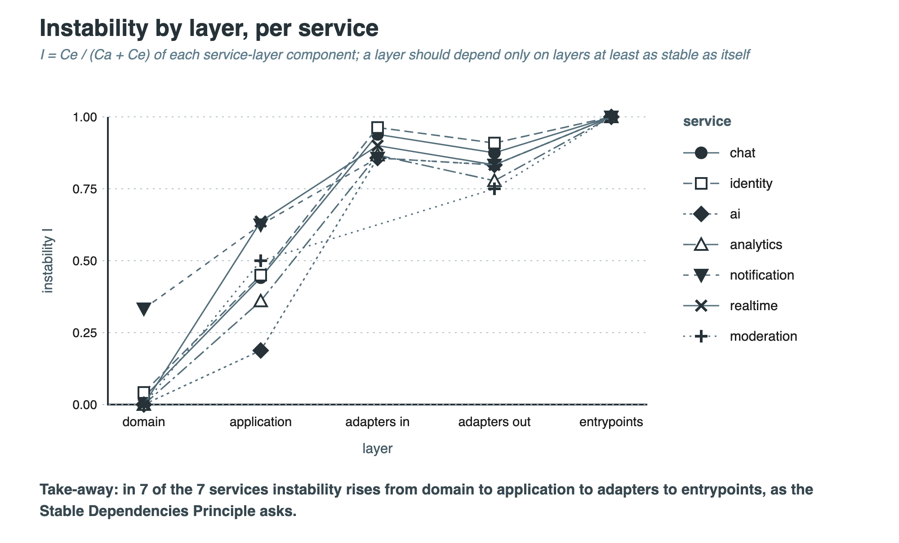

The earlier parts looked at ott-chat from the outside: what a Zalo-like messenger needs, and how it runs on AWS. This
part opens the repository. ott-chat was the project for a Software Architecture course, built by a team of four in
about nine weeks. I owned the architecture, the technology choices, the codebase and security, so the shape of the
code is mostly my decision, and so are its mistakes.

The question this part answers: how do four people change one TypeScript repository every week, deploy seven services
on their own, and not end up with one big ball of mud? My answer was domain-driven design at the top, clean
architecture inside each service, and a build that fails when anyone breaks the rules. Every number below comes from
the code on the main branch (commit `54bb684`, 17 November 2026) or from the measurement scripts of our course report,
which ran one commit earlier (`a4a6b6d`, no service code differs between the two).

## At a glance

- **Partitioned by domain, not by layer.** The top-level folders are `services/chat`, `services/identity` and five
  more, never `controllers/` or `models/`. Layers appear only inside a service.
- **Seven bounded contexts.** chat, identity, ai, analytics, moderation, notification and realtime. Each owns its
  data. They talk through events on one SNS topic, plus three synchronous seams.
- **Four layers in every service.** `domain` → `application` (use cases and ports) → `adapters` (inbound and
  outbound) → `entrypoints` (one per Lambda). Only `contract/` is public.
- **Five rules, checked by the build.** dependency-cruiser fails `make lint` on a forbidden import. Measured: 0
  forbidden imports among 2,108. A second script proves the rules still fire, because they silently stopped twice.
- **The metrics mostly agree.** Instability rises from domain to entrypoints in all 7 services. LCOM4 is 1 in 70 of 102
  files scored. The honest findings: one contract cycle (chat ↔ identity), event names spelled as strings in 11 files,
  and chat holds 123 of the 300 service files.

## 1. Why the top level is partitioned by domain

**The problem.** Six services and nine deployment units, three to four people, nine weeks, one repository (this is the
context section of ADR-001, our first architecture decision record). A seventh service, ai, came later. Everyone
would touch the code every week. The structure had to let two people work on two features without editing the
same folders, and it had to keep the services separable, or "microservices" would be a word on a slide.

**The options.** Three styles were on the table, and at first I treated them as alternatives:

| Option | What it looks like | Why I did not pick it alone |
|---|---|---|
| Layered at the top | `controllers/`, `services/`, `models/` | Technically partitioned: one feature is spread across every top folder, which is hostile to domain-driven design |
| Build-system modules | `module-api`, `module-core`, `module-impl` per domain (a production codebase I read had about 150 of them) | That design exists because everything deploys as one process, so compile time is the only boundary. We already had separate functions as physical boundaries. Its cost, six places to edit per contract change, would land in the busiest weeks |
| One repo, partitioned by domain | `services/<business capability>/` | Chosen, with two more styles inside |

**The decision.** ADR-001 uses all three styles, at different levels, because they answer different questions:
**Screaming Architecture** at the top (folder names say what the business does), **Clean Architecture** inside a
service (every dependency points inward), and **closed layers** inside that (no skipping from inbound to outbound).
It is one pnpm workspace: `pnpm-workspace.yaml` lists `kernel`, `platform`, `services/*`, `clients/*` and
`tools/keepalive`. It is also one build unit (decision D-66). There is no build-time wall between packages. The wall
is a private folder plus lint rules, explained in section 6.

**The numbers.** If the partition fits the work, most commits should touch one area. In the history up to the final
report, 279 of 353 commits that touched code (79%) touched exactly one area, and 36 touched two or more services. I read
that as a sign the partition fits, not as proof.

**The trade-off.** More files per feature (a port, a use case, an adapter, a handler, a client type) than a flat
layered app. The ADR priced it: "boilerplate nobody enjoys" (section 8).

## 2. Seven bounded contexts and how they talk

The repository never says "bounded context". It says "service", and it has a `GLOSSARY.md` that it calls "the
ubiquitous language for this system". The test for an entry is: "a term belongs here when using the wrong word would
cause a wrong decision". *Retract* is not *delete*, and someone who confuses them writes `DELETE FROM messages`. In DDD
terms, each service is a bounded context: one model, one owner of its data, one vocabulary. Figure 1 is the context
map.

![Context map: seven boxes, one per service, each listing what it owns and its store. identity and chat publish events to one SNS topic (identity's through an outbox; chat's MessageSent and reaction events inline after commit, ConversationChanged through an outbox). realtime, notification, analytics and moderation consume from it, and chat consumes identity's events to keep copies. Three synchronous seams: chat calls ai over HTTP, moderation calls chat over HTTP to retract, and chat imports moderation's pure policy function. A red label marks the one contract cycle between chat and identity.](./figures/ddd-context-map.png)

*Figure 1: the seven contexts, what each owns, and the three ways they meet: events (purple), HTTP calls (black) and
compile-time imports of another service's `contract/` (grey).*

| Context | What it owns (main concepts) | Store | Publishes | Consumes |
|---|---|---|---|---|
| **chat** | conversation (direct or group), membership, message with its `seq`, reaction, read state; copies of users and blocks | Neon `ott-chat` | MessageSent, ReactionAdded, ReactionRemoved (inline), ConversationChanged (outbox) | ProfileChanged, AdminChanged, BlockChanged |
| **identity** | profile, friend request, block, admin account and audit | Supabase Postgres + Auth | ProfileChanged, AdminChanged, BlockChanged (outbox) | none |
| **ai** | spend ledger, consent, result cache, provider choice | Supabase `ai` schema | none | none (called over HTTP) |
| **analytics** | daily KPI projections; copies of users and conversations | Neon `ott-analytics` | none | MessageSent, ReactionAdded, ConversationChanged, ProfileChanged, AdminChanged |
| **moderation** | the banned-term policy and the async scan | none of its own | none | MessageSent |
| **notification** | in-app notifications, reaction coalescing | Supabase `notification` schema | none | MessageSent, ReactionAdded |
| **realtime** | WebSocket fan-out, pruning dead sockets | DynamoDB connections table | none | MessageSent, ReactionAdded, ReactionRemoved |

Chat is the core domain. Its biggest concepts are the **conversation**, which owns its memberships, and the **message**,
whose order is a server-assigned `seq`. The glossary pins the rule that drove the split: membership is "owned by the
chat service ... a permission check must never read replicated data". So the conversation and its members had to live
in the same context as the messages they authorise. That is why chat is big.

**How they talk.** Mostly by events. A publisher puts one event on one SNS topic. Each consumer has its own SQS queue
and dead-letter queue, and is idempotent on `(event_id, handler)`. The publisher does not know who listens: the
Terraform comment reads "Adding a fourth consumer is a new key in `consumers`; chat does not change". That is the
open-closed principle at the service level.

There are three synchronous seams, and each is a deliberate exception:

1. **chat → ai over HTTP** with a shared service token. Chat keeps the user-facing `/ai/translate` and
   `/ai/summarize` routes, because it owns the membership check, and calls ai's `/ai/generate` (D-143). Ai owns
   spend, consent and the vendor key.
2. **moderation → chat over HTTP** to retract a message (D-115). Moderation could have written `chat.messages`
   directly, which "deletes D-06" (one owner per table), or sent a `RetractionRequested` event, which needs a new queue
   for "a request with an answer, not an announcement". It calls chat's own use case instead.
3. **chat imports `@moderation/contract/policy.ts`**, a pure function, for the tier-1 banned-term check before the
   insert. No I/O, no failure mode, "nothing for `chat` to be unavailable because of".

## 3. Inside one service: four layers, ports in the middle

Every service has the same folders, from chat with 123 source files down to moderation with 9. A developer who has
read chat can open moderation and find the use cases without asking. Figure 2 shows the layers and the arrows the
build allows and forbids.


*Figure 2: one service's folders and the imports between them. Black: allowed. Red: forbidden, and the build fails.*

```
services/chat/
├─ contract/           PUBLIC: api/ types and events/ schemas
├─ internal/           PRIVATE
│  ├─ domain/          rules and values; standard library + kernel only
│  ├─ application/     one use case per file, plus ports.ts
│  ├─ adapters/        inbound/ (http, ws, sqs) · outbound/ (store, events, media, ai, connections)
│  └─ entrypoints/     http/ ws/ sqs/ outbox/: one composition root per Lambda
├─ db/migrations/      forward-only SQL, owned by this service
└─ tests/              unit/ (fakes) · integration/ (real Postgres, LocalStack)
```

- **domain** holds values and rules: `message-kind.ts` refuses a kind no client may send, `membership.ts` knows when a
  member has left. It imports only `@ott/kernel`.
- **application** holds use cases (`send-message.ts`) and the **ports** they need, in `ports.ts`. Decision D-62 put the
  ports here, "never beside their implementations". ADR-001 calls this "the whole of Dependency Inversion": the use case
  owns the interface, the adapter conforms to it.
- **adapters** implement ports (outbound: Postgres with Drizzle, SNS, S3, DynamoDB, an HTTP client for ai) or turn a
  request into a use-case call (inbound: HTTP, WebSocket, SQS).
- **entrypoints** are composition roots. They create pools and SDK clients once per Lambda container and inject them.

Two shared packages sit outside the services, split by ring (D-67). `kernel/` is pure: `Result`, errors, clock, ids.
Domain and application may import it. `platform/` touches the outside world: the HTTP kit, JWT, Postgres, the outbox
relay, the logger. Only adapters and entrypoints may import it. The admission test for both (D-63) is one sentence:
"if a businessperson could have an opinion about it, it does not belong."

Tests live outside `internal/`, so the five rules need no exemption for test files. A use case gets in-memory fakes in
a unit test and real adapters in production. In numbers: 142 unit test files and 44 integration test files across the
seven services, 60 and 18 of them in chat.

## 4. One request end to end: sending a message

`POST /conversations/:id/messages` is the core path of a chat app. Here it is through the folders, from the Lambda
down to the event. I trimmed comments; the code is otherwise as written.

### 4.1 The entrypoint wires everything once

`services/chat/internal/entrypoints/http/lambda.ts` is what AWS invokes. Everything in it runs once per container,
at module load (our hard rule 8). It is the only file in the path that names a concrete adapter:

```ts
// services/chat/internal/entrypoints/http/lambda.ts (excerpt)
const policy = { check: findTier1Term };   // from @moderation/contract/policy.js

export const handler = createHandler({
  conversations: createConversationRepository(db),
  memberships: createMembershipRepository(db),
  messages: createMessageRepository(db),
  blocks: createBlockChecker(db),
  // ... reactions, readState, sync, browse, connections, isAdmin, moderationLog
  clock: systemClock,
  newId: randomUUID,
  verifyAccessToken,
  ...events,        // SNS publisher, only where EVENTS_TOPIC_ARN is set
  ...media,         // S3 + CloudFront signer, only where configured
  policy,
});
```

The optional spreads matter. `EVENTS_TOPIC_ARN` is set by Terraform only where the event bus exists; under `make
dev` it is absent, and the same use cases still work, because a port that is absent is a case the use case already
handles.

### 4.2 The handler: translate, call, respond

The inbound HTTP adapter does three things: verify the caller, parse the body, call the use case. Nothing else.

```ts
// services/chat/internal/adapters/inbound/http/handlers.ts (excerpt)
export async function postMessages(deps: ChatDeps, request: HttpRequest): Promise<HttpResponse> {
  return withCaller(deps, request, async (caller) => {
    const conversationId = requireParam(request, 'id');
    if (!conversationId.ok) return errorResponse(conversationId.error);
    const parsed = parseSendMessageBody(request.body);
    if (!parsed.ok) return errorResponse(parsed.error);

    const result = await sendMessage(
      { conversations: deps.conversations, memberships: deps.memberships, messages: deps.messages,
        media: deps.media, events: deps.events, policy: deps.policy, blocks: deps.blocks, clock: deps.clock },
      { conversationId: conversationId.value, senderId: caller.userId, kind: parsed.value.kind,
        body: parsed.value.body, clientMsgId: parsed.value.clientMsgId },
    );
    return respondFrom(result, (message) => okResponse(toMessageDto(message), 201));
  });
}
```

`toMessageDto` is the boundary mapping: the domain `Message` never leaves the service as-is. An error from any layer
becomes a status code in one function, `errorResponse` in `platform/src/http/respond.ts`.

### 4.3 The use case sees only ports

`services/chat/internal/application/send-message.ts` is 205 lines, the largest use case in the repository (the median
is 43 lines over 71 application files). Its first argument is an object of ports:

```ts
// services/chat/internal/application/send-message.ts (excerpt)
export const sendMessage = async (
  ports: {
    conversations: ConversationRepository;
    memberships: MembershipRepository;
    messages: MessageRepositoryWithMedia;
    media?: MediaUrlSigner | undefined;
    events?: EventPublisher | undefined;
    policy?: ContentPolicy | undefined;
    blocks?: BlockChecker | undefined;
    clock: Clock;
  },
  input: SendMessageInput,
): Promise<Result<Message, AppError>> => {
```

Seven ports plus a clock, the most of any use case (the mean is 2.02). In order, the body checks that the conversation
exists, that the sender is a member (chat's own table, never a copy), that no block stands in a direct conversation,
that the kind is sendable (a domain rule), and that the text passes the tier-1 policy, *before* the write:

```ts
  const violation = ports.policy?.check(input.body) ?? null;
  if (violation !== null) {
    return err(forbidden(`this message was not sent: it contains a banned term — "${violation}"`));
  }
```

`ContentPolicy` is a one-method port: `check(text: string): string | null`. The use case does not know that moderation
supplies it. Then the write and the event:

```ts
  const sent = await ports.messages.send(
    input.conversationId, input.senderId, kind.value, input.body,
    input.clientMsgId, ports.clock.now(), attachment,
  );
  if (!sent.ok) return sent;

  await publishMessageSent(ports.events, ports.clock, sent.value);
  return sent;
```

Every function returns `ok(value)` or `err(error)` from `kernel/src/result.ts` instead of throwing, so each caller
writes an `if (!r.ok)` line. The failure path is part of the signature.

### 4.4 The outbound adapters

The Postgres adapter makes the send idempotent with the unique index on `(conversation_id, client_msg_id)`. A retried
send gets back the original row and its original `seq`:

```ts
// services/chat/internal/adapters/outbound/store/message-repository.ts (excerpt)
const [row] = await db
  .insert(messages)
  .values({ id: uuidv7(now.getTime()), conversationId, senderId, kind: kind.value, body,
            clientMsgId, createdAt: now.toISOString() /* + media columns */ })
  .onConflictDoUpdate({
    target: [messages.conversationId, messages.clientMsgId],
    set: { deletedAt: messages.deletedAt },   // a no-op, so RETURNING hands back the existing row
  })
  .returning({ ...getTableColumns(messages), senderDisplayName: senderDisplayNameSql,
               systemPeople: messageSystemPeopleSql });
```

The SNS adapter implements `EventPublisher`. It is the only file on this path that imports the AWS SDK:

```ts
// services/chat/internal/adapters/outbound/events/event-publisher.ts (excerpt)
export const createEventPublisher = (client: SNSClient, topicArn: string,
                                     enrich: EventEnricher): EventPublisher => ({
  async publish(draft: ChatEvent): Promise<Result<void, AppError>> {
    const enriched = await enrich(draft);
    if (!enriched.ok) return enriched;
    const event = enriched.value;
    try {
      await client.send(new PublishCommand({ TopicArn: topicArn, Message: JSON.stringify(event),
        MessageAttributes: { type: { DataType: 'String', StringValue: event.type } } }));
      return ok(undefined);
    } catch (error) { /* ... becomes err(appError(Internal, ...)) */ }
  },
});
```

### 4.5 Where the outbox fits, and where it does not yet

Here I have to be precise, because the diagram in my head and the code disagree. **`MessageSent` does not go through
the outbox.** It is published inline, after the commit, best-effort: `publishMessageSent` awaits the publish and
swallows a failure, so the HTTP answer never fails because SNS did. The message itself is stored; clients catch up
by `seq` on their next `/sync`. D-130 names the cost: "a failed publish loses the event, and for a rollup that is one
miscount, but for a copy it is a row that stays wrong forever".

So the **transactional outbox** (D-130) carries the events that feed a copy. In chat that is `ConversationChanged`, written by a trigger in the same transaction as the change:

```sql
-- services/chat/db/migrations/20261029100100_chat_outbox.sql (excerpt)
create trigger conversations_outbox
  after insert or update on chat.conversations
  for each row execute function chat.outbox_conversation_changed();
```

The trigger function skips the updates that only touch the conversation summary, so a message does not emit a
`ConversationChanged`. A scheduled Lambda (`entrypoints/outbox/lambda.ts`) drains the table with
`relayOutbox` from `platform/src/postgres/outbox.ts`: it reads unpublished rows `for update skip locked`, publishes
them, stops at the first failure, and deletes published rows older than seven days. Delivery is at least once, so
every event carried this way is a full snapshot applied newest-wins. Identity's three events take the same path.

The decision record says it outright: "`MessageSent` and the reaction events stay inline for now; moving them onto the
outbox is part of chat's cut-over." That cut-over did not happen before the deadline.

### 4.6 The same use case in a test

Because the use case takes ports, a unit test passes fakes and runs on a laptop with no database and no AWS:

```ts
// services/chat/tests/unit/application/send-message.test.ts (excerpt)
class FailingEventPublisher implements EventPublisher {
  async publish(): Promise<Result<void, AppError>> {
    return err(appError(ErrorCode.Internal, 'sns unavailable'));
  }
}
```

The same property lets `tools/dev-server` serve the HTTP apps of identity, chat, analytics and ai from one local
Express process.

## 5. Contracts between services

**The problem.** Services need each other's shapes: realtime must parse chat's `MessageSent`, the web client must
know what `POST /messages` returns. If they import each other's code, a refactor in one breaks the others, and the
services become one architecture quantum again.

**The options.** Spec-first OpenAPI with generated clients; hand-written types on both sides; or types defined once
and imported.

**The decision.** Each service has a `contract/` folder, the only folder anyone outside may import:

- `contract/api/` holds request and response types. Clients import them (D-68, which made the backend TypeScript:
  API types are "defined once in the owning service's `contract/api/` and imported by the frontend", so the old
  hand-written client types "collapse into shared types the compiler checks").
- `contract/events/` holds event schemas, owned by the publisher (D-61). The dependency is one way:
  `analytics → chat/contract`, never back.
- Spec-first OpenAPI was deferred: "the generation machinery pays for itself once a packaged app that cannot be
  force-updated exists".

Realtime's SQS parser shows the pattern. It imports only types from chat's contract:

```ts
// services/realtime/internal/adapters/inbound/sqs/translate.ts (excerpt)
import type { MessageDto } from '@chat/contract/api/message.js';
import type { MessageSentEvent } from '@chat/contract/events/message-sent.js';
import type { ReactionAddedEvent } from '@chat/contract/events/reaction-added.js';
import type { ReactionRemovedEvent } from '@chat/contract/events/reaction-removed.js';
```

An event is designed to be self-sufficient. The `MessageSent` contract explains why: "reaching into another service's
tables is what rule 4 exists to refuse, so the event has to be self-sufficient instead".

**The numbers.** On the measured commit, services import other services' code through 31 file-to-file imports, all
into `contract/`, 27 of them type-only. The four runtime imports are chat's ai client (ai's contract), chat's lambda
(moderation's policy), and two identity files that read chat's avatar limit. Clients import contracts 124 times, 112
type-only, and never an `internal/` file. Chat's contract has an afferent coupling of 108, the highest of any
service component.

**The trade-off.** A contract import is connascence of name and type, the weakest kinds, checked by the compiler. But
it is still coupling: a breaking change to `MessageDto` fails to compile in realtime and the web client.

## 6. The five rules, and proof that they still fire

**The problem.** A folder named `internal/` is a request, not a wall. TypeScript will happily compile
`import { x } from '@identity/adapters/...'` from inside chat.

**The decision.** ADR-001 lists five rules, and dependency-cruiser enforces them from `.dependency-cruiser.cjs`:

1. `domain` imports nothing but the standard library (and the kernel)
2. `application` never imports `adapters`
3. `adapters` never import each other
4. no service touches another service's `internal/`
5. `application` never imports `platform/`

The config also has a rule 6 (the AWS SDK and Lambda types stay in outbound adapters and entrypoints), a client
variant of rule 4, `no-circular`, and `no-orphans` as a warning. Each rule is a few lines:

```js
// .dependency-cruiser.cjs (excerpt)
{
  name: 'rule-2-application-never-imports-adapters',
  comment: 'A use case depends on a PORT it declares, never on an implementation. ...',
  severity: 'error',
  from: { path: 'services/[^/]+/internal/application' },
  to: { path: 'services/[^/]+/internal/adapters' },
},
```

ESLint adds one more guard: no relative import may climb (`../*` is an error). Every import goes through an `@` alias
from `tsconfig.base.json`, seven per service for chat (`@chat/domain/*`, `@chat/application/*`, and so on).

**How CI runs them.** `make ci` is `make lint` plus `make test`. `make lint` runs types, ESLint, Prettier, then
`pnpm lint:arch`, which is `depcruise --config .dependency-cruiser.cjs kernel platform services clients
tools/keepalive`. The pull-request workflow runs `make lint`, then `make lint-arch-verify`, then unit and integration
tests.

**The rules that stopped working.** A rule that never fires looks exactly like a rule that holds. Ours failed silently
twice. Once, excluding `node_modules` from the graph removed every edge to a third-party package, so `domain` could
import a database driver and rule 1 never saw it. Once, adding the `@` aliases made every cross-layer import
unresolvable, and an unresolved import is not an error, it is a missing edge, so all five rules passed a tree that
broke them. `scripts/verify-arch-rules.sh` is the answer. It writes a deliberate violation for each rule into a probe
file and checks that dependency-cruiser rejects it:

```bash
# scripts/verify-arch-rules.sh (excerpt)
probe "$S/domain/__probe.ts"      "import { Pool } from 'pg';
export const p = new Pool();" "1"
probe "$S/application/__probe.ts" "export { toProfile } from '@identity/adapters/outbound/store/rows.js';" "2"
probe "services/chat/internal/application/__probe.ts" \
      "export { createProfileRepository } from '@identity/adapters/outbound/store/profile-repository.js';" \
      "4-no-service-reaches-into-another"
```

**The numbers.** dependency-cruiser saw 653 modules and 2,108 internal imports with 0 errors and 0 warnings. Our own
import parser, written for the report, found 2,107 of the same 2,108 edges (the one it missed is a web test file) and
also no violation of rules 1 to 6. Figure 3, from the report, sums the imports between layers over the seven services.
The two crossed arrows are forbidden, and each measures 0.


*Figure 3: file-to-file imports between layers, summed over the seven services (report figure, commit `a4a6b6d`).*

**The trade-off.** A compiler would catch a violation as you type. Lint catches it at the gate. ADR-001 put that
honestly: "a violation is caught by CI two minutes after pushing rather than instantly by a compiler". And one more
cost that the ADR did not predict: GitHub Actions became unavailable on the account (billing), so the workflow file is
kept correct but dormant. The gate that remains is local: a `pre-push` hook that runs lint and unit tests, and
`make ci-full`, which runs the whole pipeline on a laptop.

## 7. The measured numbers

The course grades cohesion, coupling and connascence with metrics, so I measured the code rather than assert it.
Three scripts did the work: `report/scripts/ch07_imports.py` (import graph, components, instability, abstractness),
`ch07_ast.mjs` (LCOM4 and parameter counts, using the TypeScript parser) and `ch07_connascence.py`. A component is one
layer of one service, plus the kernel and the platform packages. Tests are excluded. The code has no production
classes, so the unit is a file.

### 7.1 Instability and the Stable Dependencies Principle

Instability is `I = Ce / (Ca + Ce)`: outgoing over all couplings. 0 means everything depends on you and you depend on
nothing; 1 means the reverse. The Stable Dependencies Principle asks that each component depend only on components at
least as stable as itself.



*Figure 4: instability of each layer, per service (report figure).*

In all seven services instability rises from domain (0.00 to 0.33) through application (0.19 to 0.64) and adapters
(0.75 to 0.96) to entrypoints (1.00). The kernel has 216 files depending on it and depends on nothing (`I = 0`).

### 7.2 Abstractness and distance from the main sequence

Martin's abstractness is `A = Na / (Na + Nc)`. In TypeScript without classes I used a proxy: `Na` counts exported
interfaces and type aliases, `Nc` exported functions and constants. Distance is `D = |A + I − 1|`.

| Component (chat) | Files | Ca | Ce | I | A | D |
|---|---|---|---|---|---|---|
| kernel | 5 | 216 | 0 | 0.00 | 0.19 | 0.81 |
| chat/contract | 19 | 108 | 0 | 0.00 | 0.87 | 0.13 |
| chat/domain | 17 | 39 | 1 | 0.03 | 0.33 | 0.65 |
| chat/application | 34 | 33 | 26 | 0.44 | 0.65 | 0.09 |
| chat/adapters-out | 25 | 3 | 21 | 0.88 | 0.05 | 0.07 |
| chat/entrypoints | 7 | 0 | 31 | 1.00 | 0.53 | 0.53 |

Of 45 components, 26 lie within 0.3 of the main sequence. The application layers do best (D from 0.01 to 0.25),
because the ports raise A while I stays moderate.

The outliers are the domains and the kernel, in the "zone of pain" by the formula. I read that as an artefact of the
proxy: they hold records and small constructors, which count as concrete. A painful component would also change
often, and these barely do: chat's domain was touched by 20 commits against 48 for its application layer and 55 for
its inbound adapters, the kernel by 3.

### 7.3 Cohesion: LCOM4

LCOM4 counts the connected groups among a module's functions; 1 means one cohesive group. Of 102 files with two or more
top-level functions, 70 score 1, as do all 8 scored entrypoints. The worst are the request parsers of the inbound HTTP
adapters: 10 for chat's `translate/request.ts`, 8 for identity's. The metric is right that they are bags of
functions, one parser per endpoint. They change for one reason, a change to the API, so I kept them.

### 7.4 Connascence

Two elements are connascent when changing one forces a change in the other. The rule is to turn strong forms into weak
ones, and keep strong forms local.

| Form | Where | Status |
|---|---|---|
| Name, type | 31 service-to-service contract imports (27 type-only), 124 client imports | Accepted; the compiler checks them |
| Meaning | An event type spelled as a string literal in 11 consumer files of 4 services; `'MessageSent'` alone in 7 | Open |
| Position | `MessageRepository.send` takes positional parameters, four of them strings (7 in the adapter) | Open; two strings can be swapped without a compile error |
| Algorithm | The e-mail validation rule: three identical 766-character bodies (identity, web client, admin client) | Open |
| Value | `AVATAR_MAX_BYTES` used in 8 files of chat, identity and the web client | Shared by import, changes in one place |
| Execution → algorithm | Message order: clients sort by the database-assigned `seq`, never by event arrival (D-48) | Deliberate |

The `seq` row is the rule working: ordering by event arrival would be connascence of execution, which depends on the
order Lambda functions happen to run. A database-assigned `seq` is a static value a test can check.

**The contract cycle.** One pair of services imports each other's contracts: chat and identity. Identity's avatar
upload reads `AVATAR_MAX_BYTES` from `@chat/contract/api/avatar.ts`, and chat's `ports.ts` imports identity's
`ProfileChanged`, `AdminChanged` and `BlockChanged` types for its copies. The component graph has 0 cycles, because
each import lands in a `contract/` file that imports nothing back. At the service level it is still a cycle. Moving
the avatar limit into the kernel would break it.

## 8. Trade-offs I paid for

- **DTO mapping boilerplate.** The domain `Message` is never the API shape. Chat's inbound HTTP adapter has a 159-line
  `dto.ts` and a 230-line `request.ts`, plus a 104-line shared `message-dto.ts`. ADR-001 names it: "boilerplate nobody
  enjoys, the price of the dependency rule".
- **More files and more ports.** Chat's `ports.ts` is 699 lines with 30 interfaces. Every new storage need edits it.
  Across the services, 22 of 43 ports with methods have exactly one method (good for the interface segregation
  principle); the widest have 8.
- **Port drift.** `MessageRepository.send` in `ports.ts` has 6 parameters. The adapter takes 7, and
  `send-message.ts` declares a local `MessageRepositoryWithMedia` to pass the attachment without editing the port.
  It compiles and works. It also means the port no longer says the whole truth.
- **Fakes that differ from the real thing.** The fake numbers `seq` without gaps per conversation; the database uses
  one table-wide identity column, with gaps. The Liskov substitution principle holds by convention only: no shared
  test suite runs the same assertions on the fake and the Postgres adapter.
- **`Result` everywhere.** Failure is part of every signature, and every caller writes `if (!r.ok) return r`.
- **The outbox is SQL the type checker never sees.** The trigger guarantees the event and the row agree, but a typo
  in `jsonb_build_object` fails at run time.
- **Chat is too big.** It held 123 of 300 service files when measured (155 of 360 on the final main, where its
  inbound adapters reached 46 distinct files), and its contract has an afferent coupling of 108. The report considered
  splitting conversations and members away from messages, and did not, because that turns the local transaction that
  protects membership and order into a distributed one.

## 9. If I did it again

These are my opinions, not measurements.

1. **Put `MessageSent` on the outbox from the first release.** Inline publish was fine for a demo. For a statistic
   and a notification it means a silent loss whenever SNS hiccups.
2. **Write `verify-arch-rules.sh` on day one,** before the first rule. Twice the rules went green while enforcing
   nothing, and neither failure printed a warning.
3. **Export event type names from the contract** as constants, so a consumer cannot spell `'MessageSent'` on its
   own. That turns connascence of meaning into connascence of name.
4. **Break the chat ↔ identity cycle** by moving the avatar limit into the kernel, and **give `send` an object
   parameter**, which turns position into name.
5. **One shared test suite per port,** run against the fake and the real adapter. That makes substitution a test, not
   a hope.
6. **Split `ports.ts` per use-case family** in chat before it passes a few hundred lines.

What I would keep: domain folders at the top, ports in `application/`, `contract/` as the only door, and rules the
build enforces. The report's lessons say the same: a public `contract/` per service with import rules checked in CI
"let four people change the system in parallel, and it made the native macOS client possible without a backend
change".

## Sources

- ott-chat repository, branch main, commit `54bb684` (2026-11-17): `docs/ADR/ADR-001-codebase-architecture.md`,
  `docs/decisions.md` (D-115, D-129, D-130, D-143), `GLOSSARY.md`, `AGENTS.md`, `docs/2026-11-15/01-module-views.md`,
  `.dependency-cruiser.cjs`, `eslint.config.js`, `scripts/verify-arch-rules.sh`, `Makefile`,
  `.github/workflows/pull-request.yml`, `pnpm-workspace.yaml`, `terraform/live/dev/event-bus.tf`, and the files quoted
  above.
- Course report, chapter 4 (codebase tour, clean architecture, SOLID, modularity metrics, connascence) and its data
  files `report/data/ch07-*.csv`, `ch06-summary.txt`, `ch06-test-files.txt`, `ch04-change-locality.txt`, produced by
  `report/scripts/ch07_imports.py`, `ch07_ast.mjs`, `ch07_connascence.py`, `ch07_crosscheck.py` at commit `a4a6b6d`.
- Robert C. Martin, *Clean Architecture*, 2017 (dependency rule, instability, abstractness, main sequence).
- Mark Richards and Neal Ford, *Fundamentals of Software Architecture*, 2020 (domain vs technical partitioning,
  architecture quantum, connascence forms).
- Eric Evans, *Domain-Driven Design*, 2003 (bounded context, ubiquitous language, context map).

## Limits

- **One commit.** The metrics come from one snapshot, `a4a6b6d`, with seven services. The final main later added an
  eighth service (media), the account-deletion saga, rate limiting and more; those are not in these numbers, and I
  did not rerun the scripts. The 79% commit-locality figure was measured later, on the final main.
- **Proxies.** Abstractness counts interfaces and type aliases with regular expressions. LCOM4 ignores type-only
  sharing, so independent mappers score badly. Our import parser agrees with dependency-cruiser on all but one edge.
  None of the numbers was compared with an external benchmark.
- **"Bounded context" is my word, not the repo's.** The code says "service". And the contexts are not perfectly
  sealed: chat's WebSocket function writes the DynamoDB connections table that realtime reads and prunes, and
  notification, moderation and realtime share one `processed_events` ledger table in Supabase.
- **I did not run `verify-arch-rules.sh` for this post** (it writes probe files into the repository, which I kept
  read-only). Neither did the report chapter. The claim that the rules fire rests on the script and on the pull-request
  gate, not on a fresh run.
- **The CI is dormant.** The workflow file runs `make lint` and `make lint-arch-verify`, but GitHub Actions was
  unavailable on the account. The enforced gate was local: the pre-push hook and `make ci-full`.
- **Metrics describe structure, not fitness.** They fit the claim that a service can be lifted out with its data. They
  do not prove it; nobody lifted one out.

Written with Claude Code. Numbers checked against the repository and the report's data files listed under Sources.
